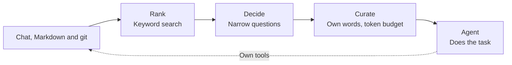

# Curate

A TypeScript library that finds what your agent needs from past chats, notes and commits.

94.2% on LongMemEval with gpt-6.1-sol answering and marking, and 92.8% under LongMemEval's own grader, with about 65 times less context than the raw history.

Curate gives an agent the context it needs for a task, drawn from chat transcripts, Markdown and git history.
It chooses the evidence a task needs and lays it out in its own words, headed by where and when it was said, for the agent to read before starting work.

## Results at a glance

On LongMemEval, Curate's task model reads 1,577 tokens a question on average, against Mem0's 6,787, and a median of 1,692, against Zep's 4,408: fewer than every other system in the table below that gives a figure.
Curate keeps local index files and needs no database, no server to run and no model that writes or rewrites memory in advance; each question is one Curate call, in which a paid decision model rates the history's parts.

LongMemEval S, all 500 questions. Two graders marked Curate's answers and Mem0's published answers; Mastra's and Zep's figures are as each published them:

| System | Task model | Marked by gpt-6.1-sol | Marked by LongMemEval's grader | As published, with the vendor's grader | Task model tokens |
| --- | --- | --- | --- | --- | --- |
| **[Curate](benchmarks/longmemeval/2026-11-11/README.md)** | **gpt-6.1-sol** | **94.2** | **92.8** | | **1,577 mean, 1,692 median** |
| [Mem0 platform](https://github.com/mem0ai/memory-benchmarks/blob/4b61c5d31b9c668a12b4f5e78064248a02c82d2b/results/platform/longmemeval_results.json) | GPT-5 | 92.6 | 91.0 | | 6,787 mean |
| [Mastra observational memory](https://mastra.ai/research/observational-memory)\* | gpt-5-mini | | | 94.87 (GPT-4o) | |
| [Zep](https://www.getzep.com/research/memory-benchmarks/)\* | gpt-5.4 | | | 90.2 (gpt-5.4) | 4,408 median |

\* Score as published; these answers were not marked again here. Mem0's answers are published, and both of its figures above were marked here from that file.

LoCoMo, all 1,540 scored questions, in two settings of Curate's layout:

| System | Task model | Marker | Score |
| --- | --- | --- | --- |
| **[Curate, 6,000 tokens](benchmarks/locomo/2026-11-12/README.md)** | **gpt-6.1-sol** | **gpt-6.1-sol** | **96.2** |
| [Zep](https://www.getzep.com/research/memory-benchmarks/)\* | gpt-5.4 | gpt-5.4 | 94.7 |
| [Mem0 platform](https://github.com/mem0ai/memory-benchmarks/blob/edcd6f1d42400837b1fcb6997716f1769dc51a37/results/platform/locomo_results.json) | GPT-5 | GPT-5 | 91.6 |
| **[Curate, 2,000 tokens](benchmarks/locomo/2026-11-12/README.md)** | **gpt-4.1-mini** | **gpt-4o-mini** | **91.4** |
| [MemOS, in OmniMemEval](https://github.com/MemTensor/OmniMemEval/blob/7c79d46e31dd85f3da2509b430bba9406656dd28/docs/user_memory/results.md#locomo)\* | gpt-4.1-mini | gpt-4o-mini | 88.83 |

\* Score as published; these answers were not marked again here. Mem0's figure is Mem0's own marking of the answers in its published results file.

The task model does the work (here, answering the question), so it should read only what the task needs.

Every result, how each run was set up and its proof files are in [benchmarks](benchmarks/README.md).

## Built for memory that keeps growing

- **No work when history is written.** Curate reads transcripts, git history and Markdown where they already live, when a task asks. No extraction step or graph to keep in sync, and no database server or hosted vector store: local index files, made on first use.
- **Go straight to the source.** [Mem0](https://docs.mem0.ai/core-concepts/memory-operations/add) extracts facts with a model, [Mastra](https://mastra.ai/docs/memory/observational-memory) keeps observations written by a model, and [Zep](https://help.getzep.com/v4/how-graph-creation-works) builds a knowledge graph. Curate selects from the original history for each task.
- **Keep the task model focused.** It reads only the parts chosen for its task, within a token budget, even when the history spans thousands of parts.

[LongMemEval](benchmarks/longmemeval/2026-11-11/README.md#context-sizes): **1,577 task-model tokens** a question on average, from histories of about **48 sessions** and **102,580 tokens** on average (o200k, every turn's role and text): about **65 times less**. [LoCoMo](benchmarks/locomo/2026-11-12/README.md#context-sizes): **3,839** and **1,248 task-model tokens** a question in the two settings, from conversations of about **21,155 tokens**.

## Install only what you need

Use Node.js 22.20 or later.

```sh
# Run the Markdown example below.
pnpm add @curatejs/core @curatejs/markdown

# Add transcript or git readers as needed.
pnpm add @curatejs/chat @curatejs/git

# Or supply your own sources.
pnpm add @curatejs/core
```

## Packages

| Package | What it supplies |
| --- | --- |
| [**@curatejs/core**](packages/core/README.md) | Task recall, selection, curation, model helpers and source contracts. No reader. |
| [**@curatejs/chat**](packages/chat/README.md) | Local agent transcripts, secret scrubbing, chat ranking and questions. |
| [**@curatejs/git**](packages/git/README.md) | Git commit history, keyword settings and questions. |
| [**@curatejs/markdown**](packages/markdown/README.md) | Markdown notes and rules, keyword settings and questions. |

Each source package depends only on core and exports its keyword settings, question set and wording guidance for extra searches.
See the [changelog](CHANGELOG.md) for what each release contains.

## Use it

Call Curate before a task, then give its text to your agent.
Always-on files such as `CLAUDE.md` and `AGENTS.md` stay with your agent's harness, and Curate picks the rules a task needs from your rule library.
Curate is a library: it calls the models you supply, with no database server or hosted vector store to deploy: local index files, made on first use.
Your agent keeps its own tools and can follow each heading to its source when it needs more detail.

### Recall context for a task

Save this as `recall.mjs`:

```js
import { memory } from '@curatejs/core';
import { jev } from '@curatejs/core/models';
import { markdown } from '@curatejs/markdown';

const decide = jev({ apiKey: process.env.TYPESAFE_API_KEY });
const mem = memory({
  sources: [markdown({ paths: ['docs'], kind: 'docs' })],
  decide,
});

const { log } = await mem.recall('What billing constraint must this change preserve?');
console.log(log);
```

Create a source note:

```sh
mkdir -p docs
cat > docs/billing.md <<'NOTE'
---
date: 2026-01-12
---
# Billing
Invoices must preserve the currency recorded when the order was placed.
NOTE
```

Set the model key and run:

```sh
export TYPESAFE_API_KEY='your-typesafe-key'
node recall.mjs
```

The text heads each part with its source and the date it was said, for example:

```text
### Most likely answer

#### markdown:docs:["/home/sam/docs"] (said 2026-01-12)

# Billing
Invoices must preserve the currency recorded when the order was placed.
```

> [!NOTE]
> At its default address, `jev()` makes paid API calls to TypeSafe's `jev-latest`. A local model server needs no hosted service. To keep every step on your machine, see [Run it on your own machine](#run-it-on-your-own-machine).

`recall()` returns the laid-out text as `log`, exact selected rules as joined text, and the full selection and layout records:

```js
const { log, rules, picked, result } = await mem.recall('What billing constraint must this change preserve?');
```

- **Source questions are automatic.** Each reader brings its own set of narrow questions.
- **Incomplete collection throws.** An absent or incomplete read, an unanswered candidate, or interrupted decisions stop recall. Parts intentionally excluded by the label questions are allowed. Read and model errors reach the caller.
- **Rules stay exact.** `rules` joins the selected rule text with blank lines. The laid-out text holds reference evidence, not rules.
- **Weak sentences go.** After the layout, `decide` rates each sentence in one more request, and the text keeps those rated 0.1 or more. `curate: { sentenceCutoff: false }` keeps every sentence and makes no request. See [Curate](#curate).
- **Cancellation is optional.** Pass an `AbortSignal` as `mem.recall(task, { signal })`.

### Read each source with its own settings

Each reader is one line:

```js
import { chat } from '@curatejs/chat';
import { git } from '@curatejs/git';
import { knowledgeBase, markdown } from '@curatejs/markdown';

chat();                                      // Claude Code and Codex transcripts
git('.');                                    // this repository's commits
markdown({ paths: ['docs'], kind: 'docs' }); // any Markdown folder, file or glob
knowledgeBase('docs');                       // a notes folder, in one argument
```

Combine them in one call:

```js
const mem = memory({ sources: [chat(), git('.'), markdown({ paths: ['docs'], kind: 'docs' })], decide });
```

Each source carries its own settings, tuned for that kind of history.
Sources can still affect each other. A selected commit brings in a note it changed, and the whole-call limits below are shared by every source.

| Source | Rare-word round | Labels | Label bar | Name lanes | Decision-score bar | Rule bar | Questions |
| --- | --- | --- | --- | --- | --- | --- | --- |
| `chat()` | Off | On, the seven kinds | 0.5 | On | 0.0146 | | `AGENT_CHAT_CASCADE` |
| `git()` | On | Off | | On | 0.0146 | | `GIT_HISTORY_CASCADE` |
| `markdown()`, `knowledgeBase()` | On | Off | | On | 0.0146 | | `MARKDOWN_CASCADE` |
| `rules()` | On | Off | | Off | 0.0146 | 0.5, not yet tuned | `MARKDOWN_CASCADE` |

- **Rare-word round:** after selection, find unselected parts of the same source that share a rare word with a selected part, and ask about them.
- **Labels:** check each history part for seven kinds of personal fact, such as what someone owns, prefers or decided. This helps Curate find relevant parts that keyword search missed. Each part is labelled once and the label stored for later questions.
- **Label bar (`labelBar`):** Curate checks which kinds of fact the task needs. If a kind scores at least `labelBar`, Curate brings in the source's parts whose label for that kind also scores at least `labelBar`. 0.5 for every source that carries labels.
- **Name lanes (`names`):** search once more for each person or thing the task names, as an exact phrase, so every part that mentions it reaches the decision step. The reason is recall: a part the search loses can never be picked. Off for rules, which are chosen by where they apply, not by search.
- **Decision-score bar:** keep a reference part the decision model scored at or above this.
- **Rule bar:** keep a rule the decision model scored at or above this. Only sources whose parts are rules use it: `rules()`, and `markdown()` with kind `rules` or `instructions`.
- **Questions:** the yes/no questions the decision model answers about each reference part, with fitted weights that combine the answers into its score.

The pick record names the settings each source ran with under `levers.sources`, such as `{ kind: 'chat', labels: true, labelBar: 0.5, rare: false, bar: 0.0146 }`, with `questions` holding the question set its parts were asked.
Each pick record's `effects` list says what each setting changed: the parts it brought in or kept out, and why when it changed nothing ([what each setting did](packages/core/README.md#what-each-setting-did)).

These levers act on the whole call:

| Lever | Out of the box |
| --- | --- |
| `read.wholeLanes` | Off: cut each search lane |
| `pick.thoroughness` | `'normal'`: decide the top 3,674 of the fused order; `quick` 672, `deep` 12,896 |
| `pick.feed` | Unset: the fused order at the level's depth. `{ order: 'combsum', size }` feeds by summed lane places, `size` parts |
| `pick.everyRanked` | Unset: `thoroughness` bounds the feed. `true` decides every ranked part; `{ c }` a scaled top-k |
| `pick.route` | Off |
| `pick.everyScored` | Unset: each source's bar. When set, one bar for every source |
| `pick.rare` | Unset: each source's setting. When set, one setting for every source |
| `pick.taskPeriod` | On: a task that names a period lets in the parts dated inside it |
| `curate.answerTokens` | 2,000: the estimated tokens the laid-out text keeps within |
| `curate.sentenceCutoff` | 0.1: the sentence rating the text keeps; `false` rates no sentence |

`pick.thoroughness` and `pick.everyRanked: { c }` rank every source's parts in one fused list before they cut, and a stopping limit in `pick.limits` (questions, batches, time) is shared by every source.
With any of them, one source's settings can change what Curate picks from another.

### Set your own

Build a source with any settings through `historySource()`.
Spread a reader's settings object, then change what you need:

```js
import { historySource } from '@curatejs/core';
import { chat, chatSettings, AGENT_CHAT_CASCADE } from '@curatejs/chat';

const source = historySource({ reader: chat({ paths: ['transcripts'] }), ...chatSettings, labels: false, questions: AGENT_CHAT_CASCADE });
```

This turns labels off for one chat source, as the DolphinBench run did.
`gitSettings`, `markdownSettings` and `rulesSettings` hold the other readers' settings.

Give a source your own decision questions the same way:

```js
import { git, gitSettings } from '@curatejs/git';

const mySet = {
  bias: 0,
  questions: [{
    key: 'decision',
    instructions: 'Does this commit record a decision the task depends on?',
    true: 'It records a decision the task depends on.',
    false: 'It records no decision the task depends on.',
    weight: 1,
  }],
};
const commits = historySource({ reader: git('.'), ...gitSettings, questions: mySet });
```

A source without `questions` asks each part one built-in question.
Other question options: `PERSONAL_CHAT_CASCADE` for histories of a person's own life, `COUNT_MARKER` for count tasks, and `pick.writeQuestions` for questions written for each task (see [core's options](packages/core/README.md#questions-written-for-each-task)).
`reader` can also be your own source; see [core's options](packages/core/README.md#levers-and-source-settings).

Pass reader options under `read`, selection options under `pick`, and layout options under `curate`:

```js
const mem = memory({
  sources,
  decide,
  pick: { limits: { maxBatchChars: 50000 } },
  curate: { answerTokens: 4000 },
});
```

Batch sizes change request size without dropping evidence.
Limits that leave a read incomplete or decisions unfinished make `recall()` throw.

Labels are stored in `$XDG_CACHE_HOME/curate/labels`, or `~/.cache/curate/labels` when `XDG_CACHE_HOME` is unset.
Use `pick.labels: { directory: 'my-labels' }` to choose a folder.

### Answer types

The decision model can say, from the task's words alone, what kind of answer the task needs: a date, a number, a name, the order of events and so on.
`pick.answerTypes` asks the task the ten questions in `ANSWER_TYPES`, in one request per pick.
Typed questions use the types it finds: a source's question set can hold `typed` questions. Each is asked of the source's parts only when the task needs its answer type, and its answer counts toward the part's score like the set's other questions.

`pick.answerTypes` is off by default, and no preset carries a typed question.
Turn it on:

```js
const mem = memory({ sources, decide, pick: { answerTypes: true } });
```

Add a typed question to git's set through `historySource()`:

```js
import { historySource } from '@curatejs/core';
import { git, gitSettings, GIT_HISTORY_CASCADE } from '@curatejs/git';

const DATED = {
  ...GIT_HISTORY_CASCADE,
  typed: [{
    answerType: 'date',
    key: 'when-decided',
    instructions: 'Does this commit say when this was decided?',
    true: 'It gives the date or time of the decision',
    false: 'It gives no date for the decision',
    weight: 1,
  }],
};
const commits = historySource({ reader: git('.'), ...gitSettings, questions: DATED });
```

A pick whose sources carry typed questions while `pick.answerTypes` is off throws a `TypeError` before it reads, so a typed question never sits unread.

### Time

Every read measures from one moment: the task date.
Give it with each call, beside the person's time zone:

```js
const { log } = await mem.recall('What did I decide in March?', { taskDate: '2025-06-02', timeZone: 'Europe/London' });
```

- **The task date:** an ISO 8601 date or date-time, such as `2025-06-02` or `2025-06-02T09:15:00+01:00`. A date alone means the end of that day. Without one, the task date is now. Git recency and a chat `since` duration count back from it. The pick record names the moment as `asOf`, so a replay with the same values reads the same history.
- **Nothing from after it:** with `taskDate`, a chat message or a git commit dated after it is not read. Markdown keeps notes dated after it: a note can declare an `effective` date ahead, and a rule that takes effect next month is still a rule. To read notes as they stood, pin the read to a revision with `read: { revision }`.
- **The person's time zone:** chat dates carry the zone's offset, so a message sent at 00:30 in London in summer is dated that day, not the day before. `timeZone` is an IANA name such as `Europe/London`. Without it, the system's own zone applies.
- **The task's period:** a task that names a period, such as "in March", "last week" or "on 2025-03-04", lets the parts dated inside it reach the decision step even when no search kept them. Nothing is dropped for its date. A part is dated when it was written, so a message in April that recalls March is dated April, and a filter on March would drop the answer. `pick: { taskPeriod: false }` turns it off.

## Sources

Combine any of these readers in the `sources` array.
Each reader ranks its own source text without a model or network call.

### Transcripts

`@curatejs/chat` reads local Claude Code and Codex JSONL transcripts.
Use `paths` for your own folders, or omit it to use the providers' default folders.

```js
import { chat } from '@curatejs/chat';

const source = chat({ paths: ['transcripts'], providers: ['claude-code'] });
```

See the [transcript reader](packages/chat/README.md) for date filters, tool messages and secret scrubbing.

### Git history

`@curatejs/git` reads non-merge commits, including their bodies, dates and changed paths.
Git must be on `PATH`.

```js
import { git } from '@curatejs/git';

const source = git('.');
```

See the [git reader](packages/git/README.md) for keyword settings and optional signals from live lines and files that change together.

### Markdown

`@curatejs/markdown` reads folders, files and globs.
Choose `knowledge` or `docs` for reference evidence, and `rules` or `instructions` for exact rules.
`rules()` reads a rule library and keeps only the rules the decision model says apply to the task.

```js
import { markdown, rules } from '@curatejs/markdown';

const sources = [
  markdown({ paths: ['docs'], kind: 'docs' }),
  rules('.cursor/rules'),
];
```

See the [Markdown reader](packages/markdown/README.md) for dates, rule scopes and revision pins.
`knowledgeBase()` reads an [Open Knowledge Format](packages/markdown/README.md#open-knowledge-format) bundle: its page dates, titles, root links, index and log.
Older notes can rank lower with [decay](packages/markdown/README.md#decay), off by default, and [`reviewNotes()`](packages/markdown/README.md#reviewing-notes) proposes notes to retire or parts to promote.

## Bring your own models

Curate accepts one plain function, `decide`.
It can call an API, a local model or a command.
The built-in helpers use `fetch` and need no model SDK.
No model writes the memory text.

- **`decide` answers narrow questions.** It receives `{ task, questions }` and an `AbortSignal`. Return an answer under each question's `key`, with `status: 'answered'` and a finite `probability` from 0 to 1. See [`PickDecide`](packages/core/src/pick.ts) for question fields and unavailable answers.

Use `openAIDecisions()` for [OpenAI's Decisions API](https://developers.openai.com/api/docs/guides/decisions) in place of `jev()`:

```js
import { openAIDecisions } from '@curatejs/core/models';

const decide = openAIDecisions({ apiKey: process.env.OPENAI_API_KEY });
```

The hosted helpers identify their label answers as `typesafe:${model}:items-once` and `openai:${model}`.
For a handwritten `decide`, set its `deciderId` property.
An explicit `pick.labels.deciderId` overrides the function's ID.
Without an ID it uses `'custom'`, so different handwritten decision functions must supply different IDs to keep their saved labels apart.

### Run it on your own machine

Ranking and deciding can both run against models on your own machine, and the layout calls no model but `decide`.
The one requirement: the decision server must return log-probabilities.
`localDecisions()` throws when a reply has none, because a pick that cannot judge must not guess.

`localDecisions()` asks an OpenAI-compatible chat server each yes/no question, one request at a time.
It reads the answer from the log-probabilities of "yes" and "no" for the first reply token:

```js
import { jev, localDecisions } from '@curatejs/core/models';

const decide = localDecisions({ url: 'http://127.0.0.1:8000/v1/chat/completions', model: 'my-local-model' });
```

A server that speaks Jev's format, such as a Clef server, can decide through `jev()`.
Give it the address and model name your server uses:

```js
const decide = jev({ url: 'http://127.0.0.1:30000/v1/systemone', model: 'clef-flash' });
```

Away from TypeSafe's address, an API key is optional, and the helpers send none unless you give one.

For meaning search, use the local embedder (it needs `node-llama-cpp@3.18.1`):

```js
import { memory } from '@curatejs/core';
import { createLocalEmbedder } from '@curatejs/core/local-embeddings';

// A local MiniLM GGUF model file; the adapter downloads nothing.
const local = await createLocalEmbedder({ modelPath });
try {
  const mem = memory({ sources, decide, read: { meaning: { embed: local.embed } } });
  const { log } = await mem.recall('What billing constraint must this change preserve?');
} finally {
  await local.dispose();
}
```

Labels from each server are stored under its own ID: `local:<host><path>:<model>` for `localDecisions()`, and `jev:<host><path>:<model>:items-once` for `jev()` at another address.
The ID leaves out the scheme and the query, so set `pick.labels.deciderId` yourself for two servers that differ only there.
A decision cache keeps the `deciderId` you give it, so give each server its own.

### Separate selection and curation

`pickFromSources()` and `curate()` remain available when you need to inspect or change the evidence before the layout.
With these separate calls, check the read and candidate records yourself before using the result.

```js
import { pickFromSources, curate } from '@curatejs/core';
import { markdown } from '@curatejs/markdown';

const task = 'What billing constraint must this change preserve?';
const sources = [markdown({ paths: ['docs'], kind: 'docs' })];
const picked = await pickFromSources(sources, { task }, { task, decide });
const result = await curate(task, picked, { decide });
```

`pickFromSources()` asks each source its own question set, as `memory()` does.
See the [core package](packages/core/README.md) for question sets, tags, local meaning search and full records.

### The `/curate` skill

The [coding-agent skill](skills/curate/SKILL.md) reads the history of the project it runs in and prints the laid-out parts for a task; the agent turns them into a cited summary.
Build the Curate checkout once:

```sh
pnpm install --frozen-lockfile
pnpm build
```

A call then needs each of the following, in this order. `node skills/curate/run.mjs --check` lists each one as ready or missing with its fix, makes no model or decision call, and exits 0 only when a call would run. A call that misses any of them stops before any work, names every one, and exits with code 3.

1. **Node.js 22.20 or later.** Curate's packages support Node.js 22.20 and later. Fix: Install it, for example with `nvm install 22 && nvm alias default 22`.
2. **The embedding engine (`node-llama-cpp`).** It runs the local embedding model that ranks the history by meaning. Fix: Run `pnpm install --frozen-lockfile` in the Curate checkout, which installs the optional `node-llama-cpp` package.
3. **An embedding model file.** Curate downloads none, and any embedding model in GGUF form works. Stored vectors are kept per model, so a different model embeds the history again. Fix: Put EmbeddingGemma 300M in 8-bit GGUF (about 330 MB) at `~/.cache/curate/models/embeddinggemma-300M-Q8_0.gguf`: `mkdir -p ~/.cache/curate/models && curl -L -o ~/.cache/curate/models/embeddinggemma-300M-Q8_0.gguf https://huggingface.co/ggml-org/embeddinggemma-300M-GGUF/resolve/main/embeddinggemma-300M-Q8_0.gguf`. Or name the model file you chose with `embeddingModel` in `~/.curate/sources.json`.
4. **The decision key (`TYPESAFE_API_KEY`).** It is a paid Jev key from TypeSafe. Jev decides which parts of the history answer the question, at a few pence a call. Fix: Get a key from TypeSafe (https://typesafe.ai), then set `TYPESAFE_API_KEY` in the environment, or put `TYPESAFE_API_KEY=<key>` in a private file and name that file with `envFile` in `~/.curate/sources.json`. Never put the key in `curate.json`.
5. **A login for the search lines.** One small call on a subscription writes the search lines: Claude Haiku on the Claude login, or GPT-6 Luna through Codex on the ChatGPT login. `searchModel` picks one. Fix: Run `claude auth login` to use Claude Haiku, or `codex login` to use GPT-6 Luna.
6. **History to read.** A call searches the git repository it runs in and the sources its settings list. Fix: Run inside a git repository, put a `curate.json` in or above the working folder, or list sources in `~/.curate/sources.json`.

Then ask from a folder inside a project:

```sh
node skills/curate/run.mjs 'Which decisions bear on this task?'
```

Save `~/.curate/sources.json` with your own paths, or name another file with `--sources`:

```json
{
  "sources": [
    {
      "type": "claude-code",
      "since": "90 days"
    },
    {
      "type": "git",
      "path": "~/projects/example"
    },
    {
      "type": "markdown",
      "path": "~/notes/example"
    }
  ],
  "embeddingModel": "~/models/embeddinggemma-300M-Q8_0.gguf",
  "thoroughness": "normal",
  "envFile": "~/.curate/credentials.env"
}
```

Paths must be absolute or start with `~/`.
Without `--sources`, the script reads `~/.curate/sources.json`, and runs without it.
Inside a git repository, the script reads the project's own commits, Markdown, Claude Code transcripts and Codex sessions with no settings entry; a repository at the home folder or the filesystem root does not count. A listed source with a path is read there only when it sets `"always": true` or its folder overlaps the project; standard error names the others. Outside a repository, it reads every listed source with a path.
A `claude-code` or `codex` entry with no `path`, as in the example, reads only the transcripts of the project the call runs in, with that entry's settings, in place of the ones the script reads on its own; outside a repository it reads nothing and says so on standard error.
Optional `related`, such as `[["~/work/obversa", "~/work/cmack"]]`, lists groups of related projects: a call in one also reads the others' Claude Code transcripts and Codex sessions, never their commits or Markdown.
The nearest `curate.json` above the working folder adds sources for every call under it, such as a knowledge base beside a code repository; it holds no secret, and its paths may be relative to it.
`--prepare` brings the stored index and embeddings of those sources up to date and exits, with no model call; it needs no decision key or login.
Optional `answerTokens` and `sentenceCutoff` set the layout's budget and sentence cutoff, as in [Curate](#curate).
Optional `thoroughness` sets how many ranked history parts the decision model checks: `quick` checks the top 672, `normal` 3,674, the default, and `deep` 12,896.
Measured on a replayed ~116,000-part history, each level cost about 1, 5 and 17 pence of questions on the largest of eight task sets; `quick` kept 24 of the 56 known answer parts, `normal` 49 and `deep` all 56.
Each source can also set `since` (an ISO date or a duration such as `"14 days"`, counted back from the task date), `exclude` (paths that source alone refuses, resolved inside `path`), and, for `git` only, `include` (only commits that changed one of the paths).
The skill combines keyword and meaning lanes, and disables label admission and the rare-word round.
Saved embeddings are reused when the model file and input text match. Identical text shares matching decision answers within each pick.
It prints the laid-out parts. Curate keeps no files of its own outside its caches under `~/.cache/curate`. Set `records` to `true` in the sources file to also save the printed text, source reads, model usage and timings under `~/.curate/runs/`.
Subscription route failures never fall back to an API.

## Rank, decide, curate



### Rank

Each reader ranks evidence using settings suited to its source.
Chat and Markdown use BM25, a score for matching words.
Git uses BM25 over each commit's subject and body, plus age and changed paths.
Each search stops keeping results when their match scores level off, rather than after a fixed number.
Set `read.wholeLanes: true` to keep every part the readers return.

- **Extra wording:** Supply `read.searchLines` for phrases or hypothetical answers that describe the evidence you need. Curate does not generate them.
- **Kinds of statement:** Supply `read.kindLanes` for phrases that help find directions, decisions or corrections.
- **Meaning search:** Supply an embedding function, which turns text into numbers for similarity search. It is off by default and needs no database.

### Decide

The decision function answers each reader's narrow questions.
By default, Curate combines search results from all sources into a ranked list.
The decision model checks the top 3,674 reference parts (the `normal` thoroughness level).
Curate keeps those that score at least their source's decision-score bar (0.0146 for every reader), highest scores first.
Unanswered candidates and unfinished decisions stay visible in the record and stop `recall()`.
Parts intentionally excluded by the label questions stay in the record without stopping recall.

- **Feed depth:** `pick.thoroughness` sets how many ranked history parts the decision model checks: 672 for `quick`, 3,674 for `normal`, the default, and 12,896 for `deep`. Parts deeper than the level stay unasked and record `thoroughness`. `pick.everyRanked: true` decides every ranked part instead, and `pick.everyRanked: { c }` keeps the top `round(c × N^0.8)` reference parts, where N is the number of reference parts. Rules pass through uncut in every mode. The skipped parts are unassessed, so use the separate selection API to inspect them. Measured on a replayed ~116,000-part history of chat transcripts, Git history and Markdown notes: each level cost about 1, 5 and 17 pence of questions on the largest of eight task sets (about 0.8, 2.3 and 6.6 decide-step minutes), and `quick` kept 24 of the 56 known answer parts, `normal` 49 of 56 and `deep` all 56.
- **Layout inputs:** a source's `bar` sets its score cut. `pick.everyScored: { bar }` sets one cut for every source, and `pick.everyScored: true` keeps every scored reference.
- **More evidence:** Git and Markdown run the rare-word round through their settings, each within its own parts. `pick.rare: true` runs it on every source; `pick.rare: false` turns it off. Under a thoroughness level the round asks its pulled parts only while the depth still has room.
- **Tags:** `pick.tags` labels selected items with their intent, importance, emphasis and whether they correct something earlier.

### Curate

`curate()` lays out the kept reference parts in their own words.
No model writes the text.

- **Strongest first:** the two parts with the highest decision score sit under `### Most likely answer`. Every other part is grouped by the date it was said and its source, oldest first and strongest first inside a group. A part with no date sits under `(said unknown)`, last. A date that is only a file's last change reads `(file changed <date>)`.
- **Copies taken once:** a part whose text is the same as a stronger kept part's is left out, and the kept part's heading names where else it was said.
- **Budget:** `curate.answerTokens` keeps the text within 2,000 estimated tokens by default. The strongest part is always kept whole. The record's `leftOut` counts the parts the budget stopped before.
- **Sentence cutoff:** given `decide`, curate rates each sentence of the taken parts in one request and keeps those rated `curate.sentenceCutoff` or more, 0.1 by default. `…` marks where text was left out. `false` keeps every sentence and makes no request. When the request fails, the whole text comes back and the record says why.

## Plain files and git

The sources remain readable without Curate.
Markdown holds facts and instructions.
Commit bodies can record why a change was made, the options considered and the constraints behind it.
The agent can look up a commit with its own tools when it needs the code.

Dates help the reader tell an old decision from its replacement, even when they share the same words.

## Results

Every result, how each run was set up and its proof files are in [benchmarks](benchmarks/README.md).

## Development

```sh
pnpm install --frozen-lockfile
pnpm build
pnpm typecheck
pnpm test
```

Build first so dependent packages and integration tests can use core's declarations and package exports.
Each package also supports `pnpm --filter @curatejs/<name> build`, `test`, `typecheck` and `pack`.

## License

[MIT](LICENSE).
