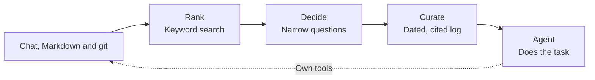

# Curate

Best in class memory that just works - simple, performant and precise without embeddings, vector databases or third party platforms

Curate gives an agent the context it needs for a task, drawn from chat transcripts, Markdown and git history.
It chooses evidence and turns it into a dated, cited log that the agent reads before starting work.

## Results at a glance

Top tier benchmark scores with up to 62 times fewer tokens

| Benchmark | System | Task model | Score | Task model tokens |
| --- | --- | --- | --- | --- |
| **LongMemEval S** | **Curate** | **GPT-5** | **93.4** | **449** |
| LongMemEval S | [Mem0 platform](https://github.com/mem0ai/memory-benchmarks/blob/4b61c5d31b9c668a12b4f5e78064248a02c82d2b/results/platform/longmemeval_results.json) | GPT-5 | 93.4 | 6,787 mean (15x more) |
| **LongMemEval S** | **Curate** | **GPT-5-mini** | **91.6** | **485** |
| LongMemEval S | [Mastra observational memory](https://mastra.ai/research/observational-memory) | GPT-5-mini | 93.6 | ~30,000 mean (62x more) |
| LongMemEval S | [Zep](https://getzep.com/research) | GPT-5.4 | 90.2 | 4,408 median (10x more) |

The task model does the work (here, answering the question), and you do not want to flood its context with noise.

*Each multiplier compares with Curate on the same task model, or on GPT-5 for Zep's GPT-5.4: 449 tokens with GPT-5, 485 with GPT-5-mini. See the [full comparison](#against-published-systems) for scoring methods and costs.*

DolphinBench: **22 of 30 tests passed**, at $0.24 a test at list prices. [See the results](#dolphinbench-mem0s-benchmark-a-30-test-slice).

## Built for memory that keeps growing

- **No work when history is written.** Curate reads transcripts, git history and Markdown where they already live, when a task asks. No extraction step, index, vector database or graph to keep in sync.
- **Go straight to the source.** [Mem0](https://docs.mem0.ai/core-concepts/memory-operations/add) extracts facts with a model, [Mastra](https://mastra.ai/docs/memory/observational-memory) keeps observations written by a model, and [Zep](https://help.getzep.com/v4/how-graph-creation-works) builds a knowledge graph. Curate selects from the original history for each task.
- **Keep the task model focused.** It gets a dated, cited log chosen for its task, even when the history spans thousands of parts.

[LongMemEval](benchmarks/longmemeval/2026-10-22/README.md): **449 to 485 task-model tokens** from about **50 sessions**. [DolphinBench slice](benchmarks/dolphinbench/2026-10-22/results.md): a median log of **about 4,500 tokens** from **5,400–5,900 history parts** (o200k tokens of the logs the agent read; the published copies, whose part IDs are shorter, count about 3,200).

## Install only what you need

Use Node.js 22.20 or later.

```sh
# Run the Markdown example below.
pnpm add @curatejs/core @curatejs/markdown

# Add transcript or git readers as needed.
pnpm add @curatejs/chat @curatejs/git

# Or supply your own sources.
pnpm add @curatejs/core
```

## Packages

| Package | What it supplies |
| --- | --- |
| [**@curatejs/core**](packages/core/README.md) | Task recall, selection, curation, model helpers and source contracts. No reader. |
| [**@curatejs/chat**](packages/chat/README.md) | Local agent transcripts, secret scrubbing, chat ranking and questions. |
| [**@curatejs/git**](packages/git/README.md) | Git commit history, keyword settings and questions. |
| [**@curatejs/markdown**](packages/markdown/README.md) | Markdown notes and rules, keyword settings and questions. |

Each source package depends only on core and exports its keyword settings, question set and wording guidance for extra searches.
See the [changelog](CHANGELOG.md) for what each release contains.

## Use it

Call Curate before a task, then give its log to your agent as text.
Always-on files such as `CLAUDE.md` and `AGENTS.md` stay with your agent's harness, and Curate picks the rules a task needs from your rule library.
Curate is a library: it keeps plain files and calls the models you supply, with no database or service to deploy.
Your agent keeps its own tools and can follow the citations when it needs more detail.

### Recall context for a task

Save this as `recall.mjs`:

```js
import { memory } from '@curatejs/core';
import { jev, chatWriter } from '@curatejs/core/models';
import { markdown } from '@curatejs/markdown';

const decide = jev({ apiKey: process.env.TYPESAFE_API_KEY });
const write = chatWriter({ apiKey: process.env.CHAT_API_KEY, model: 'gpt-5-mini' });
const mem = memory({
  sources: [markdown({ paths: ['docs'], kind: 'docs' })],
  decide,
  write,
});

const { log } = await mem.recall('What billing constraint must this change preserve?');
console.log(log);
```

Create a source note:

```sh
mkdir -p docs
cat > docs/billing.md <<'NOTE'
---
date: 2026-01-12
---
# Billing
Invoices must preserve the currency recorded when the order was placed.
NOTE
```

Set the model keys and run:

```sh
export TYPESAFE_API_KEY='your-typesafe-key'
export CHAT_API_KEY='your-chat-provider-key'
node recall.mjs
```

The log cites the source file, for example:

```text
[2026-01-12] Invoices preserve the order's recorded currency (said 2026-01-12; /home/sam/docs/billing.md#1)
```

> [!NOTE]
> At their default addresses, the model helpers make paid API calls. `jev()` uses TypeSafe's `jev-latest`; `chatWriter()` uses OpenAI's Chat Completions URL. A local model server needs no hosted service. To keep every step on your machine, see [Run it on your own machine](#run-it-on-your-own-machine).

`recall()` returns the log, exact selected rules as joined text, and the full selection and curation records:

```js
const { log, rules, picked, result } = await mem.recall('What billing constraint must this change preserve?');
```

- **Source questions are automatic.** Each reader brings its own set of narrow questions.
- **Incomplete collection throws.** An absent or incomplete read, an unanswered candidate, or interrupted decisions stop recall. Parts intentionally excluded by the label questions are allowed. Read and model errors reach the caller.
- **Rules stay exact.** `rules` joins the selected rule text with blank lines. The writer receives reference evidence, not rules.
- **Cancellation is optional.** Pass an `AbortSignal` as `mem.recall(task, { signal })`.

### Read each source with its own settings

Each reader is one line:

```js
import { chat } from '@curatejs/chat';
import { git } from '@curatejs/git';
import { knowledgeBase, markdown } from '@curatejs/markdown';

chat();                                      // Claude Code and Codex transcripts
git('.');                                    // this repository's commits
markdown({ paths: ['docs'], kind: 'docs' }); // any Markdown folder, file or glob
knowledgeBase('docs');                       // a notes folder, in one argument
```

Combine them in one call:

```js
const mem = memory({ sources: [chat(), git('.'), markdown({ paths: ['docs'], kind: 'docs' })], decide, write });
```

Each source carries its own settings, tuned for that kind of history.
A setting on one source never changes what Curate picks from another, with one exception: a selected commit brings in a note it changed.

| Source | Rare-word round | Labels | Label bar | Name lanes | Decision-score bar | Rule bar | Questions |
| --- | --- | --- | --- | --- | --- | --- | --- |
| `chat()` | Off | On, the seven kinds | 0.5 | On | 0.0146 | | `AGENT_CHAT_CASCADE` |
| `git()` | On | Off | | On | 0.0146 | | `GIT_HISTORY_CASCADE` |
| `markdown()`, `knowledgeBase()` | On | Off | | On | 0.0146 | | `MARKDOWN_CASCADE` |
| `rules()` | On | Off | | Off | 0.0146 | 0.5, not yet tuned | `MARKDOWN_CASCADE` |

- **Rare-word round:** after selection, find unselected parts of the same source that share a rare word with a selected part, and ask about them.
- **Labels:** ask each part seven kinds of personal fact (what someone owns, prefers, did, decided and so on), so parts the keyword search missed can still reach the decision step. Each part is labelled once and the label stored for later questions.
- **Label bar (`labelBar`):** a label kind the task needs at this bar or more brings in each of the source's parts labelled at this bar or more on that kind. 0.5 for every source that carries labels.
- **Name lanes (`names`):** search once more for each person or thing the task names, as an exact phrase, so every part that mentions it reaches the decision step. The reason is recall: a part the search loses can never be picked. Off for rules, which are chosen by where they apply, not by search.
- **Decision-score bar:** keep a reference part the decision model scored at or above this.
- **Rule bar:** keep a rule the decision model scored at or above this. Only sources whose parts are rules use it: `rules()`, and `markdown()` with kind `rules` or `instructions`.
- **Questions:** the yes/no questions the decision model answers about each reference part, with fitted weights that combine the answers into its score.

The pick record names the settings each source ran with under `levers.sources`, such as `{ kind: 'chat', labels: true, labelBar: 0.5, rare: false, bar: 0.0146 }`, with `questions` holding the question set its parts were asked.
Each pick and curate record's `effects` list says what each setting changed: the parts it brought in or kept out, and why when it changed nothing ([what each setting did](packages/core/README.md#what-each-setting-did)).

These levers act on the whole call:

| Lever | Out of the box |
| --- | --- |
| `read.wholeLanes` | Off: cut each search lane |
| `pick.thoroughness` | `'deep'`: decide the top 12,896 of the fused order; `quick` 672, `normal` 3,674 |
| `pick.everyRanked` | Unset: `thoroughness` bounds the feed. `true` decides every ranked part; `{ c }` a scaled top-k |
| `pick.route` and `curate.route` | Off |
| `pick.everyScored` | Unset: each source's bar. When set, one bar for every source |
| `pick.rare` | Unset: each source's setting. When set, one setting for every source |
| `pick.taskPeriod` | On: a task that names a period lets in the parts dated inside it |
| `curate.weightBands` | `[0.1, 0.6]`: the low and high weights the curator's instructions name |
| `curate.batchTokens` | Unset: one call up to 150,000 estimated tokens of evidence, layered batches of 150,000 above |

The default batch size acts only when neither `curate.batchTokens` nor `curate.contextLimit` is given.

`pick.thoroughness` and `pick.everyRanked: { c }` rank every source's parts in one fused list before they cut, and a stopping limit in `pick.limits` (questions, batches, time) is shared by every source.
With any of them, one source's settings can change what Curate picks from another.

### Set your own

Build a source with any settings through `historySource()`.
Spread a reader's settings object, then change what you need:

```js
import { historySource } from '@curatejs/core';
import { chat, chatSettings, AGENT_CHAT_CASCADE } from '@curatejs/chat';

const source = historySource({ reader: chat({ paths: ['transcripts'] }), ...chatSettings, labels: false, questions: AGENT_CHAT_CASCADE });
```

This turns labels off for one chat source, as the DolphinBench run did.
`gitSettings`, `markdownSettings` and `rulesSettings` hold the other readers' settings.

Give a source your own decision questions the same way:

```js
import { git, gitSettings } from '@curatejs/git';

const mySet = {
  bias: 0,
  questions: [{
    key: 'decision',
    instructions: 'Does this commit record a decision the task depends on?',
    true: 'It records a decision the task depends on.',
    false: 'It records no decision the task depends on.',
    weight: 1,
  }],
};
const commits = historySource({ reader: git('.'), ...gitSettings, questions: mySet });
```

A source without `questions` asks each part one built-in question.
Other question options: `PERSONAL_CHAT_CASCADE` for histories of a person's own life, `COUNT_MARKER` for count tasks, and `pick.writeQuestions` for questions written for each task (see [core's options](packages/core/README.md#questions-written-for-each-task)).
`reader` can also be your own source; see [core's options](packages/core/README.md#levers-and-source-settings).

Pass reader options under `read`, selection options under `pick`, and writer options under `curate`:

```js
const mem = memory({
  sources,
  decide,
  write,
  pick: { limits: { maxBatchChars: 50000 } },
  curate: { batchTokens: 2000 },
});
```

Batch sizes change request size without dropping evidence.
Limits that leave a read incomplete or decisions unfinished make `recall()` throw.

Labels are stored in `$XDG_CACHE_HOME/curate/labels`, or `~/.cache/curate/labels` when `XDG_CACHE_HOME` is unset.
Use `pick.labels: { directory: 'my-labels' }` to choose a folder.

### Answer types

The decision model can say, from the task's words alone, what kind of answer the task needs: a date, a number, a name, the order of events and so on.
`pick.answerTypes` asks the task the ten questions in `ANSWER_TYPES`, in one request per pick.
Two options use the types it finds:

- **Typed questions:** a source's question set can hold `typed` questions. Each is asked of the source's parts only when the task needs its answer type, and its answer counts toward the part's score like the set's other questions.
- **The hint line:** `curate.answerHint` adds one line under the task the curator reads, such as "The answer likely needs: a date, a number."

Both are off by default, and no preset carries a typed question.
Turn both on:

```js
const mem = memory({ sources, decide, write, pick: { answerTypes: true }, curate: { answerHint: true } });
```

Add a typed question to git's set through `historySource()`:

```js
import { historySource } from '@curatejs/core';
import { git, gitSettings, GIT_HISTORY_CASCADE } from '@curatejs/git';

const DATED = {
  ...GIT_HISTORY_CASCADE,
  typed: [{
    answerType: 'date',
    key: 'when-decided',
    instructions: 'Does this commit say when this was decided?',
    true: 'It gives the date or time of the decision',
    false: 'It gives no date for the decision',
    weight: 1,
  }],
};
const commits = historySource({ reader: git('.'), ...gitSettings, questions: DATED });
```

A pick whose sources carry typed questions while `pick.answerTypes` is off throws a `TypeError` before it reads, so a typed question never sits unread.

### Time

Every read measures from one moment: the task date.
Give it with each call, beside the person's time zone:

```js
const { log } = await mem.recall('What did I decide in March?', { taskDate: '2025-06-02', timeZone: 'Europe/London' });
```

- **The task date:** an ISO 8601 date or date-time, such as `2025-06-02` or `2025-06-02T09:15:00+01:00`. A date alone means the end of that day. Without one, the task date is now. Git recency and a chat `since` duration count back from it. The pick record names the moment as `asOf`, so a replay with the same values reads the same history.
- **Nothing from after it:** with `taskDate`, a chat message or a git commit dated after it is not read. Markdown keeps notes dated after it: a note can declare an `effective` date ahead, and a rule that takes effect next month is still a rule. To read notes as they stood, pin the read to a revision with `read: { revision }`.
- **The person's time zone:** chat dates carry the zone's offset, so a message sent at 00:30 in London in summer is dated that day, not the day before. `timeZone` is an IANA name such as `Europe/London`. Without it, the system's own zone applies.
- **The task's period:** a task that names a period, such as "in March", "last week" or "on 2025-03-04", lets the parts dated inside it reach the decision step even when no search kept them. Nothing is dropped for its date. A part is dated when it was written, so a message in April that recalls March is dated April, and a filter on March would drop the answer. `pick: { taskPeriod: false }` turns it off.

## Sources

Combine any of these readers in the `sources` array.
Each reader ranks its own source text without a model or network call.

### Transcripts

`@curatejs/chat` reads local Claude Code and Codex JSONL transcripts.
Use `paths` for your own folders, or omit it to use the providers' default folders.

```js
import { chat } from '@curatejs/chat';

const source = chat({ paths: ['transcripts'], providers: ['claude-code'] });
```

See the [transcript reader](packages/chat/README.md) for date filters, tool messages and secret scrubbing.

### Git history

`@curatejs/git` reads non-merge commits, including their bodies, dates and changed paths.
Git must be on `PATH`.

```js
import { git } from '@curatejs/git';

const source = git('.');
```

See the [git reader](packages/git/README.md) for keyword settings and optional signals from live lines and files that change together.

### Markdown

`@curatejs/markdown` reads folders, files and globs.
Choose `knowledge` or `docs` for reference evidence, and `rules` or `instructions` for exact rules.
`rules()` reads a rule library and keeps only the rules the decision model says apply to the task.

```js
import { markdown, rules } from '@curatejs/markdown';

const sources = [
  markdown({ paths: ['docs'], kind: 'docs' }),
  rules('.cursor/rules'),
];
```

See the [Markdown reader](packages/markdown/README.md) for dates, rule scopes and revision pins.
`knowledgeBase()` reads an [Open Knowledge Format](packages/markdown/README.md#open-knowledge-format) bundle: its page dates, titles, root links, index and log.
Older notes can rank lower with [decay](packages/markdown/README.md#decay), off by default, and [`reviewNotes()`](packages/markdown/README.md#reviewing-notes) proposes notes to retire or parts to promote.

## Bring your own models

Curate accepts two plain functions.
They can call an API, a local model or a command.
The built-in helpers use `fetch` and need no model SDK.

- **`decide` answers narrow questions.** It receives `{ task, questions }` and an `AbortSignal`. Return an answer under each question's `key`, with `status: 'answered'` and a finite `probability` from 0 to 1. See [`PickDecide`](packages/core/src/pick.ts) for question fields and unavailable answers.
- **`write` turns evidence into log text.** It receives `{ instructions, body }` and an `AbortSignal`. Return the log without a Markdown fence, or an empty string when no evidence bears on the task; Curate asks once more and, if the second reply is empty too, returns an empty log marked `empty: true`. See [`CurateWrite`](packages/core/src/curate.ts) for the full contract.

Use `openAIDecisions()` for [OpenAI's Decisions API](https://developers.openai.com/api/docs/guides/decisions) in place of `jev()`:

```js
import { openAIDecisions } from '@curatejs/core/models';

const decide = openAIDecisions({ apiKey: process.env.OPENAI_API_KEY });
```

The hosted helpers identify their label answers as `typesafe:${model}:items-once` and `openai:${model}`.
For a handwritten `decide`, set its `deciderId` property.
An explicit `pick.labels.deciderId` overrides the function's ID.
Without an ID it uses `'custom'`, so different handwritten decision functions must supply different IDs to keep their saved labels apart.

Curate checks observation dates and cited IDs.
It does not prove that the facts or date calculations are correct.
A reply with invalid format goes back to the writer once with the reason.
If repair fails, Curate keeps valid lines and malformed lines that name a supplied item ID, and drops unsupported lines.
The record's `formatRecovery` lists malformed lines kept as written and lines dropped.
A format error stops curation only when no usable evidence remains.

To use another provider that accepts Chat Completions, give the writer its URL and model:

```js
const write = chatWriter({
  apiKey: process.env.CHAT_API_KEY,
  url: process.env.CHAT_URL,
  model: process.env.CHAT_MODEL,
});
```

### Run it on your own machine

Ranking, deciding and curating can all run against models on your own machine.
The one requirement: the decision server must return log-probabilities.
`localDecisions()` throws when a reply has none, because a pick that cannot judge must not guess.

`localDecisions()` asks an OpenAI-compatible chat server each yes/no question, one request at a time.
It reads the answer from the log-probabilities of "yes" and "no" for the first reply token:

```js
import { chatWriter, jev, localDecisions } from '@curatejs/core/models';

const decide = localDecisions({ url: 'http://127.0.0.1:8000/v1/chat/completions', model: 'my-local-model' });
```

A server that speaks Jev's format, such as a Clef server, can decide through `jev()`.
Give it the address and model name your server uses:

```js
const decide = jev({ url: 'http://127.0.0.1:30000/v1/systemone', model: 'clef-flash' });
```

The writer takes any OpenAI-compatible chat address:

```js
const write = chatWriter({ url: 'http://127.0.0.1:8000/v1/chat/completions', model: 'my-local-model' });
```

Away from TypeSafe's and OpenAI's addresses, an API key is optional, and the helpers send none unless you give one.

For meaning search, use the local embedder (it needs `node-llama-cpp@3.18.1`):

```js
import { memory } from '@curatejs/core';
import { createLocalEmbedder } from '@curatejs/core/local-embeddings';

// A local MiniLM GGUF model file; the adapter downloads nothing.
const local = await createLocalEmbedder({ modelPath });
try {
  const mem = memory({ sources, decide, write, read: { meaning: { embed: local.embed } } });
  const { log } = await mem.recall('What billing constraint must this change preserve?');
} finally {
  await local.dispose();
}
```

Labels from each server are stored under its own ID: `local:<host><path>:<model>` for `localDecisions()`, and `jev:<host><path>:<model>:items-once` for `jev()` at another address.
The ID leaves out the scheme and the query, so set `pick.labels.deciderId` yourself for two servers that differ only there.
A decision cache keeps the `deciderId` you give it, so give each server its own.

### Separate selection and curation

`pickFromSources()` and `curate()` remain available when you need to inspect or change the evidence before writing.
With these separate calls, check the read and candidate records yourself before using the result.

```js
import { pickFromSources, curate } from '@curatejs/core';
import { markdown } from '@curatejs/markdown';

const task = 'What billing constraint must this change preserve?';
const sources = [markdown({ paths: ['docs'], kind: 'docs' })];
const picked = await pickFromSources(sources, { task }, { task, decide });
const result = await curate(task, picked, { write });
```

`pickFromSources()` asks each source its own question set, as `memory()` does.
See the [core package](packages/core/README.md) for question sets, tags, local meaning search and full records.

### The `/curate` skill

The [coding-agent skill](skills/curate/SKILL.md) reads sources and prints a log for a task.
It needs Jev credentials and a signed-in model subscription.
Build the repository and save your source settings outside it:

```sh
pnpm install --frozen-lockfile
pnpm build
node skills/curate/run.mjs --sources sources.json 'Which decisions bear on this task?'
```

Save `sources.json` with your own paths:

```json
{
  "sources": [
    {
      "type": "claude-code",
      "path": "~/history/chat"
    },
    {
      "type": "git",
      "path": "~/projects/example"
    },
    {
      "type": "markdown",
      "path": "~/notes/example"
    }
  ],
  "embeddingModel": "~/models/embeddinggemma-300M-Q8_0.gguf",
  "thoroughness": "normal",
  "envFile": "~/.curate/credentials.env"
}
```

Paths must be absolute or start with `~/`.
Set `TYPESAFE_API_KEY` in the environment or the `KEY=VALUE` file named by `envFile`.
Without `--sources`, the script reads `~/.curate/sources.json`.
Supply a local embedding GGUF through `embeddingModel`. The script requires Metal on macOS and downloads no model.
Optional `thoroughness` sets how deep the fused order feeds the decision step: `quick` reads the top 672 parts, `normal` 3,674 and `deep` 12,896, the default.
Measured on a replayed ~116,000-part history, each level cost about 1, 5 and 17 pence of questions on the largest of eight task sets; `quick` kept 24 of the 56 known answer parts, `normal` 49 and `deep` all 56.
The skill combines keyword and meaning lanes, and disables label admission and the rare-word round.
Vectors persist by model bytes and input text. Identical text shares matching decision answers within each pick.
It prints the log and saves the log, source reads, model usage and timings under `~/.curate/runs/`.
Subscription route failures never fall back to an API.

## Rank, decide, curate



### Rank

Each reader ranks evidence using settings suited to its source.
Chat and Markdown use BM25, a score for matching words.
Git uses shared words, age and changed paths.
Each search lane cuts where its own score curve flattens, rather than at a fixed count.
Set `read.wholeLanes: true` to keep every part the readers return.

- **Extra wording:** Supply `read.searchLines` for phrases or hypothetical answers that describe the evidence you need. Curate does not generate them.
- **Kinds of statement:** Supply `read.kindLanes` for phrases that help find directions, decisions or corrections.
- **Meaning search:** Supply an embedding function, which turns text into numbers for similarity search. It is off by default and needs no database.

### Decide

The decision function answers each reader's narrow questions.
Out of the box Curate searches and ranks broadly, then decides the top of one fused order, the `deep` thoroughness depth of 12,896 reference parts, and keeps the references that reach their source's decision-score bar, 0.0146 for every reader, strongest first.
Unanswered candidates and unfinished decisions stay visible in the record and stop `recall()`.
Parts intentionally excluded by the label questions stay in the record without stopping recall.

- **Feed depth:** `pick.thoroughness` sets how deep the fused order feeds the decision step: `quick` 672 parts, `normal` 3,674, `deep` 12,896 (the default). Parts deeper than the level stay unasked and record `thoroughness`. `pick.everyRanked: true` decides every ranked part instead, and `pick.everyRanked: { c }` keeps the top `round(c × N^0.8)` reference parts, where N is the number of reference parts. Rules pass through uncut in every mode. The skipped parts are unassessed, so use the separate selection API to inspect them. Measured on a replayed ~116,000-part history of chat transcripts, Git history and Markdown notes: each level cost about 1, 5 and 17 pence of questions on the largest of eight task sets (about 0.8, 2.3 and 6.6 decide-step minutes), and `quick` kept 24 of the 56 known answer parts, `normal` 49 of 56 and `deep` all 56.
- **Writer inputs:** a source's `bar` sets its score cut. `pick.everyScored: { bar }` sets one cut for every source, and `pick.everyScored: true` keeps every scored reference.
- **More evidence:** Git and Markdown run the rare-word round through their settings, each within its own parts. `pick.rare: true` runs it on every source; `pick.rare: false` turns it off. Under a thoroughness level the round asks its pulled parts only while the depth still has room.
- **Tags:** `pick.tags` labels selected items with their intent, importance, emphasis and whether they correct something earlier.

### Curate

The writer receives reference evidence with dates, source kinds, decision scores and any tags.
It writes observations with event dates, statement dates and source IDs.
When a later fact replaces an earlier one, the log can carry both dates.

- **Space by score:** The instructions ask the writer to retain observations scored 0.6 or more, include useful facts from 0.1 to below 0.6, and give scores below 0.1 little space. `curate.weightBands` sets the two numbers.
- **Batches:** `curate.batchTokens` writes strongest evidence first. Later batches add lines without rewording or removing earlier ones. Evidence over 150,000 estimated tokens is batched by default.
- **Length:** There is no fixed log length cap.

## Plain files and git

The sources remain readable without Curate.
Markdown holds facts and instructions.
Commit bodies can record why a change was made, the options considered and the constraints behind it.
The agent can follow a cited commit with its own tools when it needs the code.

Dates help the writer tell an old decision from its replacement, even when they share the same words.

## Results

LongMemEval tests whether a model can answer questions from a long chat history.
Curate ran all 500 LongMemEval S questions twice, and the curator wrote one log per question.

The answering model read only the log.

| System | Answering model and marker | All 500 | Context tokens (mean) | [Adjusted score](#adjusted-score) | Cost per question (list, est.) |
| --- | --- | --- | --- | --- | --- |
| **Curate** | GPT-5 answers, GPT-5 marks | **93.4** (467/500) | 449 | **98.9** | $0.16 |
| **Curate** | GPT-5-mini answers, GPT-4o marks | **91.6** (458/500) | 485 | **96.9** | **$0.12** |

The GPT-5 row's curator read about 34,000 tokens a question, the GPT-5-mini row's about 51,000.

How these runs were set up: [How each result was run](#how-each-result-was-run).

### LongMemEval's own scorer

The same answers, judged by LongMemEval's own `evaluate_qa.py` (commit `9e0b455`) with its dated GPT-4o judge, `gpt-4o-2024-08-06`:

| Answering model | Overall | Average of the six types | Abstention questions |
| --- | --- | --- | --- |
| **GPT-5** | **91.8** (459/500) | 92.8 | 26/30 |
| **GPT-5-mini** | **90.8** (454/500) | 89.3 | 23/30 |

The answers are in LongMemEval's own format (`question_id`, `hypothesis`), with the scorer's output for every question, in [`official-scorer/`](benchmarks/longmemeval/2026-10-22/official-scorer/) for the GPT-5 run and [`official-scorer/`](benchmarks/longmemeval/2026-10-14-gpt-5-mini/official-scorer/) for the GPT-5-mini run. Anyone with the dataset and an OpenAI key can score them again.

### Against published systems

| System | What you run | Answering model | Score | Answering context | Answering input cost | Full pipeline cost |
| --- | --- | --- | --- | --- | --- | --- |
| **Curate** | A TypeScript library: plain files, no database | GPT-5-mini | 91.6 | 485 | $0.0001 | **$0.12** at list prices (est.) |
| **Curate** | A TypeScript library: plain files, no database | GPT-5 | 93.4 | **449** | **$0.0006** | $0.16 at list prices (est.) |
| [Mem0 platform](https://github.com/mem0ai/memory-benchmarks/blob/4b61c5d31b9c668a12b4f5e78064248a02c82d2b/results/platform/longmemeval_results.json) | Mem0's hosted platform | GPT-5 | 93.4 | 6,787 mean | $0.0085 | not published |
| [Mastra observational memory](https://mastra.ai/research/observational-memory) | A TypeScript framework you run, with a storage provider | GPT-5-mini | 93.6 (94.87 by type) | ~30,000 mean | $0.0075 | ~$0.045 (est.) |
| [Zep](https://getzep.com/research) | Zep's hosted service is its recommended setup | GPT-5.4 | 90.2 | 4,408 median | not priced | not published |
| No memory: GPT-5 reads the whole history | Nothing | GPT-5 | not run | ~122,000 | $0.153 | $0.153 |

Costs are per question.

- **On GPT-5, Curate matches Mem0 with 15 times less context** (93.4 against 93.4, both marked by GPT-5; 449 tokens against 6,787).
- **On GPT-5-mini, Mastra's raw score is higher:** 93.6 against Curate's 91.6 per question, and 94.87 against 90.22 as an equal average of the six question types. Its answering model reads about 62 times more context.
- **Curate has the highest adjusted score** of these systems, because its answering model reads the least context.
- **On LoCoMo, Curate scores 93.7 (149/159) with GPT-5,** against Mem0's own published answers on the same 159 questions, 94.3 (150/159), and 91.6 across all 1,540 ([proof files](benchmarks/locomo/2026-10-22/README.md)).

**Notes on the table**

- **Answering input cost** = the answering context × the answering model's input price. It prices every system the same way.
- **Curate's full pipeline costs are estimates from the runs' call records:**
  - Jev decisions: $0.0097 a question.
  - Curation, on a ChatGPT subscription, priced at gpt-6.1-sol's list price of $2.00 per million input tokens and $10 per million output tokens (third-party price list, 11 October 2026): about 51,000 input tokens a question in the GPT-5-mini run, about 34,000 in the GPT-5 run.
  - The GPT-5 row's estimate is the GPT-5-mini row's $0.12, plus the GPT-5 answer ($0.014 a question) and chat labels (about $0.025 a question).
- **Mastra's full pipeline cost is an estimate:** its observer reads each history once with gemini-2.5-flash, at $0.30 per million input tokens (about $0.037), plus the answer. Observer output is not counted.
- **What you run:** Mem0's result file comes from Mem0 Platform, its hosted service. Zep recommends its hosted service; its research page does not say which setup produced 90.2. Mastra's observational memory runs in its TypeScript framework with a storage provider. Curate needs no database and no server: it is a package that writes plain files and calls the decision model, curator and answering model you choose.
- **Mem0 and Zep do not publish** their ingestion models or calls.
- **Marking models differ:** GPT-5 for Curate's GPT-5 row and for Mem0, GPT-4o for Curate's GPT-5-mini row and for Mastra, GPT-5.4 for Zep.
- **Token counting differs** too, including Zep's median in place of a mean. The rows compare roughly; they are not one controlled run.
- **Prices:** OpenAI's list prices, checked 13 October 2026. Jev: $0.042 per million input tokens, output free.

### Adjusted score

```text
adjusted score = answer score − 5 × log10(context tokens ÷ 5,698)
```

The 5,698-token reference is the mean context of only the sessions containing the answer, over all 500 questions, counted with GPT-4o's token counter.
This is LongMemEval's oracle setting: perfect selection of sessions, rather than the shortest possible answer.
Halving the context adds about 1.5 points; doubling it removes about 1.5.
Adjusted score is a custom measure, not LongMemEval's official score.
It counts the answering model's context, excluding decisions, curation and ingestion work.

### DolphinBench: Mem0's benchmark, a 30-test slice\*

[DolphinBench](https://dolphinbench.ai/) is Mem0's agent-memory benchmark.
An agent gets a request and real app tools (email, calendar, Slack, CRM and more), and the benchmark grades what the agent does, using facts from up to five years of one person's messages.
Curate ran 30 of its 600 tests: the curator wrote a dated log, and the agent read only that log.

| System | Agent | Passed, of these 30 | List cost a test |
| --- | --- | --- | --- |
| **Curate** | GPT-5.6 Luna, high, through the Codex CLI | **22** | $0.24 (est.) |
| Honcho | GPT-5.6 Luna, high, in Hermes | 21 | $0.24 |
| Mem0 | GPT-5.6 Luna, high, in Hermes | 20 | $0.16 |
| Hindsight | GPT-5.6 Luna, high, in Hermes | 19 | $0.14 |
| Hermes built-in memory | GPT-5.6 Luna, high, in Hermes | 17 | $0.10 |
| No memory | GPT-5.6 Luna, high, through the Codex CLI | 0 | |
| The test's own fact messages, given directly | GPT-5.6 Luna, high, through the Codex CLI | 29 | |

The published systems' results are their own per-test files in the DolphinBench repository; their costs are each published run's total over 600 tests.
Every Curate log, app call and verdict is in [the proof files](benchmarks/dolphinbench/2026-10-22/README.md).
How this run was set up: [How each result was run](#how-each-result-was-run).

\* **Small print**

- **Unofficial.** This is not a DolphinBench submission. The model-judged checks ran on gpt-5.6-sol through the Codex CLI, not the benchmark's own judge setup. On Mem0's published tool calls for these 30 tests, this judge agreed with Mem0's published verdicts on all 30.
- **A slice.** 30 of 600 tests: every 20th test for each of the three people. One test is 3.3 points, and published systems change order on slices this small.
- **A different agent harness.** The agent ran in the Codex CLI with only the test's app tools, not in Hermes, with the same model and reasoning setting as the published runs.
- **One run.** Each test ran once.
- **Cost.** The curator read about 93,000 tokens a test, priced at gpt-6.1-sol's list price; it ran on a ChatGPT plan. Jev's decisions were replayed from a saved cache of an earlier run on these tests; deciding fresh would add about $0.009 a test. Mem0's published cost includes its one-off memory building.

### Where the cost goes

Every memory system reads the whole history with some model. Mem0 and Zep read it once, as messages arrive; Mastra's observer reads it once; Curate reads it for each question.
Curate reads it twice per question: once with the decision model, at $0.042 per million tokens, and once with the curator.
The 0.0146 cut keeps the curator's input to about 51,000 tokens a question in the LongMemEval GPT-5-mini run and about 34,000 in the GPT-5 run, for a list cost of $0.12 and $0.16 a question, while the answering model, usually the most capable and costly one, reads 449 to 485 tokens.

### How each result was run

The runs used the settings described below. This section says how each run was set up, built and fed.

**LongMemEval, GPT-5.** The benchmark harness gave the decision model every part of each history, and only parts it scored 0.0146 or more reached the curator: about 70 of a history's 851 parts. Chat labels were asked, as they are by default, and changed nothing here: every part was already going to the decide step, and the curator's input was the same as without them on all 500 questions ([how this was checked](benchmarks/longmemeval/2026-10-22/README.md#labels-changed-nothing)). Answers, verdicts and build details are in [its proof files](benchmarks/longmemeval/2026-10-22/README.md).

**LongMemEval, GPT-5-mini.** The same decide and keep settings, at commit `aacb042`, a build from before labels existed. Its answers, verdicts and logs are in [its proof files](benchmarks/longmemeval/2026-10-14-gpt-5-mini/README.md).

**Both LongMemEval runs.** 0.0146 is the chat reader's decision-score bar. In a measurement on 249 of the 500 questions, 0.0146 was the highest cut that lost no answer message.
Both runs replay the same saved decisions, so no part was scored again for them.
No answer was cut short by an output limit: two answers of the GPT-5 run that ran into the 4,096-token cap of Mem0's client were answered again with no cap, and no other answer reached it.

**LoCoMo.** The LoCoMo slice used Curate's presets as they come. The benchmark harness gave the decision model every part of each conversation, and only parts it scored 0.0146 or more reached the curator. Its chat labels changed nothing the curator received ([how this was checked](benchmarks/locomo/2026-10-22/README.md#labels-changed-nothing)).

**DolphinBench.** The DolphinBench run used the presets as they come, with chat labels turned off, so the chat reader's keyword lanes chose the parts and only parts scored 0.0146 or more reached the curator.
From a history of about 5,500 parts, Jev scored about 525 that the keyword lanes chose, and about 330 scored 0.0146 or more went to the curator.
Replayed on the release build, Curate `8e37c76`, with the same settings and saved decisions, every test selects the same parts and gives the curator a byte-identical prompt: 30 of 30.

### Settings: dials for cost, speed and score

Curate's options let each use set its own balance of cost, speed and score.
A host can send every scored part to the curator or choose a score cut that sends fewer parts.
These dials were measured on 249 of the 500 questions, with gpt-6.1-sol curating unless named, GPT-5-mini answering and GPT-4o marking:

| Dial | Parts the curator reads | Correct of 249 | Cost per question (list, est.) |
| --- | --- | --- | --- |
| Decision score 0.0146 or more | 70 | 225, then 223 in the all-500 run | $0.13 |
| Decision score 0.05 or more | 10 | 231, then 223 on a repeat | $0.11 |
| Scaled top-k: the top 0.68 × N^0.8 of the keyword-and-label ranking | 150 | 229 | $0.18 |
| gpt-6-luna as the curator, at two of these inputs | 10 to 150 | 217 to 221 | $0.015 to $0.037 |

- **N** is the number of parts in the history.

## Development

```sh
pnpm install --frozen-lockfile
pnpm build
pnpm typecheck
pnpm test
```

Build first so dependent packages and integration tests can use core's declarations and package exports.
Each package also supports `pnpm --filter @curatejs/<name> build`, `test`, `typecheck` and `pack`.

## License

[MIT](LICENSE).
