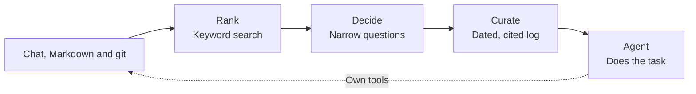

# Curate

Curate gives an agent the context it needs for a task, drawn from chat transcripts, Markdown and git history.
Memory is a process of choosing, rather than a problem of storing.
Finding a conversation is only the start: the agent needs the decision, why it was made, and what changed after it.

Curate ranks the sources, asks a small model narrow questions, and asks a writer to turn the evidence into a dated, cited log.
The agent reads that log before starting work.
It keeps its own tools and can explore the sources further.
Curate is a library, not a service: there is no database and nothing to deploy. It keeps plain files and calls the models you give it.
Curate is a handy assistant.

## Use it

### In an agent workflow or a runtime agent

Call Curate before a task or a step, then put its log in the context you give your agent.
Your agent needs no special interface: the log is text.
You supply the sources and two functions, `decide` and `write`, using your own model routes.

This example reads Markdown and writes both a memory log and a prompt for your agent.
It uses the Jev decision function and chat writer under **Bring your own models** below.
Save those recipes together as `models.mjs`, beside this file, saved as `recall.mjs`:

```js
import { writeFile } from 'node:fs/promises';
import { pickFromSources, curate } from '@curatejs/core';
import { markdown, MARKDOWN_CASCADE } from '@curatejs/markdown';
import { decideJev as decide, write } from './models.mjs';

const task = process.argv[2] ?? 'What billing constraint must this change preserve?';
const sources = [markdown({ paths: ['docs'], kind: 'docs' })];
const picked = await pickFromSources(sources, { task }, {
  task,
  decide,
  cascadesByKind: { markdown: MARKDOWN_CASCADE },
});
if (picked.reads.some((read) => read.status !== 'read' || !read.complete)
  || picked.record.candidates.some((item) =>
    item.status === 'unanswered' || item.status === 'unassessed')) {
  throw new Error('Context collection did not finish; inspect the source and decision records.');
}
const result = await curate(task, picked, { write });
const rules = picked.selected.filter((item) => item.role === 'rule')
  .map((item) => item.text).join('\n\n');
const prompt = `TASK:\n${task}\n\nMEMORY:\n${result.log}\n\nRULES:\n${rules}`;
await writeFile('memory.md', result.log);
await writeFile('agent-prompt.txt', prompt);
console.log(prompt);
```

Use Node.js 22.12 or later.
In a new folder, install the packages and create a source note:

```sh
pnpm add @curatejs/core @curatejs/markdown
mkdir -p docs
cat > docs/billing.md <<'NOTE'
---
date: 2026-01-12
---
# Billing
Invoices must preserve the currency recorded when the order was placed.
NOTE
```

With `recall.mjs` and `models.mjs` saved, configure the routes and run:

```sh
export TYPESAFE_API_KEY='your-typesafe-key'
export CHAT_API_KEY='your-chat-provider-key'
export CHAT_URL='https://api.openai.com/v1/chat/completions'
export CHAT_MODEL='gpt-5-mini'
node recall.mjs 'What billing constraint must this change preserve?'
```

These model recipes make paid API calls when run.
Pass `agent-prompt.txt` to your existing agent, or insert `result.log` into its messages in your application.
Curate does not start or replace the agent.
Selected rules stay as exact text in `picked.selected`; the writer receives only reference evidence.

For chat and git, add their readers and question sets to the same call:

```js
import { chat, CHAT_CASCADE } from '@curatejs/chat';
import { gitHistory, GIT_HISTORY_CASCADE } from '@curatejs/git';
import { markdown, MARKDOWN_CASCADE } from '@curatejs/markdown';

const sources = [
  chat({ paths: ['transcripts'] }),
  gitHistory('.'),
  markdown({ paths: ['docs'], kind: 'docs' }),
];
const cascadesByKind = {
  chat: CHAT_CASCADE,
  'git-history': GIT_HISTORY_CASCADE,
  markdown: MARKDOWN_CASCADE,
};
```

Install `@curatejs/chat` and `@curatejs/git` for those readers.
Replace `sources` and `cascadesByKind` in the first example with these values.
Point the readers at your own transcript folders, repository and documents.

### Bring your own models

Curate imports no model engine and has no adapter packages.
The host supplies two plain functions.
They can call an API, a local model, or a command using a subscription.

**`decide`: questions in, probabilities out.**
The [`PickDecide` type](packages/core/src/pick.ts) takes a batch and an `AbortSignal`, which cancels work:

```ts
import type { PickAnswer, PickQuestion } from '@curatejs/core';

type PickDecide = (
  batch: { task: string; questions: readonly PickQuestion[] },
  signal: AbortSignal,
) => Promise<Record<string, PickAnswer>>;
```

Each question has `key`, `role`, `question`, `trueCriterion`, `falseCriterion`, `sourceId`, `id`, `title` and `text`.
Optional fields are `questionKey`, `kind` and `date: { value, meaning }`.
`role` is `reference` or `rule`; `kind` is `knowledge`, `docs`, `rules` or `instructions`.
A date's `meaning` is `changed`, `effective`, `recorded` or `modified`.
`questionKey` names a question in a fitted set; `key` identifies this particular request.
Return answers under `key`, with a finite probability between 0 and 1.
A tag question also carries `tagSet`, the decision tag it answers.
An unavailable answer is `{ status: 'refused' | 'missing' | 'error', detail?: string }`.
Curate records it as unanswered.
A `decide` call that throws stops the pick; the record names the batch's candidates and the error.
Set `limits.maxBatchChars` so that each batch fits your decision model's request limit. Batches only change request size; no item is dropped or cut.

**`write`: instructions and evidence in, log text out.**
The [`CurateWrite` type](packages/core/src/curate.ts) is:

```ts
type CurateWrite = (
  prompt: { instructions: string; body: string },
  signal: AbortSignal,
) => Promise<string>;
```

Send `instructions` as the model's instructions and `body` as its input.
Return only the log text, without a Markdown fence.
Curate checks the dates and cited item IDs; it does not prove the facts are correct.
A reply that fails this check goes back to the writer once, with the reason and the rejected text. A second failure stops the curation, and the record counts each repair.
An observation has this form, using an ID from the supplied evidence:

```text
[2026-01-12] Invoices preserve the order's recorded currency (said 2026-01-12; billing.md#1)
```

The following recipes use Node's built-in `fetch`; no model SDK is needed.
Save the shared helpers, one decision recipe, and the writer in `models.mjs`.

**Shared helpers**

```js
function required(name) {
  const value = process.env[name];
  if (!value) throw new Error(`Set ${name}.`);
  return value;
}

async function post(url, key, body, signal) {
  const response = await fetch(url, {
    method: 'POST',
    headers: { authorization: `Bearer ${key}`, 'content-type': 'application/json' },
    body: JSON.stringify(body),
    signal,
  });
  if (!response.ok) throw new Error(`Model request failed: HTTP ${response.status}.`);
  return response.json();
}

function itemText(q) {
  return JSON.stringify({ sourceId: q.sourceId, id: q.id, role: q.role,
    kind: q.kind, date: q.date, title: q.title, text: q.text });
}

function probabilityAnswer(probability) {
  return typeof probability === 'number' && Number.isFinite(probability)
    && probability >= 0 && probability <= 1
    ? { status: 'answered', probability } : { status: 'missing' };
}
```

**Jev decision recipe.** [TypeSafe's Noul API](https://docs.typesafe.ai/api) returns a yes/no probability in `noul`.
The temporary names keep provider question names separate from Curate's keys.

```js
export async function decideJev(batch, signal) {
  const raw = await post('https://api.typesafe.ai/v1/systemone',
    required('TYPESAFE_API_KEY'), {
      model: 'jev-latest',
      state: batch.task,
      questions: Object.fromEntries(batch.questions.map((q, i) => [`q${i}`, {
        type: 'noul',
        instructions: `${q.question}\n\nEvidence: ${itemText(q)}`,
        criteria: { true: q.trueCriterion, false: q.falseCriterion },
      }])),
    }, signal);
  return Object.fromEntries(batch.questions.map((q, i) =>
    [q.key, probabilityAnswer(raw.answers?.[`q${i}`]?.noul)]));
}
```

**OpenAI decision recipe.** The [Decisions API](https://developers.openai.com/api/docs/guides/decisions) returns named answers in an array.
Its `predicate` question estimates whether a statement is true.
To use it in `recall.mjs`, change the import to `decideOpenAI as decide` and set `OPENAI_API_KEY`.

```js
export async function decideOpenAI(batch, signal) {
  const raw = await post('https://api.openai.com/v1/decisions',
    required('OPENAI_API_KEY'), {
      model: 'gpt-6-luna',
      input: batch.task,
      questions: batch.questions.map((q, i) => ({
        type: 'predicate',
        name: `q${i}`,
        instructions: `${q.question}\nTrue: ${q.trueCriterion}\nFalse: ${q.falseCriterion}\nEvidence: ${itemText(q)}`,
      })),
    }, signal);
  const answers = new Map((raw.answers ?? []).map((a) => [a.name, a]));
  return Object.fromEntries(batch.questions.map((q, i) => {
    const answer = answers.get(`q${i}`);
    return [q.key, answer?.type === 'refusal' ? { status: 'refused' }
      : probabilityAnswer(answer?.type === 'predicate' ? answer.probability : undefined)];
  }));
}
```

**Chat writer recipe.** This works with providers that accept the [Chat Completions format](https://developers.openai.com/api/reference/resources/chat/subresources/completions/methods/create).
For other chat models, keep the same function contract and use their request format.
Set `CHAT_URL`, `CHAT_MODEL` and `CHAT_API_KEY` for your chosen route.
The recipe passes an empty reply through: with `batchTokens`, a later pass whose batch holds nothing new returns no lines, and Curate itself rejects an empty log everywhere else.

```js
export async function write({ instructions, body }, signal) {
  const raw = await post(required('CHAT_URL'), required('CHAT_API_KEY'), {
    model: required('CHAT_MODEL'),
    messages: [
      { role: 'system', content: instructions },
      { role: 'user', content: body },
    ],
  }, signal);
  const text = raw.choices?.[0]?.message?.content;
  if (typeof text !== 'string') throw new Error('Writer returned no log.');
  return text;
}
```

### An example of use: the `/curate` skill

The [skill](skills/curate/SKILL.md) is one example built on the packages.
Agent workflows and runtime agents are Curate's main use.
The skill runs the readers, writes extra searches, asks Jev for decisions, and writes the log through a subscription command.
It requires Jev credentials and a signed-in subscription route.

Make `skills/curate/` available in your coding agent's skill folder, then invoke `/curate <task>`.
Build the repository first and keep source settings outside it.
The same command can be run from the repository root:

```sh
pnpm install --frozen-lockfile
pnpm build
node skills/curate/run.mjs --sources sources.json 'Which decisions bear on this task?'
```

Save `sources.json` with your own paths:

```json
{
  "sources": [
    { "type": "claude-code", "path": "~/history/chat" },
    { "type": "git", "path": "~/projects/example" },
    { "type": "markdown", "path": "~/notes/example" }
  ],
  "envFile": "~/.curate/credentials.env",
  "threshold": 0
}
```

Paths must be absolute or start with `~/`.
Set `TYPESAFE_API_KEY` in the environment or the `KEY=VALUE` file named by `envFile`.
Without `--sources`, the script reads `~/.curate/sources.json`.
It prints the log and saves the log, source reads, model usage and timings under `~/.curate/runs/`.
Jev calls cost money; price the source feed and approve that spend before running the skill.
Subscription route failures never fall back to an API.
Codex sends your global Codex instructions (`~/.codex/AGENTS.md`) with every call, and Codex 0.162.1 has no option to leave them out.
On macOS the skill runs Codex in a sandbox that cannot read that file.
On other systems, and when the skill itself runs inside another macOS sandbox, your global Codex instructions go into every search and curator call: they cost tokens and can steer the log.
The run record says which happened for each call.

## Rank, decide, curate



- **Rank:** Keyword settings suit each source kind. Chat and Markdown use BM25, a score for matching words. Git uses shared words, age and changed paths. Supply `searchLines` for extra wording or hypothetical answers, and `kindLanes` for phrases in the language of the kind of message the task asks for. Inside `pickFromSources`, each search lane is cut where its own score curve flattens, not at a fixed count; pass `laneCut: false` to decide every part a source returns. A lane that matches nothing keeps nothing, and a read with no match at all records `noSearchMatch`. Optional local meaning search adds similarity ranks with a host-supplied embedding function; it is off by default and needs no database.
- **Decide:** The source packages export fitted sets of narrow questions. Pass them through `cascadesByKind`, as in the examples. Without a fitted set, core asks its ordinary relevance or rule question. Pass `tags` (for example `DECISION_TAGS`) to label each kept item with its intent, importance, emphasis and whether it corrects something earlier. Every reference with a valid score is kept by default, strongest score first. Set `thresholds.reference` for one optional cut, or `thresholds.referenceBySize` for a cut that rises with the number of decided items; zero keeps even zero scores. Missing answers stay visible in the record.
- **Curate:** Each item reaches the writer with its date, source kind, decision score and any tags. The writer writes observations with event dates, statement dates and source IDs. It is asked to retain observations from scores of 0.6 or more, include useful facts from 0.1 to below 0.6, and give scores below 0.1 little space. Later facts that replace earlier ones carry both dates. Set `batchTokens` to write the log in batches, strongest items first: each later batch adds lines and never rewords or removes an earlier line. There is no fixed log length cap.

No default drops evidence at a fixed count.
Batch sizes change request size without dropping items.
Extra searches must be supplied by the host; the packages do not generate them.
See [core's options](packages/core/README.md) for search lines, local meaning search and user-set limits.

## Plain files and git

The memory lives in plain files and git, without a database, vector store or server.
Markdown holds facts and instructions.
Commit bodies hold decisions: why a change was made, the options considered and the constraints behind it.
A commit can be a decision record as well as a code change.
The agent follows its cited commit with its own tools when it needs the code.

The sources remain readable without Curate.
Dates let the writer distinguish an old decision from its replacement, even when they share the same words.

## Results

LongMemEval tests whether a model can answer questions from a long chat history.
Curate ran all 500 LongMemEval S questions with its packages at commit `aacb042`, at two settings:

- **Performance, the package default.** Every part of each history went to the decision model, every scored part went to the curator, and the curator wrote one log per question.
- **Economic.** One option, `thresholds: { reference: 0.0146 }`: only the parts the decision model scored 0.0146 or more went to the curator, about 70 of a history's 851. 0.0146 is the highest cut that lost no answer message in an earlier measurement on the tuning questions.

The answering model read only the log.
Every answer, verdict and log is in [the proof files](benchmarks/longmemeval/2026-10-14/README.md).

| Setting | Answering model and marker | All 500 | Held-out 251 | Context tokens (mean) | Adjusted score | Cost per question (list, est.) |
| --- | --- | --- | --- | --- | --- | --- |
| **Performance** | GPT-5 answers, GPT-5 marks | **94.0** (470/500) | 94.8 (238/251) | 580 | **99.0** | $0.49 |
| **Performance** | GPT-5-mini answers, GPT-4o marks | **92.0** (460/500) | 93.6 (235/251) | 580 | **97.0** | $0.48 |
| **Economic** | GPT-5-mini answers, GPT-4o marks | **91.6** (458/500) | 93.6 (235/251) | 485 | **96.9** | **$0.12** |

The held-out 251 are the questions never used to tune Curate.
The GPT-5-mini performance row answers the same saved logs as the GPT-5 row; it asks no new decisions and writes no new logs.
The economic row reuses the performance run's saved decisions and writes new logs from fewer parts.
Two runs of one setting differ by up to 8 questions on 249, so the two settings score the same within that noise.

### Settings: dials for cost, speed and score

Curate's options let each use set its own balance of cost, speed and score.
An agent that must never miss a past decision can let the curator read everything; a service answering many questions can let it read less.
These dials were measured on the 249 tuning questions, with gpt-6.1-sol curating unless named, GPT-5-mini answering and GPT-4o marking:

| Dial | Parts the curator reads | Correct of 249 | Cost per question (list, est.) |
| --- | --- | --- | --- |
| Every scored part (performance) | 850 | 225 | $0.51 |
| Decision score 0.0146 or more (economic) | 70 | 225, then 223 in the all-500 run | $0.13 |
| Decision score 0.05 or more | 10 | 231, then 223 on a repeat | $0.11 |
| Scaled top-k: the top 0.68 × N^0.8 of the keyword-and-label ranking | 150 | 229 | $0.18 |
| gpt-6-luna as the curator, at three of these inputs | 10 to 850 | 217 to 221 | $0.015 to $0.043 |

- **N** is the number of parts in the history.
- **Speed:** at the performance setting, the median question took 20 seconds to a finished log (ranking 0.1 s, deciding 3.0 s, curating 16.9 s). The economic run did not record its time.
- **At the economic setting, most of what the curator reads is instructions added to every call,** because the curator ran on a ChatGPT plan through the Codex CLI: the CLI's own instructions and the operator's global Codex instructions file.

### LongMemEval's own scorer

The same answers, judged by LongMemEval's own `evaluate_qa.py` (commit `9e0b455`) with its dated GPT-4o judge, `gpt-4o-2024-08-06`:

| Answering model | Overall | Average of the six types | Abstention questions |
| --- | --- | --- | --- |
| **GPT-5**, performance | **93.0** (465/500) | 92.1 | 29/30 |
| **GPT-5-mini**, performance | **92.2** (461/500) | 91.2 | 22/30 |
| **GPT-5-mini**, economic | **90.8** (454/500) | 89.3 | 23/30 |
| **gpt-6.1-sol** through the Codex CLI, with gpt-6-luna curating | **88.2** (441/500) | 89.5 | 29/30 |

The last row uses two models a ChatGPT plan offers: gpt-6-luna writes the log in place of gpt-6.1-sol, and gpt-6.1-sol answers through the Codex CLI in place of GPT-5. It loses most on multi-session questions (78.9 against 87.2 for GPT-5) and temporal ones (85.0 against 94.7), because Luna's logs average 158 tokens and leave out events that counting and date questions need. Its proof is in [`luna-sol/`](benchmarks/longmemeval/2026-10-14/luna-sol/).

The answers are in LongMemEval's own format (`question_id`, `hypothesis`), with the scorer's output for every question, in [`official-scorer/`](benchmarks/longmemeval/2026-10-14/official-scorer/). Anyone with the dataset and an OpenAI key can score them again.

### Against published systems

| System | What you run | Answering model | Score | Answering context | Answering input cost | Full pipeline cost |
| --- | --- | --- | --- | --- | --- | --- |
| **Curate** | A TypeScript library: plain files, no database | GPT-5 | **94.0** | **580** | **$0.0007** | $0.49 at list prices (est.); $0.024 paid |
| **Curate** | A TypeScript library: plain files, no database | GPT-5-mini | 92.0 | 580 | $0.0001 | $0.48 at list prices (est.) |
| **Curate, economic setting** | A TypeScript library: plain files, no database | GPT-5-mini | 91.6 | 485 | $0.0001 | **$0.12** at list prices (est.) |
| [Mem0 platform](https://github.com/mem0ai/memory-benchmarks/blob/4b61c5d31b9c668a12b4f5e78064248a02c82d2b/results/platform/longmemeval_results.json) | Mem0's hosted platform | GPT-5 | 93.4 | 6,787 mean | $0.0085 | not published |
| [Mastra observational memory](https://mastra.ai/research/observational-memory) | A TypeScript framework you run, with a storage provider | GPT-5-mini | 93.6 (94.87 by type) | ~30,000 mean | $0.0075 | ~$0.045 (est.) |
| [Zep](https://getzep.com/research) | Zep's hosted service is its recommended setup | GPT-5.4 | 90.2 | 4,408 median | not priced | not published |
| No memory: GPT-5 reads the whole history | Nothing | GPT-5 | not run | ~122,000 | $0.153 | $0.153 |

Costs are per question.

- **On GPT-5, Curate scores above Mem0's committed result file** (94.0 against 93.4, both marked by GPT-5). With LongMemEval's own GPT-4o judge, Curate's GPT-5 answers score 93.0.
- **On GPT-5-mini, Mastra's raw score is higher:** 93.6 against 92.0 per question, and 94.87 against 90.99 as an equal average of the six question types. Its answering model reads about 50 times more context.
- **Curate has the highest adjusted score** of these systems, because its answering model reads the least context.

**Notes on the table**

- **Answering input cost** = the answering context × the answering model's input price. It prices every system the same way.
- **Curate's full pipeline cost is measured from the run's call records:**
  - Jev decisions: $0.0097 a question.
  - The GPT-5 answer: $0.014 a question.
  - Curation: about 193,000 input tokens for the first call, 232,050 a question on average with repairs, on a ChatGPT subscription. At gpt-6.1-sol's list price of $2.00 per million input tokens and $10 per million output tokens (third-party price list, 11 October 2026), that is about $0.47 (est.).
- **Mastra's full pipeline cost is an estimate:** its observer reads each history once with gemini-2.5-flash, at $0.30 per million input tokens (about $0.037), plus the answer. Observer output is not counted.
- **What you run:** Mem0's result file comes from Mem0 Platform, its hosted service. Zep recommends its hosted service; its research page does not say which setup produced 90.2. Mastra's observational memory runs in its TypeScript framework with a storage provider. Curate needs no database and no server: it is a package that writes plain files and calls the decision model, curator and answering model you choose.
- **Mem0 and Zep do not publish** their ingestion models or calls.
- **Marking models differ:** GPT-5 for Curate's first row and for Mem0, GPT-4o for Curate's second row and for Mastra, GPT-5.4 for Zep.
- **Token counting differs** too, including Zep's median in place of a mean. The rows compare roughly; they are not one controlled run.
- **Prices:** OpenAI's list prices, checked 13 October 2026. Jev: $0.042 per million input tokens, output free.

```text
adjusted score = answer score − 5 × log10(context tokens ÷ 5,698)
```

The 5,698-token reference is the mean context of only the sessions containing the answer, over all 500 questions, counted with GPT-4o's token counter.
This is LongMemEval's oracle setting: perfect selection of sessions, rather than the shortest possible answer.
Halving the context adds about 1.5 points; doubling it removes about 1.5.
Adjusted score is a custom measure, not LongMemEval's official score.
It counts the answering model's context, excluding decisions, curation and ingestion work.

### DolphinBench: Mem0's benchmark, a 30-test slice\*

[DolphinBench](https://dolphinbench.ai/) is Mem0's agent-memory benchmark.
An agent gets a request and real app tools (email, calendar, Slack, CRM and more), and the benchmark grades what the agent does, using facts from up to five years of one person's messages.
Curate ran 30 of its 600 tests in performance mode: Jev scored every part of the person's history, about 5,500 parts, the curator wrote a dated log, and the agent read only that log.

| System | Agent | Passed, of these 30 | List cost a test |
| --- | --- | --- | --- |
| **Curate, performance mode** | GPT-5.6 Luna, high, through the Codex CLI | **23** | $3.24 (est.) |
| Honcho | GPT-5.6 Luna, high, in Hermes | 21 | $0.24 |
| Mem0 | GPT-5.6 Luna, high, in Hermes | 20 | $0.16 |
| Hindsight | GPT-5.6 Luna, high, in Hermes | 19 | $0.14 |
| Hermes built-in memory | GPT-5.6 Luna, high, in Hermes | 17 | $0.10 |
| No memory | GPT-5.6 Luna, high, through the Codex CLI | 0 | |
| The test's own fact messages, given directly | GPT-5.6 Luna, high, through the Codex CLI | 29 | |

The published systems' results are their own per-test files in the DolphinBench repository; their costs are each published run's total over 600 tests.
Every Curate log, app call and verdict is in [the proof files](benchmarks/dolphinbench/2026-10-15/README.md).

\* **Small print**

- **Unofficial.** This is not a DolphinBench submission. The model-judged checks ran on gpt-5.6-sol through the Codex CLI, not the benchmark's own judge setup. On Mem0's published tool calls for these 30 tests, this judge agreed with Mem0's published verdicts on all 30.
- **A slice.** 30 of 600 tests: every 20th test for each of the three people. One test is 3.3 points, and published systems change order on slices this small.
- **A different agent harness.** The agent ran in the Codex CLI with only the test's app tools, not in Hermes, with the same model and reasoning setting as the published runs.
- **One run.** On 23 of these tests, two runs of the same logs passed 18 and 16.
- **Cost.** In performance mode the curator reads the whole history for every test, about 1.3 million tokens, so Curate's list cost is about 20 times Mem0's. Here the curator ran on a ChatGPT plan, and the paid cost was Jev's, about $0.10 a test.

### Where the cost goes

Every memory system reads the whole history with some model. Mem0 and Zep read it once, as messages arrive; Mastra's observer reads it once; Curate reads it for each question.
Curate reads it twice per question: once with the decision model, at $0.042 per million tokens, and once with the curator.
At the package defaults the curator reads every decided part, about 193,000 tokens a question.
That makes the default pipeline the most expensive in the table at list prices, while the answering model, usually the most capable and costly one, reads 580 tokens.
The economic setting cuts the curator's input to about 51,000 tokens a question and the list cost to $0.12, at the same score within run-to-run noise.

### What worked and what did not

These are measured results. "Tuning" means the 249 questions used to tune Curate.

**Worked**

- **The curator reads every decided part.** On the held-out half with GPT-5-mini answering and GPT-4o marking, the score rose from 90.4, with the curator's input packed to a fixed size, to 93.6, with every decided part. Curation input rose about seven times. The two runs also used different answering prompts.
- **One format repair.** About one question in six needed it; without it, one reply out of the expected format stopped a run.
- **The curated log carries more than the evidence sessions.** On 98 tuning questions with GPT-4.1 answering and GPT-4o marking, the log alone (median 532 characters) scored 88. The sessions that contain the answer (median 27,797 characters) scored 83.
- **Labels from the decision model reach answers that share no words with the question.** Keyword search alone reached 439 of the tuning half's 445 answer messages. With each part labelled by the kind of statement it holds, all 445 were reached at 38% of each history. This is not yet a default.
- **Scaled top-k: a share of the ranking that grows with the history's size.** On the tuning half, keeping 0.68 × N^0.8 of the keyword-and-label ranking held 99% of the answer messages at every size from 127 to 8,475 parts. N is the number of parts. The larger sizes were built by adding other tuning questions' sessions. With gpt-6.1-sol curating it scored 229 of 249. It is a dial, not the default.
- **A low cut on decision scores.** Keeping parts scored 0.0146 or more scored 458 of 500 against 460 for keeping everything, at a quarter of the cost. It is the economic setting.

**Did not work**

- **Stopping when the decision model's yes rate falls to chance.** The best version lost answers at ranks 311 to 555 that it scored 0.63 to 0.87 once read. Answers are rare, and the rule stopped just before them.
- **A higher cut on decision scores loses answers.** A cut at 0.05 dropped 8 of 438 answer messages on the tuning half; its score held within run-to-run noise (231 and 223 against 225).
- **Sending left-out items back to the curator.** When the log cited no line for an item weighted 0.6 or more, a second pass sent that item back once. With gpt-6-luna curating it scored 216 and 218 of 249, against 217 without it. The answer messages Luna left out were mostly weighted 0.05 to 0.5, under the 0.6 bar, so the pass reached only 3 of the 12 wrong answers that had one. Sending back every uncited item instead, with no bar, cited 405 of the tuning half's 445 answer messages against 389 and scored 227 against 223 (Luna curating, gpt-6.1-sol answering, LongMemEval's scorer): inside the noise, for a second read of almost the whole history. It also fired on 11 of 249 questions with gpt-6.1-sol, where the items left out repeated facts already in the log.
- **A cheaper curator.** gpt-6-luna scored below gpt-6.1-sol at every input tried (217 to 221 against 223 to 231 of 249). Its logs were a third as long and left out events the answer needed.
- **Cutting the curator's input to a fixed number of parts.** The top 10, 15 or 25 parts each scored below all parts on 60 tuning questions.
- **Decision questions written for each task, and questions about named things.** Neither beat the fitted question sets by more than the run-to-run noise.
- **A keyword-only lane cut.** It missed 6 of 445 answer messages on the tuning half: three shared no words with the question, and three ranked below their lane's cut.

### Next

- **Calling the curator without the Codex CLI's own instructions,** which are most of its input at the economic setting.
- **Labels stored once per part with a cached decision,** so that the decision model reads each part once rather than for each question.

## Packages

| Package | What it supplies |
| --- | --- |
| [**@curatejs/core**](packages/core/README.md) | Selection, curation, source contracts, shared types and rank blending. No reader. |
| [**@curatejs/chat**](packages/chat/README.md) | Local agent transcripts, secret scrubbing, chat ranking and questions. |
| [**@curatejs/git**](packages/git/README.md) | Git commit history, keyword settings and questions. |
| [**@curatejs/markdown**](packages/markdown/README.md) | Markdown notes and rules, keyword settings and questions. |

Each source package depends only on core and exports its keyword settings, question set and wording guidance for extra searches.

## Install only what you need

```sh
# Supply your own sources.
pnpm add @curatejs/core

# Read transcripts.
pnpm add @curatejs/core @curatejs/chat

# Read commits and notes.
pnpm add @curatejs/core @curatejs/git @curatejs/markdown
```

## Markdown paths

`@curatejs/markdown` reads folders, files and globs with explicit kinds.

```ts
import { markdown } from '@curatejs/markdown';

const sources = [
  markdown({ paths: ['docs'], kind: 'docs' }),
  markdown({ paths: ['.agents/rules'], kind: 'rules' }),
  markdown({ paths: ['**/AGENTS.md'], kind: 'instructions' }),
];
```

See the [Markdown package](packages/markdown/README.md) for rule scopes, instruction locations, shared reads, dates and whole-text defaults.

## Development

```sh
pnpm install --frozen-lockfile
pnpm build
pnpm typecheck
pnpm test
```

Build first so dependent packages and integration tests can use core's declarations and package exports.
Each package also supports `pnpm --filter @curatejs/<name> build`, `test`, `typecheck` and `pack`.
