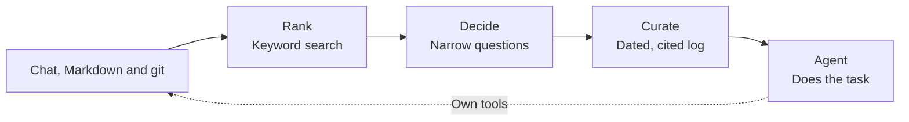

# Curate

Curate gives an agent the context it needs for a task, drawn from chat transcripts, Markdown and git history.
It chooses evidence and turns it into a dated, cited log that the agent reads before starting work.

## Results at a glance

On LongMemEval S, across all 500 questions:

| Setting | Answering model and marker | All 500 | Held-out 251 | Context tokens (mean) | Adjusted score | Cost per question (list, est.) |
| --- | --- | --- | --- | --- | --- | --- |
| **Performance** | GPT-5 answers, GPT-5 marks | **94.0** (470/500) | 94.8 (238/251) | 580 | **99.0** | $0.49 |
| **Performance** | GPT-5-mini answers, GPT-4o marks | **92.0** (460/500) | 93.6 (235/251) | 580 | **97.0** | $0.48 |
| **Economy** | GPT-5-mini answers, GPT-4o marks | **91.6** (458/500) | 93.6 (235/251) | 485 | **96.9** | **$0.12** |

DolphinBench: **23 of 30 tests passed** in performance mode.
That is an unofficial slice of 600 tests with a different agent setup; the comparisons are not one controlled run.
LongMemEval comparisons also use different models and token counts.
See [Results](#results) for the full tables, costs, proof files and limits.

## Install only what you need

Use Node.js 22.20 or later.

```sh
# Run the Markdown example below.
pnpm add @curatejs/core @curatejs/markdown

# Add transcript or git readers as needed.
pnpm add @curatejs/chat @curatejs/git

# Or supply your own sources.
pnpm add @curatejs/core
```

## Packages

| Package | What it supplies |
| --- | --- |
| [**@curatejs/core**](packages/core/README.md) | Task recall, selection, curation, model helpers and source contracts. No reader. |
| [**@curatejs/chat**](packages/chat/README.md) | Local agent transcripts, secret scrubbing, chat ranking and questions. |
| [**@curatejs/git**](packages/git/README.md) | Git commit history, keyword settings and questions. |
| [**@curatejs/markdown**](packages/markdown/README.md) | Markdown notes and rules, keyword settings and questions. |

Each source package depends only on core and exports its keyword settings, question set and wording guidance for extra searches.
See the [changelog](CHANGELOG.md) for what each release contains.

## Use it

Call Curate before a task, then give its log to your agent as text.
Curate is a library: it keeps plain files and calls the models you supply, with no database or service to deploy.
Your agent keeps its own tools and can follow the citations when it needs more detail.

### Recall context for a task

Save this as `recall.mjs`:

```js
import { memory } from '@curatejs/core';
import { jev, chatWriter } from '@curatejs/core/models';
import { markdown } from '@curatejs/markdown';

const decide = jev({ apiKey: process.env.TYPESAFE_API_KEY });
const write = chatWriter({ apiKey: process.env.CHAT_API_KEY, model: 'gpt-5-mini' });
const mem = memory({
  sources: [markdown({ paths: ['docs'], kind: 'docs' })],
  decide,
  write,
});

const { log } = await mem.recall('What billing constraint must this change preserve?');
console.log(log);
```

Create a source note:

```sh
mkdir -p docs
cat > docs/billing.md <<'NOTE'
---
date: 2026-01-12
---
# Billing
Invoices must preserve the currency recorded when the order was placed.
NOTE
```

Set the model keys and run:

```sh
export TYPESAFE_API_KEY='your-typesafe-key'
export CHAT_API_KEY='your-chat-provider-key'
node recall.mjs
```

The log cites the source file, for example:

```text
[2026-01-12] Invoices preserve the order's recorded currency (said 2026-01-12; /home/sam/docs/billing.md#1)
```

> [!NOTE]
> The model helpers make paid API calls. `jev()` uses TypeSafe's `jev-latest`; `chatWriter()` uses OpenAI's Chat Completions URL unless you supply `url`.

`recall()` returns the log, exact selected rules as joined text, and the full selection and curation records:

```js
const { log, rules, picked, result } = await mem.recall('What billing constraint must this change preserve?');
```

- **Source questions are automatic.** Each reader brings its own set of narrow questions.
- **Incomplete collection throws.** An absent or incomplete read, or an unanswered or unassessed candidate, stops recall. Read and model errors reach the caller.
- **Rules stay exact.** `rules` joins the selected rule text with blank lines. The writer receives reference evidence, not rules.
- **Cancellation is optional.** Pass an `AbortSignal` as `mem.recall(task, { signal })`.

### Cost and selection options

Use `preset: 'economy'` to send fewer scored parts to the writer:

```js
const mem = memory({ sources, decide, write, preset: 'economy' });
```

The default is `performance`.
Both presets and the individual options are described in [core's options](packages/core/README.md#levers-and-modes).
Pass reader options under `read`, selection options under `pick`, and writer options under `curate`:

```js
const mem = memory({
  sources,
  decide,
  write,
  pick: { limits: { maxBatchChars: 50000 } },
  curate: { batchTokens: 2000 },
});
```

Batch sizes change request size without dropping evidence.
Limits that leave a read incomplete or candidates unassessed make `recall()` throw.

## Sources

Combine any of these readers in the `sources` array.
Each reader ranks its own source text without a model or network call.

### Transcripts

`@curatejs/chat` reads local Claude Code and Codex JSONL transcripts.
Use `paths` for your own folders, or omit it to use the providers' default folders.

```js
import { chat } from '@curatejs/chat';

const source = chat({ paths: ['transcripts'], providers: ['claude-code'] });
```

See the [transcript reader](packages/chat/README.md) for date filters, tool messages and secret scrubbing.

### Git history

`@curatejs/git` reads non-merge commits, including their bodies, dates and changed paths.
Git must be on `PATH`.

```js
import { gitHistory } from '@curatejs/git';

const source = gitHistory('.');
```

See the [git reader](packages/git/README.md) for keyword settings and optional signals from live lines and files that change together.

### Markdown

`@curatejs/markdown` reads folders, files and globs.
Choose `knowledge` or `docs` for reference evidence, and `rules` or `instructions` for exact rules.

```js
import { markdown } from '@curatejs/markdown';

const sources = [
  markdown({ paths: ['docs'], kind: 'docs' }),
  markdown({ paths: ['.agents/rules'], kind: 'rules' }),
  markdown({ paths: ['**/AGENTS.md'], kind: 'instructions' }),
];
```

See the [Markdown reader](packages/markdown/README.md) for dates, rule scopes and revision pins.

## Bring your own models

Curate accepts two plain functions.
They can call an API, a local model or a command.
The built-in helpers use `fetch` and need no model SDK.

- **`decide` answers narrow questions.** It receives `{ task, questions }` and an `AbortSignal`. Return an answer under each question's `key`, with `status: 'answered'` and a finite `probability` from 0 to 1. See [`PickDecide`](packages/core/src/pick.ts) for question fields and unavailable answers.
- **`write` turns evidence into log text.** It receives `{ instructions, body }` and an `AbortSignal`. Return the log without a Markdown fence, or an empty string when no evidence bears on the task; Curate then returns an empty log marked `empty: true`. See [`CurateWrite`](packages/core/src/curate.ts) for the full contract.

Use `openAIDecisions()` for [OpenAI's Decisions API](https://developers.openai.com/api/docs/guides/decisions) in place of `jev()`:

```js
import { openAIDecisions } from '@curatejs/core/models';

const decide = openAIDecisions({ apiKey: process.env.OPENAI_API_KEY });
```

Curate checks observation dates and cited IDs.
It does not prove that the facts or date calculations are correct.
A reply with invalid format goes back to the writer once with the reason; a second failure stops curation.

To use another provider that accepts Chat Completions, give the writer its URL and model:

```js
const write = chatWriter({
  apiKey: process.env.CHAT_API_KEY,
  url: process.env.CHAT_URL,
  model: process.env.CHAT_MODEL,
});
```

### Separate selection and curation

`pickFromSources()` and `curate()` remain available when you need to inspect or change the evidence before writing.
With these separate calls, check the read and candidate records yourself before using the result.

```js
import { pickFromSources, curate } from '@curatejs/core';
import { markdown, MARKDOWN_CASCADE } from '@curatejs/markdown';

const task = 'What billing constraint must this change preserve?';
const sources = [markdown({ paths: ['docs'], kind: 'docs' })];
const picked = await pickFromSources(sources, { task }, {
  task,
  decide,
  cascadesByKind: { markdown: MARKDOWN_CASCADE },
});
const result = await curate(task, picked, { write });
```

For `memory()`, override a reader's questions through `pick.cascadesByKind`.
See the [core package](packages/core/README.md) for question sets, tags, local meaning search and full records.

### The `/curate` skill

The [coding-agent skill](skills/curate/SKILL.md) reads sources and prints a log for a task.
It needs Jev credentials and a signed-in model subscription.
Build the repository and save your source settings outside it:

```sh
pnpm install --frozen-lockfile
pnpm build
node skills/curate/run.mjs --sources sources.json 'Which decisions bear on this task?'
```

Save `sources.json` with your own paths:

```json
{
  "sources": [
    {
      "type": "claude-code",
      "path": "~/history/chat"
    },
    {
      "type": "git",
      "path": "~/projects/example"
    },
    {
      "type": "markdown",
      "path": "~/notes/example"
    }
  ],
  "envFile": "~/.curate/credentials.env",
  "threshold": 0
}
```

Paths must be absolute or start with `~/`.
Set `TYPESAFE_API_KEY` in the environment or the `KEY=VALUE` file named by `envFile`.
Without `--sources`, the script reads `~/.curate/sources.json`.
It prints the log and saves the log, source reads, model usage and timings under `~/.curate/runs/`.
Subscription route failures never fall back to an API.

## Rank, decide, curate



### Rank

Each reader ranks evidence using settings suited to its source.
Chat and Markdown use BM25, a score for matching words.
Git uses shared words, age and changed paths.
Each search lane cuts where its own score curve flattens, rather than at a fixed count.
Set `read.wholeLanes: true` to keep every part the readers return.

- **Extra wording:** Supply `read.searchLines` for phrases or hypothetical answers that describe the evidence you need. Curate does not generate them.
- **Kinds of statement:** Supply `read.kindLanes` for phrases that help find directions, decisions or corrections.
- **Meaning search:** Supply an embedding function, which turns text into numbers for similarity search. It is off by default and needs no database.

### Decide

The decision function answers each reader's narrow questions.
Every reference with a valid score is kept by default, strongest first.
Unanswered or unassessed candidates stay visible in the record and stop `recall()`.

- **Fewer decisions:** `pick.everyRanked: { c }` keeps the top `round(c × N^0.8)` reference parts, where N is the number of reference parts. Rules pass through uncut. The skipped parts are unassessed, so use the separate selection API to inspect them.
- **Fewer writer inputs:** `pick.everyScored: { bar }` keeps references at or above your chosen score.
- **More evidence:** `pick.rare` finds unselected parts that share rare words with the selected evidence.
- **Tags:** `pick.tags` labels selected items with their intent, importance, emphasis and whether they correct something earlier.

### Curate

The writer receives reference evidence with dates, source kinds, decision scores and any tags.
It writes observations with event dates, statement dates and source IDs.
When a later fact replaces an earlier one, the log can carry both dates.

- **Space by score:** The instructions ask the writer to retain observations scored 0.6 or more, include useful facts from 0.1 to below 0.6, and give scores below 0.1 little space.
- **Batches:** `curate.batchTokens` writes strongest evidence first. Later batches add lines without rewording or removing earlier ones.
- **Length:** There is no fixed log length cap.

## Plain files and git

The sources remain readable without Curate.
Markdown holds facts and instructions.
Commit bodies can record why a change was made, the options considered and the constraints behind it.
The agent can follow a cited commit with its own tools when it needs the code.

Dates help the writer tell an old decision from its replacement, even when they share the same words.

## Results

LongMemEval tests whether a model can answer questions from a long chat history.
Curate ran all 500 LongMemEval S questions with its packages at commit `aacb042`, at two settings:

- **Performance, the package default.** Every part of each history went to the decision model, every scored part went to the curator, and the curator wrote one log per question.
- **Economy.** One option, `everyScored` off at `bar` 0.0146: only the parts the decision model scored 0.0146 or more went to the curator, about 70 of a history's 851. 0.0146 is the highest cut that lost no answer message in an earlier measurement on the tuning questions. The `economy` preset reproduces this setting.

The answering model read only the log.
Every answer, verdict and log is in [the proof files](benchmarks/longmemeval/2026-10-14/README.md).

| Setting | Answering model and marker | All 500 | Held-out 251 | Context tokens (mean) | Adjusted score | Cost per question (list, est.) |
| --- | --- | --- | --- | --- | --- | --- |
| **Performance** | GPT-5 answers, GPT-5 marks | **94.0** (470/500) | 94.8 (238/251) | 580 | **99.0** | $0.49 |
| **Performance** | GPT-5-mini answers, GPT-4o marks | **92.0** (460/500) | 93.6 (235/251) | 580 | **97.0** | $0.48 |
| **Economy** | GPT-5-mini answers, GPT-4o marks | **91.6** (458/500) | 93.6 (235/251) | 485 | **96.9** | **$0.12** |

The held-out 251 are the questions never used to tune Curate.
The GPT-5-mini performance row answers the same saved logs as the GPT-5 row; it asks no new decisions and writes no new logs.
The economy row reuses the performance run's saved decisions and writes new logs from fewer parts.
Two runs of one setting differ by up to 8 questions on 249, so the two settings score the same within that noise.

### Settings: dials for cost, speed and score

Curate's options let each use set its own balance of cost, speed and score.
An agent that must never miss a past decision can let the curator read everything; a service answering many questions can let it read less.
These dials were measured on the 249 tuning questions, with gpt-6.1-sol curating unless named, GPT-5-mini answering and GPT-4o marking:

| Dial | Parts the curator reads | Correct of 249 | Cost per question (list, est.) |
| --- | --- | --- | --- |
| Every scored part (performance) | 850 | 225 | $0.51 |
| Decision score 0.0146 or more (economy) | 70 | 225, then 223 in the all-500 run | $0.13 |
| Decision score 0.05 or more | 10 | 231, then 223 on a repeat | $0.11 |
| Scaled top-k: the top 0.68 × N^0.8 of the keyword-and-label ranking | 150 | 229 | $0.18 |
| gpt-6-luna as the curator, at three of these inputs | 10 to 850 | 217 to 221 | $0.015 to $0.043 |

- **N** is the number of parts in the history.
- **Speed:** at the performance setting, the median question took 20 seconds to a finished log (ranking 0.1 s, deciding 3.0 s, curating 16.9 s). The economy run did not record its time.

### LongMemEval's own scorer

The same answers, judged by LongMemEval's own `evaluate_qa.py` (commit `9e0b455`) with its dated GPT-4o judge, `gpt-4o-2024-08-06`:

| Answering model | Overall | Average of the six types | Abstention questions |
| --- | --- | --- | --- |
| **GPT-5**, performance | **93.0** (465/500) | 92.1 | 29/30 |
| **GPT-5-mini**, performance | **92.2** (461/500) | 91.2 | 22/30 |
| **GPT-5-mini**, economy | **90.8** (454/500) | 89.3 | 23/30 |
| **gpt-6.1-sol** through the Codex CLI, with gpt-6-luna curating | **88.2** (441/500) | 89.5 | 29/30 |

The last row uses two models a ChatGPT plan offers: gpt-6-luna writes the log in place of gpt-6.1-sol, and gpt-6.1-sol answers through the Codex CLI in place of GPT-5. It loses most on multi-session questions (78.9 against 87.2 for GPT-5) and temporal ones (85.0 against 94.7), because Luna's logs average 158 tokens and leave out events that counting and date questions need. Its proof is in [`luna-sol/`](benchmarks/longmemeval/2026-10-14/luna-sol/).

The answers are in LongMemEval's own format (`question_id`, `hypothesis`), with the scorer's output for every question, in [`official-scorer/`](benchmarks/longmemeval/2026-10-14/official-scorer/). Anyone with the dataset and an OpenAI key can score them again.

### Against published systems

| System | What you run | Answering model | Score | Answering context | Answering input cost | Full pipeline cost |
| --- | --- | --- | --- | --- | --- | --- |
| **Curate** | A TypeScript library: plain files, no database | GPT-5 | **94.0** | **580** | **$0.0007** | $0.49 at list prices (est.); $0.024 paid |
| **Curate** | A TypeScript library: plain files, no database | GPT-5-mini | 92.0 | 580 | $0.0001 | $0.48 at list prices (est.) |
| **Curate, economy setting** | A TypeScript library: plain files, no database | GPT-5-mini | 91.6 | 485 | $0.0001 | **$0.12** at list prices (est.) |
| [Mem0 platform](https://github.com/mem0ai/memory-benchmarks/blob/4b61c5d31b9c668a12b4f5e78064248a02c82d2b/results/platform/longmemeval_results.json) | Mem0's hosted platform | GPT-5 | 93.4 | 6,787 mean | $0.0085 | not published |
| [Mastra observational memory](https://mastra.ai/research/observational-memory) | A TypeScript framework you run, with a storage provider | GPT-5-mini | 93.6 (94.87 by type) | ~30,000 mean | $0.0075 | ~$0.045 (est.) |
| [Zep](https://getzep.com/research) | Zep's hosted service is its recommended setup | GPT-5.4 | 90.2 | 4,408 median | not priced | not published |
| No memory: GPT-5 reads the whole history | Nothing | GPT-5 | not run | ~122,000 | $0.153 | $0.153 |

Costs are per question.

- **On GPT-5, Curate scores above Mem0's committed result file** (94.0 against 93.4, both marked by GPT-5). With LongMemEval's own GPT-4o judge, Curate's GPT-5 answers score 93.0.
- **On GPT-5-mini, Mastra's raw score is higher:** 93.6 against 92.0 per question, and 94.87 against 90.99 as an equal average of the six question types. Its answering model reads about 50 times more context.
- **Curate has the highest adjusted score** of these systems, because its answering model reads the least context.

**Notes on the table**

- **Answering input cost** = the answering context × the answering model's input price. It prices every system the same way.
- **Curate's full pipeline cost is measured from the run's call records:**
  - Jev decisions: $0.0097 a question.
  - The GPT-5 answer: $0.014 a question.
  - Curation: about 193,000 input tokens for the first call, 232,050 a question on average with repairs, on a ChatGPT subscription. At gpt-6.1-sol's list price of $2.00 per million input tokens and $10 per million output tokens (third-party price list, 11 October 2026), that is about $0.47 (est.).
- **Mastra's full pipeline cost is an estimate:** its observer reads each history once with gemini-2.5-flash, at $0.30 per million input tokens (about $0.037), plus the answer. Observer output is not counted.
- **What you run:** Mem0's result file comes from Mem0 Platform, its hosted service. Zep recommends its hosted service; its research page does not say which setup produced 90.2. Mastra's observational memory runs in its TypeScript framework with a storage provider. Curate needs no database and no server: it is a package that writes plain files and calls the decision model, curator and answering model you choose.
- **Mem0 and Zep do not publish** their ingestion models or calls.
- **Marking models differ:** GPT-5 for Curate's first row and for Mem0, GPT-4o for Curate's second row and for Mastra, GPT-5.4 for Zep.
- **Token counting differs** too, including Zep's median in place of a mean. The rows compare roughly; they are not one controlled run.
- **Prices:** OpenAI's list prices, checked 13 October 2026. Jev: $0.042 per million input tokens, output free.

```text
adjusted score = answer score − 5 × log10(context tokens ÷ 5,698)
```

The 5,698-token reference is the mean context of only the sessions containing the answer, over all 500 questions, counted with GPT-4o's token counter.
This is LongMemEval's oracle setting: perfect selection of sessions, rather than the shortest possible answer.
Halving the context adds about 1.5 points; doubling it removes about 1.5.
Adjusted score is a custom measure, not LongMemEval's official score.
It counts the answering model's context, excluding decisions, curation and ingestion work.

### DolphinBench: Mem0's benchmark, a 30-test slice\*

[DolphinBench](https://dolphinbench.ai/) is Mem0's agent-memory benchmark.
An agent gets a request and real app tools (email, calendar, Slack, CRM and more), and the benchmark grades what the agent does, using facts from up to five years of one person's messages.
Curate ran 30 of its 600 tests in performance mode: Jev scored every part of the person's history, about 5,500 parts, the curator wrote a dated log, and the agent read only that log.

| System | Agent | Passed, of these 30 | List cost a test |
| --- | --- | --- | --- |
| **Curate, performance mode** | GPT-5.6 Luna, high, through the Codex CLI | **23** | $3.24 (est.) |
| Honcho | GPT-5.6 Luna, high, in Hermes | 21 | $0.24 |
| Mem0 | GPT-5.6 Luna, high, in Hermes | 20 | $0.16 |
| Hindsight | GPT-5.6 Luna, high, in Hermes | 19 | $0.14 |
| Hermes built-in memory | GPT-5.6 Luna, high, in Hermes | 17 | $0.10 |
| No memory | GPT-5.6 Luna, high, through the Codex CLI | 0 | |
| The test's own fact messages, given directly | GPT-5.6 Luna, high, through the Codex CLI | 29 | |

The published systems' results are their own per-test files in the DolphinBench repository; their costs are each published run's total over 600 tests.
Every Curate log, app call and verdict is in [the proof files](benchmarks/dolphinbench/2026-10-15/README.md).

\* **Small print**

- **Unofficial.** This is not a DolphinBench submission. The model-judged checks ran on gpt-5.6-sol through the Codex CLI, not the benchmark's own judge setup. On Mem0's published tool calls for these 30 tests, this judge agreed with Mem0's published verdicts on all 30.
- **A slice.** 30 of 600 tests: every 20th test for each of the three people. One test is 3.3 points, and published systems change order on slices this small.
- **A different agent harness.** The agent ran in the Codex CLI with only the test's app tools, not in Hermes, with the same model and reasoning setting as the published runs.
- **One run.** On 23 of these tests, two runs of the same logs passed 18 and 16.
- **Cost.** In performance mode the curator reads the whole history for every test, about 1.3 million tokens, so Curate's list cost is about 20 times Mem0's. Here the curator ran on a ChatGPT plan, and the paid cost was Jev's, about $0.10 a test.

### Where the cost goes

Every memory system reads the whole history with some model. Mem0 and Zep read it once, as messages arrive; Mastra's observer reads it once; Curate reads it for each question.
Curate reads it twice per question: once with the decision model, at $0.042 per million tokens, and once with the curator.
At the package defaults the curator reads every decided part, about 193,000 tokens a question.
That makes the default pipeline the most expensive in the table at list prices, while the answering model, usually the most capable and costly one, reads 580 tokens.
The economy setting cuts the curator's input to about 51,000 tokens a question and the list cost to $0.12, at the same score within run-to-run noise.

## Development

```sh
pnpm install --frozen-lockfile
pnpm build
pnpm typecheck
pnpm test
```

Build first so dependent packages and integration tests can use core's declarations and package exports.
Each package also supports `pnpm --filter @curatejs/<name> build`, `test`, `typecheck` and `pack`.

## License

[MIT](LICENSE).
