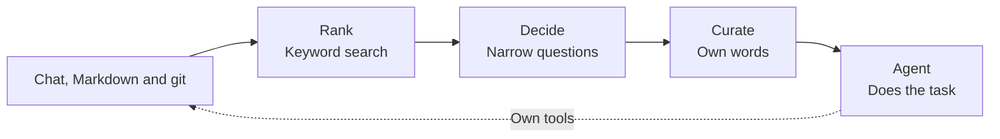

# Curate

Curate finds what your agent needs from past chats, notes and commits.
It picks the evidence for a task and hands it over word for word, with where and when each piece was said.

**95.2% on LongMemEval** (476 of 500 questions), with the agent reading about 3,650 tokens a question (median). Answers and marking by gpt-6.1-sol.
The compact setting scores 94.2%, or 92.8% under LongMemEval's own grader, on about 65 times less context than the raw history.
See [Results](#results).

**You need a paid key.** Curate uses a decision model, TypeSafe's Jev (`jev-latest`), to rate passages from your history. It costs about $0.00002 a passage.
Get a key at [typesafe.ai](https://typesafe.ai) and set `TYPESAFE_API_KEY`.
The library can also use a model on your own machine; the `curate` command can't. See [Run it on your own machine](docs/library.md#run-it-on-your-own-machine).

## Quick start

Use Node.js 22.20 or later.
Tested on macOS and Linux; Windows is untested.

### In a project

Run these in a git repository you already work in.
Curate reads the history that is already there: its commits, its Markdown, and its Claude Code and Codex transcripts.

```sh
cd ~/projects/your-app
npm install -g @curatejs/cli
curate setup
```

`curate setup` checks the [requirements](#requirements) and offers to sort out what it can: the embedding model, a settings file, a private key file and a first index of the project.
It won't sign you in or set your key, so do those yourself:

```sh
claude auth login        # or: codex login
export TYPESAFE_API_KEY='your-typesafe-key'
```

`curate check` tells you when you're ready:

```console
$ curate check
ready    Node.js 22.20 or later: Node.js 22.23.2
ready    The embedding engine (`node-llama-cpp`): `node-llama-cpp` is installed
ready    An embedding model file: ~/.cache/curate/models/embeddinggemma-300M-Q8_0.gguf
ready    The decision key (`TYPESAFE_API_KEY`): set in the environment
ready    A login for the search lines: Claude Haiku, on the Claude login
ready    History to read: 3 sources
All 6 needs met: a call would run.
```

Now ask it something:

```sh
curate "Why do webhook retries stop after three attempts?"
```

You get back the passages that answer it, strongest first, each under a heading with its source and date.

To use it from Claude Code and Codex, install the `/curate` skill:

```sh
npx skills add jonny981/curate -g -a claude-code -a codex -y
```

Commands and settings are under [The `curate` command](#the-curate-command).

### In your own code

Use the library to get the same thing inside your own agent.
This script reads the project's `docs` folder. [Sources](#sources) shows how to add commits and transcripts.

```sh
pnpm add @curatejs/core @curatejs/markdown
```

Save this as `recall.mjs` in the project and run it with `node recall.mjs`:

```js
import { memory } from '@curatejs/core';
import { jev } from '@curatejs/core/models';
import { markdown } from '@curatejs/markdown';

const decide = jev({ apiKey: process.env.TYPESAFE_API_KEY });
const mem = memory({
  sources: [markdown({ paths: ['docs'], kind: 'docs' })],
  decide,
});

const { log } = await mem.recall('What billing constraint must this change preserve?');
console.log(log);
```

If `docs/billing.md` is dated 12 January 2026 and says invoices keep the order's currency, you get:

```text
### Most likely answer

#### markdown:docs:["/home/sam/docs"] (said 2026-01-12)

# Billing
Invoices must preserve the currency recorded when the order was placed.
```

## How it works



1. **[Rank](docs/library.md#rank).** Each reader ranks its own source. No model, no network.
2. **[Decide](docs/library.md#decide).** A decision model answers short yes/no questions about the top-ranked passages. Each one gets a rating, and Curate keeps those above its source's threshold.
3. **[Curate](docs/library.md#curate).** Code, not a model, lays out what was kept: strongest first, word for word, each under its source and date.
4. **Read.** The agent reads this before it starts. It still has its own tools, and each heading points back to the source if it wants more.

### Why it works this way

- **Nothing to do when history is written.** Curate reads transcripts, git and Markdown where they already are, when a task asks. There's no extraction step, no graph to keep in sync, and no database or vector store to host. It builds local index files on first use.
- **Straight from the source.** [Mem0](https://docs.mem0.ai/core-concepts/memory-operations/add) extracts facts with a model, [Mastra](https://mastra.ai/docs/memory/observational-memory) keeps observations a model wrote, and [Zep](https://help.getzep.com/v4/how-graph-creation-works) builds a knowledge graph. Curate picks from the original history every time.
- **A focused task model.** It reads only what was picked for its task, even when the history runs to thousands of passages.
- **Your files stay readable.** Nothing is locked inside Curate. Markdown holds facts and instructions, and a commit body can say why a change was made, what else was considered and what constrained it.
- **Dates tell old from new.** A date lets the reader tell an old decision from the one that replaced it, even when the wording is the same.

## Sources

Mix any of these readers in `sources`.

```js
import { chat } from '@curatejs/chat';
import { git } from '@curatejs/git';
import { knowledgeBase, markdown, rules } from '@curatejs/markdown';

chat();                                                       // Claude Code and Codex transcripts
chat({ paths: ['transcripts'], providers: ['claude-code'] }); // your own transcript folders
git('.');                                                     // this repository's commits
markdown({ paths: ['docs'], kind: 'docs' });                  // any Markdown folder, file or glob
knowledgeBase('docs');                                        // a notes folder, in one argument
rules('.cursor/rules');                                       // a rule library

const mem = memory({ sources: [chat(), git('.'), markdown({ paths: ['docs'], kind: 'docs' })], decide });
```

- **Transcripts (`@curatejs/chat`).** Reads Claude Code and Codex transcripts on your machine. Leave `paths` out to use their default folders, or point it at your own. The [transcript reader](packages/chat/README.md) covers date filters, tool messages and secret scrubbing.
- **Git history (`@curatejs/git`).** Reads commits (not merges): message, date and changed paths. Git has to be on your `PATH`. The [git reader](packages/git/README.md) covers keyword settings and two optional signals, live lines and files that change together.
- **Markdown (`@curatejs/markdown`).** Reads folders, files and globs. Use kind `knowledge` or `docs` for reference material, and `rules` or `instructions` for rules to follow exactly. The [Markdown reader](packages/markdown/README.md) covers dates, rule scopes and revision pins.
- **Rules (`rules()`).** Reads a rule library and keeps only the rules that apply to the task. Always-on files like `CLAUDE.md` and `AGENTS.md` stay with your agent.
- **Knowledge bases (`knowledgeBase()`).** Reads an [Open Knowledge Format](packages/markdown/README.md#open-knowledge-format) bundle: its page dates, titles, root links, index and log.
- **Keeping notes fresh.** [Decay](packages/markdown/README.md#decay) (off by default) ranks older notes lower, and [`reviewNotes()`](packages/markdown/README.md#reviewing-notes) suggests notes to retire and passages to promote.

## Results

LongMemEval S, all 500 questions:

| System | Answering model | Marker | Score | Tokens read (mean) |
| --- | --- | --- | --- | --- |
| **Curate** | **gpt-6.1-sol** | **gpt-6.1-sol** | **95.2** | **3,652 median** |
| **[Curate (compact)](benchmarks/longmemeval/2026-11-11/README.md)** | **gpt-6.1-sol** | **gpt-6.1-sol** | **94.2** | **1,577** |
| [Mastra observational memory](https://mastra.ai/research/observational-memory)\* | gpt-5-mini | GPT-4o | 93.6† | about 30,000 (estimated) |
| **[Curate (compact)](benchmarks/longmemeval/2026-11-11/README.md)** | **gpt-6.1-sol** | **LongMemEval's grader (GPT-4o)** | **92.8** | **1,577** |
| [Mem0 platform](https://github.com/mem0ai/memory-benchmarks/blob/4b61c5d31b9c668a12b4f5e78064248a02c82d2b/results/platform/longmemeval_results.json) | GPT-5 | gpt-6.1-sol | 92.6 | 6,787 |
| [Zep](https://www.getzep.com/research/memory-benchmarks/)\* | gpt-5.4 | gpt-5.4 | 90.2 | 4,408 median |

† Mastra publishes 94.87, the average of its six category scores; 93.6 is the same result counted per question (468 of 500), as every other row is.

LoCoMo, all 1,540 scored questions:

| System | Answering model | Marker | Score | Tokens read (mean) |
| --- | --- | --- | --- | --- |
| **[Curate (full)](benchmarks/locomo/2026-11-12/README.md)** | **gpt-6.1-sol** | **gpt-6.1-sol** | **96.5** | **3,839** |
| [Zep](https://www.getzep.com/research/memory-benchmarks/)\* | gpt-5.4 | gpt-5.4 | 94.7 | 5,760 median |
| [Mem0 platform](https://github.com/mem0ai/memory-benchmarks/blob/edcd6f1d42400837b1fcb6997716f1769dc51a37/results/platform/locomo_results.json) | GPT-5 | GPT-5 | 91.6 | |
| **[Curate (compact)](benchmarks/locomo/2026-11-12/README.md)** | **gpt-4.1-mini** | **gpt-4o-mini** | **91.4** | **1,248** |
| [MemOS, in OmniMemEval](https://github.com/MemTensor/OmniMemEval/blob/7c79d46e31dd85f3da2509b430bba9406656dd28/docs/user_memory/results.md#locomo)\* | gpt-4.1-mini | gpt-4o-mini | 88.83 | 5,400 with prompt |

LoCoMo, a sample of 150 scored questions:

| System | Answering model | Marker | Score | Tokens read (mean) |
| --- | --- | --- | --- | --- |
| **Curate** | **gpt-6.1-sol** | **gpt-6.1-sol** | **95.3** | **5,320 median** |

\* Score as published; these answers were not marked again here.

- **Curate (full):** an answer budget of 6,000 tokens, keeping every sentence (`answerTokens: 6000`, `sentenceCutoff: false`).
- **Curate (compact):** an answer budget of 2,000 tokens and a sentence cutoff of 0.1 (`answerTokens: 2000`, `sentenceCutoff: 0.1`).
- **By default,** Curate sets neither: it lays out every part the decision model keeps.

Context sizes: on [LongMemEval](benchmarks/longmemeval/2026-11-11/README.md#context-sizes), **1,577 task-model tokens** a question on average in the compact setting, the lowest token figure in its table, from histories of about **48 sessions** and **102,580 tokens** on average (o200k, every turn's role and text): about **65 times less**.
On [LoCoMo](benchmarks/locomo/2026-11-12/README.md#context-sizes), **3,839** task-model tokens a question in the full setting and **1,248** in the compact one, from conversations of about **21,155 tokens**.

How each run was set up, and its proof files, are in [benchmarks](benchmarks/README.md).

## Library reference

Everything the library can do is in the [library reference](docs/library.md):

- **[What recall returns](docs/library.md#what-recall-returns):** the result text, the exact rules, the full records, and when `recall()` throws.
- **[Settings for each source](docs/library.md#settings-for-each-source):** the bars, labels, name lanes and question sets each reader uses.
- **[Labels](docs/library.md#labels):** where labels are stored, and the ID each decision model stores them under.
- **[Whole-call options](docs/library.md#whole-call-options):** every option that acts on the whole call, its default, and the section that explains it.
- **[Rank](docs/library.md#rank), [Decide](docs/library.md#decide) and [Curate](docs/library.md#curate):** each step's options, including [the rating stop](docs/library.md#the-rating-stop), the text budget and the sentence cutoff.
- **[Your own source settings](docs/library.md#your-own-source-settings) and [answer types](docs/library.md#answer-types):** your own decision questions for a source.
- **[Time](docs/library.md#time):** the task date, time zones and periods the task names.
- **[Bring your own models](docs/library.md#bring-your-own-models) and [run it on your own machine](docs/library.md#run-it-on-your-own-machine):** OpenAI, local decision servers and local meaning search.
- **[Separate selection and curation](docs/library.md#separate-selection-and-curation):** inspect or change the evidence before the layout.

## The `curate` command

`curate` answers a question from the history of the project you're in.
The [`/curate` skill](skills/curate/SKILL.md) runs it for Claude Code and Codex, and the agent turns the result into a cited summary.

### Commands

| Command | What it does |
| --- | --- |
| `curate "<question>"` | Answers the question from the project you're in. |
| `curate check` | Shows each [requirement](#requirements) as ready or missing, and how to fix it. Free: it calls no model. |
| `curate setup` | Runs the check, then offers to download the embedding model (about 330 MB), create `~/.curate/sources.json` and a private key file, and index the project. It won't sign you in. |
| `curate prepare` | Brings the project's index and embeddings up to date. Free: no model, key or login. It also deletes index files left by older versions of Curate and lists them, so don't run it while an older version is mid-run. |

Exit codes are 0 on success, 3 when a requirement is missing, and 1 for anything else.
The [command's README](packages/cli/README.md) has the detail.

Working in a Curate checkout? After `pnpm install --frozen-lockfile` and `pnpm build`, `node skills/curate/run.mjs` takes the same arguments, with `--check` and `--prepare` instead of `check` and `prepare`.

### Requirements

`curate check` tests these in order and prints the fix for anything missing.
If any are missing, Curate stops before it does any work and lists them all.

1. **Node.js 22.20 or later.** For example, `nvm install 22 && nvm alias default 22`.
2. **The embedding engine, `node-llama-cpp`.** It runs the local model that searches by meaning. `npm install -g @curatejs/cli` installs it. In a Curate checkout, run `pnpm install --frozen-lockfile`.
3. **An embedding model file.** Any embedding model in GGUF form works. `curate setup` offers to download EmbeddingGemma 300M (8-bit, about 330 MB), or fetch it yourself:

   ```sh
   mkdir -p ~/.cache/curate/models && curl -L -o ~/.cache/curate/models/embeddinggemma-300M-Q8_0.gguf https://huggingface.co/ggml-org/embeddinggemma-300M-GGUF/resolve/main/embeddinggemma-300M-Q8_0.gguf
   ```

   Curate looks in `~/.cache/curate/models`, or `$XDG_CACHE_HOME/curate/models` if that's set. To keep the file somewhere else, set `embeddingModel` in `~/.curate/sources.json`. Curate never downloads a model during a question, and it stores vectors per model, so switching models embeds the history again.
4. **A decision key, `TYPESAFE_API_KEY`.** A paid Jev key from [TypeSafe](https://typesafe.ai). Jev rates passages at about $0.00002 each. Set the key in your environment, or put `TYPESAFE_API_KEY=<key>` in a private file and point `envFile` at it in `~/.curate/sources.json`. Never put the key in `curate.json`.
5. **A Claude or ChatGPT login.** One small call on your subscription writes the search lines, the queries Curate searches with. Run `claude auth login` for Claude Haiku or `codex login` for GPT-6 Luna. `searchModel` picks between them.
6. **Some history.** Run inside a git repository, add a `curate.json` in or above the folder, or list sources in `~/.curate/sources.json`.

### What it reads

- **Inside a git repository:** the project's commits, Markdown, Claude Code transcripts and Codex sessions. No settings needed. A repository at your home folder or the filesystem root doesn't count.
- **Sources you list with a `path`:** read whenever you're outside a project. Inside one, a listed source is read only if it sets `"always": true` or its folder overlaps the project. Curate names the ones it skipped on standard error.
- **Sources in `curate.json`:** read for everything under that file, alongside the project's own history.
- **A `claude-code` or `codex` entry with no `path`:** applies its settings to the current project's transcripts, in place of the defaults. Outside a repository it reads nothing, and says so.
- **Related projects:** `related`, for example `[["~/work/app", "~/work/docs"]]`, groups projects. From one of them, Curate also reads the others' Claude Code and Codex transcripts, but not their commits or Markdown.

The full rules are in the [settings reference](skills/curate/references/settings.md).

### Configuration

- **`~/.curate/sources.json`** is for one machine: the embedding model, `envFile`, and sources that live elsewhere. It's optional.
- **`curate.json`** is for a project. Curate uses the nearest one at or above the folder you're in. You can commit it, so keep secrets out of it.
- **If both set the same thing,** `curate.json` wins.
- **`--sources <file>`** uses that one file and ignores the other two.
- **Paths** are absolute or start with `~/`. In `curate.json` they can also be relative to the file.

An example `~/.curate/sources.json`:

```json
{
  "sources": [
    {
      "type": "claude-code",
      "since": "90 days"
    },
    {
      "type": "git",
      "path": "~/projects/example"
    },
    {
      "type": "markdown",
      "path": "~/notes/example"
    }
  ],
  "embeddingModel": "~/models/embeddinggemma-300M-Q8_0.gguf",
  "envFile": "~/.curate/credentials.env"
}
```

| Setting | What it does |
| --- | --- |
| `since` (each source) | How far back to read: an ISO date, or a duration such as `"14 days"` |
| `exclude` (each source) | Paths to skip in that source, relative to its `path` |
| `include` (`git` only) | Only commits that changed one of the paths |
| `always` (each source) | `true` reads the source from inside any project ([What it reads](#what-it-reads)) |
| `related` | Groups of related projects ([What it reads](#what-it-reads)) |
| `embeddingModel` | Where the embedding model file is ([Requirements](#requirements), item 3) |
| `envFile` | A private file that holds `TYPESAFE_API_KEY` (item 4) |
| `searchModel` | `haiku` or `luna`: which model writes the search lines (item 5). By default Curate uses Haiku if you're logged in to Claude, and Luna if not |
| `answerTokens`, `sentenceCutoff` | Optional limits on the size of the result ([Curate](docs/library.md#curate)). Unset by default |
| `stopWhenCold` | Stops rating once the ratings go cold, which keeps a question cheap. On by default, with a `floor` of 0.1 and a `share` of 0.2. Change them with, say, `{ "share": 0.1 }`, or set `false` to rate everything ([The rating stop](docs/library.md#the-rating-stop)). Curate tells you on standard error how many passages it left unread |
| `records` | `true` saves a record of each question ([Files it writes](#files-it-writes)) |

### Search

The command searches by keyword and by meaning.
Two extra search steps the library offers, label admission and the rare-word round, are off.
Identical text is only rated once.

### Files it writes

- **By default, only caches.** They live under `~/.cache/curate`, or `$XDG_CACHE_HOME/curate` if that's set: the index, the embeddings and the label store. Embeddings are reused as long as the model file and the text haven't changed.
- **`curate setup` writes only what you say yes to:** the settings and key files under `~/.curate`, and the embedding model if `embeddingModel` points outside the caches.
- **With `"records": true`,** each question also saves its result, what it read, model usage and timings under `~/.curate/runs/`.

### What leaves your machine

Curate reads your history locally. A question sends text to two services:

- **The decision model, TypeSafe's Jev.** Each request carries your question and, for every passage being rated, its id, date, title and text. An id can include the path of the file it came from. If you set a `sentenceCutoff`, one more request carries the question and the sentences of the result, with dates but no ids or titles.
- **The model that writes the search lines.** One call goes through the `claude` command to Claude Haiku, or through the `codex` command to GPT-6 Luna, on your own login. It gets your question, fixed guidance on wording for each kind of history, and today's date. If the reply can't be read, Curate asks the same model once more. A failed subscription call never falls back to an API.
- **Codex instructions.** Codex also sends your global Codex instructions (`AGENTS.md` in `~/.codex`, or in `CODEX_HOME`) on every system except macOS, and on macOS too when Curate itself runs inside a sandbox.

Likely secrets, such as API keys, are scrubbed from chat text before it's ranked or sent.
Commit messages and Markdown are sent as written.

Curate has no telemetry. The only network request it makes itself is the decision request; the `claude` and `codex` commands make their own. `curate setup` downloads the embedding model from Hugging Face if you say yes.

## Packages

| Package | What it supplies |
| --- | --- |
| [**@curatejs/core**](packages/core/README.md) | Task recall, selection, curation, model helpers and source contracts. No reader. |
| [**@curatejs/chat**](packages/chat/README.md) | Local agent transcripts, secret scrubbing, chat ranking and questions. |
| [**@curatejs/git**](packages/git/README.md) | Git commit history, keyword settings and questions. |
| [**@curatejs/markdown**](packages/markdown/README.md) | Markdown notes and rules, keyword settings and questions. |
| [**@curatejs/cli**](packages/cli/README.md) | The `curate` command, with `curate setup`, that runs the `/curate` skill. |

Install only the readers you use, for example `pnpm add @curatejs/core @curatejs/chat @curatejs/git`. Take `@curatejs/core` alone if you're bringing your own sources.
Each reader depends only on core.
The [changelog](CHANGELOG.md) lists what's in each release.

## Development

```sh
pnpm install --frozen-lockfile
pnpm build
pnpm typecheck
pnpm test
```

Build first: the other packages and the integration tests need core's built output.
Each package also takes `pnpm --filter @curatejs/<name> build`, `test`, `typecheck` and `pack`.

## License

[MIT](LICENSE).
