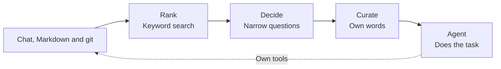

# Curate

A TypeScript library that finds what your agent needs from past chats, notes and commits.
It chooses the evidence a task needs and lays it out in its own words, headed by where and when it was said, for the agent to read before starting work.

95.2% on LongMemEval (476 of 500 questions) with gpt-6.1-sol answering and marking, the agent reading a median of about 3,650 tokens a question.
In the compact setting, 94.2% with gpt-6.1-sol answering and marking, and 92.8% under LongMemEval's own grader, with about 65 times less context than the raw history.
Full tables are in [Results](#results).

**Needs a paid key.** Curate asks a decision model, TypeSafe's Jev, to rate the parts of your history, at about $0.00002 a part.
Get a key at [typesafe.ai](https://typesafe.ai) and set `TYPESAFE_API_KEY`.
The library, though not the `curate` command, can also decide with a model on your own machine: see [Run it on your own machine](docs/library.md#run-it-on-your-own-machine).

## Quick start

Use Node.js 22.20 or later.
Tested on macOS and Linux; Windows is untested.

### The library

```sh
pnpm add @curatejs/core @curatejs/markdown
```

Save this as `recall.mjs`:

```js
import { memory } from '@curatejs/core';
import { jev } from '@curatejs/core/models';
import { markdown } from '@curatejs/markdown';

const decide = jev({ apiKey: process.env.TYPESAFE_API_KEY });
const mem = memory({
  sources: [markdown({ paths: ['docs'], kind: 'docs' })],
  decide,
});

const { log } = await mem.recall('What billing constraint must this change preserve?');
console.log(log);
```

Create a source note:

```sh
mkdir -p docs
cat > docs/billing.md <<'NOTE'
---
date: 2026-01-12
---
# Billing
Invoices must preserve the currency recorded when the order was placed.
NOTE
```

Set the model key and run:

```sh
export TYPESAFE_API_KEY='your-typesafe-key'
node recall.mjs
```

The text heads each part with its source and the date it was said:

```text
### Most likely answer

#### markdown:docs:["/home/sam/docs"] (said 2026-01-12)

# Billing
Invoices must preserve the currency recorded when the order was placed.
```

> [!NOTE]
> At its default address, `jev()` makes paid API calls to TypeSafe's `jev-latest`. A local model server needs no hosted service. To keep every step on your machine, see [Run it on your own machine](docs/library.md#run-it-on-your-own-machine).

### The command

To ask about your projects' history from the terminal, and from Claude Code and Codex through the `/curate` skill:

```sh
npm install -g @curatejs/cli
curate setup
npx skills add jonny981/curate -g -a claude-code -a codex -y
```

`curate setup` lists what is missing and, in a terminal, offers to download the embedding model (about 330 MB), to create the settings file that names a private file for the decision key, and to prepare the project you are in.
A call also needs a Claude or ChatGPT login, which `curate setup` does not make: one small call on that subscription writes the search lines.
Run `claude auth login` or `codex login`.

Then ask from a folder inside a project:

```sh
curate "What did we decide about retries, and why?"
```

Every requirement and setting is in [The `curate` command](#the-curate-command).

## How it works



1. **Rank.** Each reader searches its own source with settings suited to it, with no model or network call.
2. **Decide.** A decision model answers narrow yes/no questions about the ranked parts. Curate keeps the parts that score at least their source's bar.
3. **Curate.** Code lays out the kept parts in their own words, strongest first, each headed by its source and date. No model writes the text.
4. **Read.** The agent reads the text before the task. It keeps its own tools and can follow each heading to its source when it needs more detail.

Always-on files such as `CLAUDE.md` and `AGENTS.md` stay with your agent's harness.
Curate picks the rules a task needs from your rule library.

### Built for memory that keeps growing

- **No work when history is written.** Curate reads transcripts, git history and Markdown where they already live, when a task asks. No extraction step or graph to keep in sync, no database server, hosted vector store or other server to run: local index files, made on first use.
- **Go straight to the source.** [Mem0](https://docs.mem0.ai/core-concepts/memory-operations/add) extracts facts with a model, [Mastra](https://mastra.ai/docs/memory/observational-memory) keeps observations written by a model, and [Zep](https://help.getzep.com/v4/how-graph-creation-works) builds a knowledge graph. Curate selects from the original history for each task.
- **Keep the task model focused.** It reads only the parts chosen for its task, even when the history spans thousands of parts.
- **Plain files stay readable.** The sources remain readable without Curate. Markdown holds facts and instructions, and commit bodies can record why a change was made, the options considered and the constraints behind it.
- **Dates separate old from new.** Dates help the reader tell an old decision from its replacement, even when they share the same words.

## Sources

Combine any of these readers in the `sources` array.

```js
import { chat } from '@curatejs/chat';
import { git } from '@curatejs/git';
import { knowledgeBase, markdown, rules } from '@curatejs/markdown';

chat();                                                       // Claude Code and Codex transcripts
chat({ paths: ['transcripts'], providers: ['claude-code'] }); // your own transcript folders
git('.');                                                     // this repository's commits
markdown({ paths: ['docs'], kind: 'docs' });                  // any Markdown folder, file or glob
knowledgeBase('docs');                                        // a notes folder, in one argument
rules('.cursor/rules');                                       // a rule library

const mem = memory({ sources: [chat(), git('.'), markdown({ paths: ['docs'], kind: 'docs' })], decide });
```

- **Transcripts (`@curatejs/chat`).** Reads local Claude Code and Codex JSONL transcripts. Use `paths` for your own folders, or omit it to use the providers' default folders. See the [transcript reader](packages/chat/README.md) for date filters, tool messages and secret scrubbing.
- **Git history (`@curatejs/git`).** Reads non-merge commits, including their bodies, dates and changed paths. Git must be on `PATH`. See the [git reader](packages/git/README.md) for keyword settings and optional signals from live lines and files that change together.
- **Markdown (`@curatejs/markdown`).** Reads folders, files and globs. Choose `knowledge` or `docs` for reference evidence, and `rules` or `instructions` for exact rules. See the [Markdown reader](packages/markdown/README.md) for dates, rule scopes and revision pins.
- **Rules (`rules()`).** Reads a rule library and keeps only the rules the decision model says apply to the task.
- **Knowledge bases (`knowledgeBase()`).** Reads an [Open Knowledge Format](packages/markdown/README.md#open-knowledge-format) bundle: its page dates, titles, root links, index and log.
- **Note upkeep.** Older notes can rank lower with [decay](packages/markdown/README.md#decay), off by default, and [`reviewNotes()`](packages/markdown/README.md#reviewing-notes) proposes notes to retire or parts to promote.

## Results

On LongMemEval, Curate (compact) reads 1,577 tokens a question on average, and every other token figure in that table is higher.

LongMemEval S, all 500 questions:

| System | Answering model | Marker | Score | Tokens read (mean) |
| --- | --- | --- | --- | --- |
| **Curate** | **gpt-6.1-sol** | **gpt-6.1-sol** | **95.2** | **3,652 median** |
| **[Curate (compact)](benchmarks/longmemeval/2026-11-11/README.md)** | **gpt-6.1-sol** | **gpt-6.1-sol** | **94.2** | **1,577** |
| [Mastra observational memory](https://mastra.ai/research/observational-memory)\* | gpt-5-mini | GPT-4o | 93.6† | about 30,000 (estimated) |
| **[Curate (compact)](benchmarks/longmemeval/2026-11-11/README.md)** | **gpt-6.1-sol** | **LongMemEval's grader (GPT-4o)** | **92.8** | **1,577** |
| [Mem0 platform](https://github.com/mem0ai/memory-benchmarks/blob/4b61c5d31b9c668a12b4f5e78064248a02c82d2b/results/platform/longmemeval_results.json) | GPT-5 | gpt-6.1-sol | 92.6 | 6,787 |
| [Zep](https://www.getzep.com/research/memory-benchmarks/)\* | gpt-5.4 | gpt-5.4 | 90.2 | 4,408 median |

† Mastra publishes 94.87, the average of its six category scores; 93.6 is the same result counted per question (468 of 500), as every other row is.

LoCoMo, all 1,540 scored questions:

| System | Answering model | Marker | Score | Tokens read (mean) |
| --- | --- | --- | --- | --- |
| **[Curate (full)](benchmarks/locomo/2026-11-12/README.md)** | **gpt-6.1-sol** | **gpt-6.1-sol** | **96.5** | **3,839** |
| [Zep](https://www.getzep.com/research/memory-benchmarks/)\* | gpt-5.4 | gpt-5.4 | 94.7 | 5,760 median |
| [Mem0 platform](https://github.com/mem0ai/memory-benchmarks/blob/edcd6f1d42400837b1fcb6997716f1769dc51a37/results/platform/locomo_results.json) | GPT-5 | GPT-5 | 91.6 | |
| **[Curate (compact)](benchmarks/locomo/2026-11-12/README.md)** | **gpt-4.1-mini** | **gpt-4o-mini** | **91.4** | **1,248** |
| [MemOS, in OmniMemEval](https://github.com/MemTensor/OmniMemEval/blob/7c79d46e31dd85f3da2509b430bba9406656dd28/docs/user_memory/results.md#locomo)\* | gpt-4.1-mini | gpt-4o-mini | 88.83 | 5,400 with prompt |

LoCoMo, a sample of 150 scored questions:

| System | Answering model | Marker | Score | Tokens read (mean) |
| --- | --- | --- | --- | --- |
| **Curate** | **gpt-6.1-sol** | **gpt-6.1-sol** | **95.3** | **5,320 median** |

\* Score as published; these answers were not marked again here.

- **Curate (full):** an answer budget of 6,000 tokens, keeping every sentence (`answerTokens: 6000`, `sentenceCutoff: false`).
- **Curate (compact):** an answer budget of 2,000 tokens and a sentence cutoff of 0.1 (`answerTokens: 2000`, `sentenceCutoff: 0.1`).
- **By default,** Curate sets neither: it lays out every part the decision model keeps.

Context sizes: on [LongMemEval](benchmarks/longmemeval/2026-11-11/README.md#context-sizes), **1,577 task-model tokens** a question on average in the compact setting, from histories of about **48 sessions** and **102,580 tokens** on average (o200k, every turn's role and text): about **65 times less**.
On [LoCoMo](benchmarks/locomo/2026-11-12/README.md#context-sizes), **3,839** task-model tokens a question in the full setting and **1,248** in the compact one, from conversations of about **21,155 tokens**.

How each run was set up, and its proof files, are in [benchmarks](benchmarks/README.md).

## Library reference

The [library reference](docs/library.md) covers the library's options:

- **[What recall returns](docs/library.md#what-recall-returns):** the laid-out text, the exact rules and the full records, and when `recall()` throws.
- **[Settings for each source](docs/library.md#settings-for-each-source):** the bars, labels, name lanes and question sets each reader uses.
- **[Whole-call options](docs/library.md#whole-call-options):** how far the decision model reads, budgets and sentence cutoffs.
- **[Rank](docs/library.md#rank), [Decide](docs/library.md#decide) and [Layout](docs/library.md#layout):** each step's options, and what reading less costs and saves.
- **[Your own source settings](docs/library.md#your-own-source-settings) and [answer types](docs/library.md#answer-types):** your own decision questions for a source.
- **[Time](docs/library.md#time):** the task date, time zones and periods the task names.
- **[Bring your own models](docs/library.md#bring-your-own-models) and [run it on your own machine](docs/library.md#run-it-on-your-own-machine):** OpenAI, local decision servers and local meaning search.
- **[Separate selection and curation](docs/library.md#separate-selection-and-curation):** inspect or change the evidence before the layout.

## The `curate` command

The command and the [coding-agent skill](skills/curate/SKILL.md) read the history of the project they run in and print the laid-out parts for a task; the agent turns them into a cited summary.
Install it as in [Quick start](#the-command).
In a Curate checkout built with `pnpm install --frozen-lockfile` and `pnpm build`, `node skills/curate/run.mjs` takes the same arguments, with `--check` and `--prepare` in place of `check` and `prepare`.
The [command's README](packages/cli/README.md) lists every subcommand and exit code.

### Requirements

A call needs each of the following, in this order.
`curate check` lists each one as ready or missing with its fix, makes no model or decision call, and exits 0 only when a call would run.
A call that misses any of them stops before any work, names every one, and exits with code 3.

1. **Node.js 22.20 or later.** Curate's packages support Node.js 22.20 and later. Fix: Install it, for example with `nvm install 22 && nvm alias default 22`.
2. **The embedding engine (`node-llama-cpp`).** It runs the local embedding model that ranks the history by meaning. Fix: Install the command with `npm install -g @curatejs/cli`, which installs `node-llama-cpp` with it. In a Curate checkout, run `pnpm install --frozen-lockfile`.
3. **An embedding model file.** A call downloads none, and any embedding model in GGUF form works. Stored vectors are kept per model, so a different model embeds the history again. Fix: Put EmbeddingGemma 300M in 8-bit GGUF (about 330 MB) at `~/.cache/curate/models/embeddinggemma-300M-Q8_0.gguf`, or under `$XDG_CACHE_HOME/curate/models` when `XDG_CACHE_HOME` is set: `curate setup` offers to download it, or run `mkdir -p ~/.cache/curate/models && curl -L -o ~/.cache/curate/models/embeddinggemma-300M-Q8_0.gguf https://huggingface.co/ggml-org/embeddinggemma-300M-GGUF/resolve/main/embeddinggemma-300M-Q8_0.gguf`. Or name the model file you chose with `embeddingModel` in `~/.curate/sources.json`.
4. **The decision key (`TYPESAFE_API_KEY`).** It is a paid Jev key from TypeSafe. Jev decides which parts of the history answer the question, at about $0.00002 for each part it rates. Fix: Get a key from TypeSafe (https://typesafe.ai), then set `TYPESAFE_API_KEY` in the environment, or put `TYPESAFE_API_KEY=<key>` in a private file and name that file with `envFile` in `~/.curate/sources.json`. Never put the key in `curate.json`.
5. **A login for the search lines.** One small call on a subscription writes the search lines: Claude Haiku on the Claude login, or GPT-6 Luna through Codex on the ChatGPT login. `searchModel` picks one. Fix: Run `claude auth login` to use Claude Haiku, or `codex login` to use GPT-6 Luna.
6. **History to read.** A call searches the git repository it runs in and the sources its settings list. Fix: Run inside a git repository, put a `curate.json` in or above the working folder, or list sources in `~/.curate/sources.json`.

### Which history a call reads

- **Paths:** every path in a settings file must be absolute or start with `~/`. Paths in `curate.json` may also be relative to it.
- **The project:** inside a git repository, a call reads the project's own commits, Markdown, Claude Code transcripts and Codex sessions with no settings entry. A repository at the home folder or the filesystem root does not count.
- **Listed sources inside a project:** a listed source with a path is read only when it sets `"always": true` or its folder overlaps the project. Standard error names the others.
- **Listed sources outside a project:** a call reads every listed source with a path.
- **A chat entry with no `path`:** a `claude-code` or `codex` entry with no `path` reads only the transcripts of the project the call runs in, with that entry's settings, in place of the ones the call reads on its own. Outside a repository it reads nothing and says so on standard error.
- **Related projects:** optional `related`, such as `[["~/work/app", "~/work/docs"]]`, lists groups of related projects. A call in one also reads the others' Claude Code transcripts and Codex sessions, never their commits or Markdown.
- **`curate.json`:** the nearest `curate.json` above the working folder adds sources for every call under it, such as a knowledge base beside a code repository. It holds no secret.
- **The settings file:** without `--sources`, a call reads `~/.curate/sources.json`, and runs without it.

The full rules are in the skill's [settings reference](skills/curate/references/settings.md).

### Settings file

Save `~/.curate/sources.json` with your own paths, or name another file with `--sources`:

```json
{
  "sources": [
    {
      "type": "claude-code",
      "since": "90 days"
    },
    {
      "type": "git",
      "path": "~/projects/example"
    },
    {
      "type": "markdown",
      "path": "~/notes/example"
    }
  ],
  "embeddingModel": "~/models/embeddinggemma-300M-Q8_0.gguf",
  "envFile": "~/.curate/credentials.env"
}
```

| Setting | What it does |
| --- | --- |
| `since` (each source) | An ISO date or a duration such as `"14 days"`, counted back from the task date |
| `exclude` (each source) | Paths that source alone refuses, resolved inside `path` |
| `include` (`git` only) | Only commits that changed one of the paths |
| `always` (each source) | `true` reads the source from every project |
| `related` | Groups of related projects whose chats a call also reads |
| `embeddingModel` | The embedding model file |
| `envFile` | A private file that holds `TYPESAFE_API_KEY` |
| `searchModel` | `haiku` or `luna`: the model that writes the search lines |
| `answerTokens`, `sentenceCutoff` | The layout's budget and sentence cutoff, as in [Layout](docs/library.md#layout) |
| `stopWhenCold` | Where the decision model stops reading; see below |
| `records` | `true` also saves the printed text, source reads, model usage and timings under `~/.curate/runs/` |

- **The stop is on.** Unlike the library, a call stops reading where the ratings go cold, with the library's own levels: a `floor` of 0.1 and a `share` of 0.2, as in [Decide](docs/library.md#decide). `{ "share": 0.1 }` and the like change those numbers. When it stops with ranked parts unread, standard error says how many.
- **Turning it off costs more.** `false` turns the stop off: the decision model then rates every part the search lanes keep, so a call's cost grows with that number: about $0.00002 a part, $0.0033 for a 170-part LoCoMo conversation and $0.053 for the 2,361 parts a DolphinBench test rated on average.
- **Search.** The command combines keyword and meaning lanes, and disables label admission and the rare-word round.
- **Reuse.** Saved embeddings are reused when the model file and input text match. Identical text shares matching decision answers within each pick.
- **Files.** A call keeps no files of its own outside its caches under `~/.cache/curate`. Outside those caches, `curate setup` writes only what it offers and you accept: the settings and key files under `~/.curate`, and the embedding model when `embeddingModel` names a path outside them.
- **No API fallback.** Subscription route failures never fall back to an API.

`curate prepare` brings the stored index and embeddings of the sources a call from the working folder would read up to date, removes the index and vector files an earlier version of Curate kept for them and names each, and exits, with no model call.
It needs no decision key or login.
Run it when no call from an older version of Curate is in flight: it cannot tell whether one still reads those files.

### What leaves your machine

Curate reads your history on your machine. A `curate` call sends text to two services:

- **The decision service, TypeSafe's Jev.** Each decision request holds the question and, for each part it is asked to rate, the part's id, date, title and text. A part's id can hold the path of the file it came from. One more request then holds the question and the sentences of the laid-out text, with each part's date on its first sentence and no id or title.
- **The search-line model.** One call writes the search lines, through the `claude` command to Claude Haiku or through the `codex` command to GPT-6 Luna, on your own login. It receives the question, fixed wording guidance for each kind of history, and today's date. A reply that cannot be read goes back to the same model once, for repair. Codex also sends your global Codex instructions (`AGENTS.md` in `~/.codex`, or in `CODEX_HOME`) on every system other than macOS, and on macOS when Curate itself runs inside a sandbox.

Chat text is scrubbed of likely secrets, such as API keys, before it is ranked or sent.
Commit messages and Markdown are sent as written.

Curate has no telemetry. Its only network request is the decision request; the `claude` and `codex` commands make their own. `curate setup` also downloads the embedding model from Hugging Face, when you answer yes.

## Packages

| Package | What it supplies |
| --- | --- |
| [**@curatejs/core**](packages/core/README.md) | Task recall, selection, curation, model helpers and source contracts. No reader. |
| [**@curatejs/chat**](packages/chat/README.md) | Local agent transcripts, secret scrubbing, chat ranking and questions. |
| [**@curatejs/git**](packages/git/README.md) | Git commit history, keyword settings and questions. |
| [**@curatejs/markdown**](packages/markdown/README.md) | Markdown notes and rules, keyword settings and questions. |
| [**@curatejs/cli**](packages/cli/README.md) | The `curate` command, with `curate setup`, that runs the `/curate` skill. |

Each source package depends only on core and exports its keyword settings, question set and wording guidance for extra searches.
Install only the readers you use, for example `pnpm add @curatejs/core @curatejs/chat @curatejs/git`, or `@curatejs/core` alone to supply your own sources.
See the [changelog](CHANGELOG.md) for what each release contains.

## Development

```sh
pnpm install --frozen-lockfile
pnpm build
pnpm typecheck
pnpm test
```

Build first so dependent packages and integration tests can use core's declarations and package exports.
Each package also supports `pnpm --filter @curatejs/<name> build`, `test`, `typecheck` and `pack`.

## License

[MIT](LICENSE).
