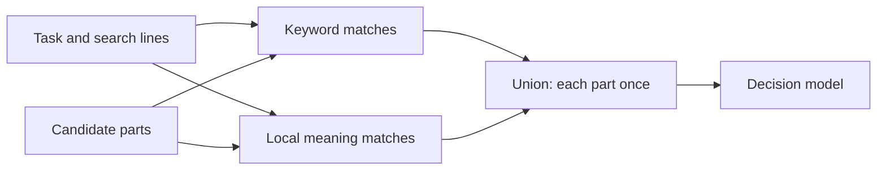

# Library reference

Everything `memory()` can do, option by option.
Start with the [README](../README.md) to install Curate and run a first example.
To call the steps yourself, write your own source or read the full record, see the [core package](../packages/core/README.md).

Options for the whole call go in three places: `read` for searching, `pick` for deciding and `curate` for the layout.

```js
const mem = memory({
  sources,
  decide,
  pick: { limits: { maxBatchChars: 50000 } },
  curate: { answerTokens: 4000 },
});
```

## What recall returns

```js
const { log, rules, picked, result } = await mem.recall('What billing constraint must this change preserve?');
```

| Field | What it holds |
| --- | --- |
| `log` | The kept parts, laid out in their own words ([Curate](#curate)). Empty when nothing was kept. |
| `rules` | The selected rules, word for word, joined with blank lines. Rules never appear in `log`. |
| `picked` | The full selection, a `PickSourcesResult`: every source read and every decision. |
| `result` | The full layout, a `CurateResult`, with its record. |

Each source asks its own questions, so you don't pass any ([Question sets](#question-sets)).
To cancel, pass an `AbortSignal` as `mem.recall(task, { signal })`; it reaches the readers and every `decide` call.
To set the date the question is asked on, see [Time](#time).

`recall()` throws if collection didn't finish: a source that was absent or only partly read, a part with no answer, or decisions a limit left undone.
The error says `Context collection did not finish; inspect the source and decision records.`, and its `cause` holds `picked`, where each unfinished item stays visible.
Parts left out on purpose don't count: those the label gate left out, those past [the rating stop](#the-rating-stop) and those past a `feed` size.

Read errors and model errors reach you as they are. To accept a partial selection, [call the steps yourself](#separate-selection-and-curation).

## Settings for each source

Each source carries its own settings, tuned for that kind of history.
The readers start from these:

| Source | Rare-word round | Labels | Label bar | Name lanes | Keep bar | Rule bar | Questions |
| --- | --- | --- | --- | --- | --- | --- | --- |
| `chat()` | Off | On, the seven kinds | 0.5 | On | 0.0146 | | `AGENT_CHAT_CASCADE` |
| `git()` | On | Off | | On | 0.0146 | | `GIT_HISTORY_CASCADE` |
| `markdown()`, `knowledgeBase()` | On | Off | | On | 0.0146 | | `MARKDOWN_CASCADE` |
| `rules()` | On | Off | | Off | 0.0146 | 0.5, not yet tuned | `MARKDOWN_CASCADE` |

| Setting | What it does |
| --- | --- |
| `rare` | Runs the [rare-word round](#rare-word-round) on this source. |
| `labels` | The [label](#labels) kinds asked of each part: `true` for the seven in `LABEL_KINDS`, a list for your own, `false` for none. |
| `labelBar` | From 0 to 1. A kind the task needs at this bar or more brings in this source's parts labelled at this bar or more. Absent means 0.5. |
| `names` | Searches once more for each person or thing the task names ([Names](#names)). |
| `bar` | The keep bar: keep a reference part rated at or above this. |
| `ruleBar` | Keep a rule rated at or above this. Absent means 0. Only sources whose parts are rules use it: `rules()`, and `markdown()` with kind `rules` or `instructions`. |
| `questions` | The yes/no questions asked of each reference part, with fitted weights that combine the answers into its rating ([Question sets](#question-sets)). Absent means one built-in question for the part's kind. |
| `decay` | Ranks older notes lower by their age at the task date, as `{ halfLife: '365 days' }`. Absent or `false` is off, as in every reader. Markdown only; see the [Markdown reader](../packages/markdown/README.md#decay). |

Name lanes are off for rules because rules are chosen by where they apply, not by search.
A source also carries its reader's own `since`, `paths` and `exclude`; each reader's README covers them.

Each reader exports its settings as one object, so you can spread it and change what you need ([Your own source settings](#your-own-source-settings)):

| Object | Value | Used by |
| --- | --- | --- |
| `chatSettings` (`@curatejs/chat`) | `{ rare: false, labels: true, names: true, bar: 0.0146, questions: CHAT_CASCADE }` | `chat()`, which swaps in `AGENT_CHAT_CASCADE` |
| `gitSettings` (`@curatejs/git`) | `{ rare: true, labels: false, names: true, bar: 0.0146, questions: GIT_HISTORY_CASCADE }` | `git()` |
| `markdownSettings` (`@curatejs/markdown`) | `{ rare: true, labels: false, names: true, bar: 0.0146, questions: MARKDOWN_CASCADE }` | `markdown()`, `knowledgeBase()` |
| `rulesSettings` (`@curatejs/markdown`) | `{ ...markdownSettings, names: false, ruleBar: 0.5 }` | `rules()` |

Sources can still affect each other in three ways.
A selected commit brings in a note it changed ([Linked notes](#linked-notes)).
By default, and under `everyRanked: { c }`, every source's parts are ranked in one list before the decision step reads or cuts it.
And a stopping limit in `pick.limits` is shared by every source, so only `everyRanked: true` with no stopping limit keeps each source's settings to its own pick, apart from linked notes.

The pick record lists the settings each source ran with under `levers.sources`, such as `{ kind: 'chat', labels: true, labelBar: 0.5, rare: false, bar: 0.0146 }`, with `questions` holding the question set its parts were asked.
Its `effects` list says what each setting changed: the parts it brought in or kept out, and why when it changed nothing ([What each setting did](../packages/core/README.md#what-each-setting-did)).

## Labels

Labels help Curate find parts that keyword search missed.
Each part of a source with label kinds is checked once for each kind, such as what someone owns, prefers or decided, and the answers are stored for later questions.
The task is asked which kinds it needs. If a kind scores at least the source's `labelBar`, the source's parts labelled at least `labelBar` on that kind join the label lane, strongest first.

The decision step reads the keyword lanes and the label lane merged by reciprocal-rank fusion.
Under the fused order, the default, the label lane reorders what the decision step reads but adds no part; every part of the order, inside any `feed` size, is labelled before the read starts.
Under `everyRanked`, a part the keyword lanes dropped can reach the decision step through the label lane, because labels are asked of the source's whole uncut search pool.
The label lane isn't capped by `maxCandidates`, but label requests count against `maxBatches` and `maxElapsedMs`, so a stop while labelling leaves the decision step unasked.

`LABEL_KINDS` holds seven kinds: personal facts, things owned or used, purchases or arrivals, events or plans, preferences, habits, and decisions.
Chat asks all seven; git and Markdown ask none.
A source with no kinds gets no label questions, and its other search lanes still apply.
Two sources with the same kinds share the task's answers, but each reads them at its own bar.

Give a source your own kinds through `labels`:

```js
import { historySource } from '@curatejs/core';
import { markdown, markdownSettings } from '@curatejs/markdown';

const labelKinds = [{
  key: 'constraint',
  name: 'a constraint',
  part: {
    true: 'The excerpt states a constraint.',
    false: 'The excerpt states no constraint.',
  },
}];
const source = historySource({ reader: markdown({ paths: ['docs'], kind: 'docs' }), ...markdownSettings, labels: labelKinds });
```

### Where labels are stored

Labels live in `$XDG_CACHE_HOME/curate/labels`, or `~/.cache/curate/labels` when `XDG_CACHE_HOME` is unset.
Choose another folder with `pick.labels: { directory: 'my-labels' }`.
Each part's answers are one JSON file, written to a temporary file and renamed into place, and the task's answers are stored the same way under the task's own keys.

A later pick over the same text reuses the stored answers and asks nothing.
A changed part, decision model ID, kind set or `questionVersion` is labelled again.
A missing, corrupt or wrong-shaped file is a miss, and a refused, missing or failed answer is never stored.
If a write fails, the pick keeps its answers, adds one `warning` to the record's `labels`, and the next pick asks again.

Picks running at the same time in one Node process share label work.
If another pick is already asking for a part's labels, from the same folder, kind set, `questionVersion` and decision model ID, a pick waits for that answer instead of asking again.
If that answer fails, a stop leaves the part unasked, or the asking pick is cancelled mid-request, one waiting pick asks for the part itself and the others wait for it. A wait ends at the waiting pick's own `signal` and `maxElapsedMs`; picks in separate processes don't share.

### Label IDs

Each decision model stores its labels under its own ID, so two models never read each other's answers.

| Decision model | ID |
| --- | --- |
| `jev()` at TypeSafe | `typesafe:${model}:items-once` |
| `jev()` at another address | `jev:<host><path>:<model>:items-once` |
| `openAIDecisions()` | `openai:${model}` |
| `localDecisions()` | `local:<host><path>:<model>` |
| Your own `decide` | Its `deciderId` property, or `'custom'` without one |

`pick.labels.deciderId` overrides any of these.
Give each handwritten decision function its own `deciderId`, or they'll share saved labels.
The IDs built from a server's address leave out its scheme and query, so set `pick.labels.deciderId` yourself for two servers that differ only there.
A decision cache keeps the `deciderId` you give it, so give each server its own.

Labels stored by an older `jev()` are under its earlier ID, `typesafe:${model}`, so `jev()` asks for them once more.
A pick that sets `labels.deciderId`, or a decision cache with its own `deciderId`, keeps its stored entries.

## Whole-call options

Every option below is off or unset unless you set it, except where the default says otherwise.

### Read options

| Option | Default | What it does |
| --- | --- | --- |
| `searchLines` | None | Extra searches you write: keywords, or a short passage that says what the evidence would say ([Rank](#search-lines)) |
| `searchPhrases` | None | Exact phrases to find ([Exact phrases](#exact-phrases)) |
| `kindLanes` | Off | Phrase searches for directions, decisions or corrections, in each source's own wording ([Kinds of statement](#kinds-of-statement)) |
| `speakerOnly` | Off | Kind lanes on chat keep only the person's own messages |
| `meaning` | Off | Meaning search with your embedding function ([Meaning search](#meaning-search)) |
| `wholeLanes` | Off: each search lane is cut | Keep every part each search returns ([Lane cut](#lane-cut)) |
| `stripSearchInstructions` | Off | Drop output instructions such as "cite both" from the search text |
| `limit` | None | The most parts each source read returns ([Search lines](#search-lines)) |
| `maxQuestionText` | The source's own: 700, or whole notes for Markdown | Reader part size in characters; every character is kept across parts. `limits.maxQuestionText` overrides it |
| `exclude` | None | Paths no reader opens: their text never reaches a search or a model |
| `revision` | The working state | Read as of one revision, a SHA or `'HEAD'`. A source that can't honour it answers `absent` |
| `paths` | None | Paths the task names: a ranking hint, never a filter |

### Pick options

| Option | Default | What it does |
| --- | --- | --- |
| `stopWhenCold` | Off: every part of the fused order is rated | Stop rating once the ratings go cold ([The rating stop](#the-rating-stop)) |
| `feed` | Unset: the whole fused order | Change the order the decision step reads, and how far ([Feed](#feed)) |
| `everyRanked` | Unset: the fused order | `true` decides every ranked part; `{ c }` only the top `round(c × N^0.8)` ([Every ranked part](#every-ranked-part)) |
| `everyScored` | Unset: each source's `bar` | One keep bar for every source ([Keep bars](#keep-bars)) |
| `rare` | Unset: each source's `rare` | The [rare-word round](#rare-word-round) on or off for every source |
| `labels` | The default folder and the model's ID | `{ directory, deciderId }` for stored [labels](#where-labels-are-stored) |
| `route` | Off | Ask the task what kind of answer it needs, and switch options on to match ([Routing](#routing)) |
| `answerTypes` | Off | Ask the task what kind of answer it needs, for typed questions ([Answer types](#answer-types)) |
| `writeQuestions` | Off | A model writes two to four questions for each task ([Questions written for each task](#questions-written-for-each-task)) |
| `findNames` | Unset: `taskNames()` | Your own function to find the names in a task ([Names](#names)) |
| `tags`, `tagsByKind` | Off | Label kept parts with intent, importance and emphasis ([Tags](#tags)) |
| `cache` | Off | Store each answered decision for later picks ([Decision cache](#decision-cache)) |
| `keepTop`, `rankProtection`, `bestPartFirst` | Off | Change the order of what's kept, or what's asked first ([Order](#order)) |
| `ranking` | Every weight 1 | Weight ranking signals by Markdown kind ([Question sets](#question-sets)) |
| `taskPeriod` | On | Bring in parts dated inside a period the task names ([Time](#time)) |
| `limits` | 150 questions a request, no other limit | Request sizes and stopping limits ([Limits](#limits)) |
| `thresholds.linkedPathBar` | 0.4 | The rating a note needs to come in through a commit that changed it ([Linked notes](#linked-notes)) |

### Curate options

| Option | Default | What it does |
| --- | --- | --- |
| `answerTokens` | Unset: no budget | Keep the text within this many estimated tokens ([Curate](#curate)) |
| `sentenceCutoff` | Unset: no sentence is rated | Keep only sentences rated this or more ([Curate](#curate)) |

## Rank

Each reader ranks its own source, with no model and no network.
Chat and Markdown use BM25, a score for matching words.
Git uses BM25 over each commit's subject and body, plus age and changed paths.

A source read is a set of lanes: one keyword lane for the task and one for each distinct search line, one lane per exact phrase, and any kind, name or meaning lanes.
Curate keeps the parts the lanes keep, each part once with its best rank.
The read result's `lanes` lists each lane with its search text, its type (`search`, `phrase`, `kind`, `meaning` or `name`), how many parts the source returned for it and how many the lane kept, so you can see which lanes made a large result large.

### Lane cut

Each keyword lane on a reference source stops keeping results where its scores level off, rather than after a fixed number.
`cutLane` orders a lane by the sum of each part's signals, and `cutScoreCurve` finds the bend: the point furthest below the straight line between the lane's best and worst positive scores.
Parts at or below the bend drop out.

Equal scores fall together, two or fewer positive scores always stay, and a lane with no bend keeps every positive score.
The curve reads the lane's own match score (`laneScore`) where a source's signals hold a merged rank, so chat's curve reads its keyword score before the merge, never a rank position.

A search lane where nothing scored keeps nothing, and a read that keeps nothing at all reports `noSearchMatch`, so you see the miss and can ask more broadly.
Exact phrase lanes are never cut, since an exact phrase is its own evidence.
Kind lanes and meaning lanes are cut on their own scores, as their sections say.
Set `read.wholeLanes: true` to keep every part each lane returns.

### Search lines

`read.searchLines` adds a keyword search for each distinct, nonblank line, beside the task.
A line can be keywords or a short passage saying what the evidence would say; Curate never writes them, and keyword searches need no model.
Duplicate lines, and lines that repeat the task, add no read.
Omit `searchLines` or pass `[]` for one search.

```ts
const picked = await pickFromSources(
  sources,
  {
    task,
    searchLines: ['Backup copies are encrypted and tested by restoring them.'],
    searchPhrases: ['restored a', 'tested the backup'],
    stripSearchInstructions: true,
  },
  { task, decide, limits: { maxCandidates: 200 } },
);
```

`read.limit` applies to each keyword read. Chat and Markdown keep their best matches; git takes the latest commits before ranking, so a git limit leaves older commits out of keyword searches.
`limits.maxCandidates` applies to each search's feed on its own, so the union can be larger and an extra search never pushes out the task's own results.
Batch and time limits apply to the whole run.

`read.stripSearchInstructions: true` removes standalone output instructions, such as "cite both" and "answer in one line", from the search text.
It keeps unfamiliar wording and what the search needs, such as counts, dates, comparisons and which fact is newer.
The full task still goes to `decide`; pass the same task to `curate`. The exported `stripSearchInstructions(task)` does the same thing.

### Exact phrases

`read.searchPhrases` finds exact, contiguous words in a part's text or title.
Case and punctuation are ignored, but short words and word order count, and there's no stemming.
"got my" matches "I even got my vinyl signed", but "forgot my" and "got a copy of my" don't.
A phrase can't span the title and the text, and matches are ordered by how often the phrase occurs, then by item id.

Phrase matching runs before the read's `limit`, so a phrase read can cost more local file reading than a keyword read.
A reader that understands phrase reads keeps only the matching parts; for one that doesn't, core filters after the read.
Exclusions, revision pins and cancellation still apply, and a source that stops early stays marked incomplete.
A phrase with no matches adds nothing, and the per-search decision budget applies to each phrase.

### Kinds of statement

`read.kindLanes` searches for the words a kind of message is written in, one phrase list per source kind (`chat`, `git-history`, `markdown`).
Each source reads only its own kind's phrases, and each phrase is a lane of its own.
A phrase only finds a match, not how relevant it is, so each match is scored against the task, and a reader cuts that score curve inside the read when `wholeLanes` is off.
A kind lane is never cut on how often its phrase occurs, so a direction said once survives a phrase everyone repeats; a reader that can't score the task returns every match, and the pick keeps them all.

Each reader exports ready phrase lists: `CHAT_KIND_PHRASES`, `GIT_HISTORY_KIND_PHRASES` and `MARKDOWN_KIND_PHRASES`.
Each maps `directions`, `decisions` and `corrections` to phrases in its source's own wording, such as "we decided" and "settled on" in chat against "chose" and "instead of" in commits.

```js
read: { kindLanes: { chat: CHAT_KIND_PHRASES.directions }, speakerOnly: true }
```

`speakerOnly: true` keeps only the person's own messages (role `user`) in chat kind lanes, for a task that asks what someone said.
Parts with no chat metadata still match.

### Names

With a source's `names` setting on, Curate searches once more for each person or thing the task names, as an exact phrase that ignores case.
The reason is recall: a part the search loses can never be picked, and a name is the most exact search a task offers.
A name lane is never cut on its score curve, but it holds at most the read's `limit`, `maxCandidates` caps it, and a feed cut, `everyRanked: { c }` or the rating stop can leave a match undecided.
A task with no names opens no name lane, a name another phrase lane already searches opens none, and a name gets no meaning lane.

`taskNames(task)` finds the names with code, no model.
It finds quoted titles, hashtags, and runs of capitalised words that don't start a sentence; a run of two or more counts even at the start of one.
Month and day names, "I" and question words are never names; "Dr." and "St." stay inside a name, and a trailing "'s" is dropped.
`taskNames('Who graduated first among Emma, Rachel and Alex?')` returns `['Emma', 'Rachel', 'Alex']`; it also lists capitalised words that name nothing specific, such as "Korean".

`pick.findNames` replaces `taskNames` for one call, for example with a small model: it takes the task and returns the names.
It's called once a pick, and only when a source has `names` on or a question set has `named`.
A function that throws, or returns anything but an array of strings, stops the pick. Curate ships no model for it.

### Meaning search

Pass an embedding function, which turns text into numbers for similarity search, as `read.meaning: { embed }`.
Curate then also searches by meaning for the task and each distinct search line, and the decision step reads the keyword and meaning matches together, each part once.
Keyword ranks are untouched. It's off by default and needs no database; [Run it on your own machine](#run-it-on-your-own-machine) shows the local embedder.



Each meaning query is cut where its similarity scores level off, like a keyword lane.
`read.wholeLanes: true`, or `meaning.wholeLanes: true` for meaning lanes only, keeps every rank; `meaning.nearest`, a positive whole number, caps the ranks each query keeps for each source either way.
`limits.maxCandidates` still applies to each query's feed.
Meaning ranks change the combined order, so batch or time limits can leave keyword matches unasked.

A reader that supports it scores similarity inside the read and returns only the parts it keeps, so the history's text is never held in memory.
For a reader that doesn't, the pick makes one more read with no limit and scores the whole pool itself.
Exclusions and revision pins apply either way, and a partial read stays marked partial.
A local model failure stops the search before any decision, cancellation is checked between batches and model windows, and there's no fallback to an API.

## Decide

By default, Curate merges the search results from every source into one ranked list, the fused order, and the decision model rates every part of it.
Each part's place is the best of its keyword-lane places (a keyword lane being one search across every source) and its place in the history's own best-similarity ranking.
Curate keeps the parts whose rating reaches their source's keep bar (0.0146 for every reader), strongest first, with the ranked order breaking ties.
Rules are rated separately, against whether they apply.

Parts with the same text share their answers within a pick, including copies in one request. A part with no text shares on its title instead, so two title-only commits with different subjects get their own answers.
Each copy keeps its source, and that source's question weights and keep bar.

### Keep bars

A source's `bar` sets its keep bar, and `pick.everyScored` sets one for every source in their place.
`everyScored: true` keeps every part with a valid rating, including zero, and `everyScored: { bar: 0.05 }` keeps those at 0.05 or more:

```ts
const picked = await pick(candidates, {
  task, decide, everyScored: { bar: 0.05 },
});
```

`everyScored: { bySize }` takes a curve of `[decided count, bar]` points instead of one bar.
The count is how many reference parts got an answer, so a small set can keep everything while a large one cuts more of the weakest.
Below the first point the first bar applies, above the last point the last bar applies, and between two points the bar moves in a straight line.

Points must be unique whole numbers of 0 or more, with bars from 0 to 1.
Set them against the history you'll read, and measure what each point keeps before you rely on it.
The record keeps the sorted points, and the bar used as `thresholds.appliedReference`.

Rules are kept at any rating by default.
A source's `ruleBar` sets a cut for its rules, and `rules()` sets 0.5.
A rule a host builds with `applies: 'always'` skips the check.

### Linked notes

A commit's `changedPaths` names the paths it changed, which `git()` fills from the diff, never from paths its text mentions.
A note rated below its keep bar but at or above `linkedPathBar` (0.4) is still kept when a selected commit from the same `repository` changed its `path`.
Its record entry names that commit in `link`, and a linked note never brings in another.
0.4 is a chosen default, not a measured best; set `pick.thresholds.linkedPathBar` to change it.

### Feed

`pick.feed` changes the order the decision step reads, and how far.

`feed: { order: 'combsum' }` orders the list by the sum of each part's lane places, where the default takes its best place.
That favours a part several lanes agree on over a part one lane placed high.
A keyword lane's place is the part's share of that lane across every source, a meaning lane's place is its share among its own source's members, and a name lane adds nothing. Equal sums keep the list's order.

`size` is the most reference parts the decision step reads; without it, it reads the whole order.
A part past the size is never rated and records `unassessed` with reason `'feed'`, so a shorter feed can miss a part the default would have kept.
A rating stop still works inside the size, and the rare-word round asks the parts it pulls only while the size has room. Rules are never cut.

```js
const picked = await pick(candidates, {
  task, decide, feed: { order: 'combsum', size: 400 },
});
picked.record.pick?.feed; // { order: 'combsum', size: 400, unjudged: 2600 } when 3,000 parts were ranked
```

### Every ranked part

`pick.everyRanked: true` decides every ranked part instead of the fused order.
`everyRanked: { c }` decides only the top `round(c × N^0.8)` reference parts, where N is the history's size in reference parts, not the ranking's, so the decision step's work grows more slowly than the history.
Rules pass through uncounted and uncut, and a part below the count records `unassessed` with reason `'pick'`.

`recall()` throws for those parts, so use `{ c }` with [the steps called yourself](#separate-selection-and-curation).
It's a dial, never the default, because no fixed count is safe everywhere ([measured](measurements.md#scaled-top-k)).

The ranking is the label lane fused into the keyword order when labels ran, and the keyword order otherwise.
Lane cuts and read limits don't shrink N, but a pool member that no lane kept reaches the decision step only through labels or the rare-word round.
`c` must be a positive finite number. `everyRanked` with `stopWhenCold` or `feed` throws a `TypeError` before any request.

### The rating stop

`pick.stopWhenCold` sets where the decision model stops reading the fused order.
It's off by default, so the decision model rates every part, at about $0.00002 a part, and a question's cost grows with the parts the search lanes keep: $0.0033 for a 170-part LoCoMo conversation and $0.053 for the 2,361 parts a DolphinBench test rated on average.
The `curate` command turns it on at the default levels.

1. `pick.stopWhenCold: {}` reads the order two batches at a time, in the request-sized batches `limits` forms.
2. When both replies land, it checks the two batches in order.
3. It stops at the first batch whose best rating is under `floor` (0.1), or under `share` (0.2) times the best rating of every batch before it.
4. It never stops before the read has kept a part at its keep bar and rated one at or above `floor`.

So a question the history holds nothing for, and a history whose every part rates under `floor`, reads the whole order, at the cost of the stop being off.
The rating is the part's full score after all its questions. A part that repeats an earlier part's text takes that answer and doesn't count toward its batch's best, and a rule kept at its own bar doesn't count as a kept part.

The other batch of a pair that went cold is rated and kept as usual, so the read passes the cold batch by at most one batch.
The stop never drops a part it rated: every rated part at or above its keep bar is kept.

`{ floor, share }` changes the two numbers for one call.
A higher `share` stops sooner and costs less; a lower one reads further and finds more.
A higher `floor` can make a read longer, since it goes on until some part rates at or above it: on 20 parts, two a batch, the first rating 0.2 and the rest 0.05, a floor of 0.1 rates 4 parts and stops, and a floor of 0.3 rates all 20.
The stop only applies when `everyRanked` is unset.

A part past the stop is never rated and records `unassessed` with reason `'stopWhenCold'`, though the rare-word round can still pull it in.
A part no lane placed in the order records `'feed'`.
The record says what the stop read and what ended it ([The rating stop's record](../packages/core/README.md#the-rating-stops-record)), and the [measurements](measurements.md#the-rating-stop) show what it saves and costs.

### Rare-word round

A second, narrow round after selection, run inside each source on its own.
Git and Markdown turn it on through their `rare` setting; chat leaves it off.
`pick.rare: true` runs it on every source, `pick.rare: false` turns it off everywhere, and `pick.rare: { share, bar }` runs it everywhere with your numbers.
To turn it off for one source, build that source with `rare: false`.

1. The source's parts that cleared its keep bar give the seed words.
2. A seed word is rare when it appears in at most `share × N` of the source's reference parts, N counting the parts the search lanes left out too. `share` defaults to `5/850`, a count of 5 fitted on an 850-part LongMemEval history.
3. Every unselected reference part of the source that shares a rare word is pulled in. One that was never rated goes to the decision step; one already rated keeps its rating.
4. A pulled part joins the selection at or above `bar`, which defaults to 0.0146. The seeds keep their source's own bar.

Each source's round reads only that source, so one source's setting never changes another's pick.
This N can differ from `pick.n`, which counts reference parts across every source.
On a source with fewer than 340 reference parts, the default share can pull nothing: a shared word appears in at least 2 parts, and `5/850 × N` stays below 2.

With the rating stop on, the round reads the parts it asks in fused order, two batches at a time, under a stop with a best rating of its own, so a round whose answers go cold ends.
No part is asked twice, the round only adds reference parts, and `share` must be a positive finite number and `bar` from 0 to 1, both checked before any request.

### Tags

`pick.tags` asks extra yes/no questions of each kept reference part, after selection, so a later step can read intent, importance and emphasis without asking the decision model again.
The answers never change what's kept, and rules are never tagged.

```js
import { DECISION_TAGS } from '@curatejs/core';
import { GIT_HISTORY_TAGS } from '@curatejs/git';
import { MARKDOWN_TAGS } from '@curatejs/markdown';

const picked = await pickFromSources(sources, request, {
  task, decide,
  tags: DECISION_TAGS,
  tagsByKind: { 'git-history': GIT_HISTORY_TAGS, markdown: MARKDOWN_TAGS },
});
```

| Tag sets | What they add |
| --- | --- |
| `DECISION_TAGS` | Intent (instruction, decision, correction, idea, question, fact, chat), importance (passing, relevant, important, critical), emphasis (neutral, emphatic, approving) and a yes/no "corrects something earlier" |
| `GIT_HISTORY_TAGS` | Fix, feature and revert, for commits |
| `MARKDOWN_TAGS` | Decision record, rule and how-to, for notes |

`tagsByKind` adds sets for the reference parts of one source kind.
A set's `value` is the first of its questions, in list order, answered at 0.5 or more, so earlier keys win; with none at 0.5 it stays unset.
A one-question set's value is `yes` at 0.5 or more, `no` otherwise, and a set whose answers all failed records them with no value.
Every answer is on the part's record entry under `tags` with its status (`answered`, `missing`, `refused` or `error`), and tag set keys must be unique for each part.

Tag questions run under the same stops and limits as the decision questions.
A question a stop left unasked records `unassessed` with the stop's reason, so you can see which tags are partial.
A failed tag request leaves the selection standing and records the error on the tag answers.

### Order

Kept reference parts are ordered by rating, strongest first, with no fixed size cap.
Three options change that order; all three are off by default ([measured](measurements.md#defaults-and-evidence)).

| Option | What it does |
| --- | --- |
| `keepTop: N` | Moves the first N ranked keyword hits that pass their bar to the front. Rejected parts stay rejected. N must be a whole number of 0 or more |
| `rankProtection: true` | Orders kept parts by `w / rank + (1 - w) * probability`, where rank is the part's best one-based rank in its source, probability is its rating, and `w` is 0.75 at ranks 1–3, 0.60 at 4–10 and 0.40 below. Rules stay first and `keepTop` still applies. Only the order changes: the record stores `orderScore` on its own, and the layout still gets the original ratings |
| `bestPartFirst: true` | Asks first about the part of each document with the most distinct task words (words of three characters or more; ties keep feed order), then about its other parts. A low first rating never skips the rest, and each part is kept on its own rating. Chat parts group by provider and session, notes by file, and commits stay separate; source and revision are part of every group, and you can set `candidate.documentId` for your own parts. Rules are asked on their own, limits still apply, and each part records its `representative` |

### Routing

`pick.route: 'jev'` asks the task the four questions in `ROUTE_QUESTIONS`, once a pick.
They ask whether the task needs a count or a complete list across sessions; a date, a duration or an order; the user's stated tastes; or the latest value of something.
They go in the same request as the task's label questions when labels run, and in one request of their own otherwise, always as one request whatever the request-size limits allow.

An answer at 0.5 (`LABEL_LANE_BAR`) or more switches options on: `taste` turns on `preferenceAdvice` and `preferenceChange`, and `count`, `date` and `latest` turn on `working`.
The record's `route` keeps the answers and the options they switched on.

### Decision cache

`pick.cache: { store, deciderId }` stores each answered decision so a later pick can reuse it.
`decisionFileStore(directory)` is the built-in store, one JSON file per answer written to a temporary file and renamed into place; any store with asynchronous `get(key)` and `set(key, value)` works.
`deciderId` is required, so two decision models never read each other's answers.
Pass `cache: false` to skip a configured cache for one pick, for example a held-out benchmark run.

An answer is keyed on its part and its exact question, not the request around it: the task, the question set's version, the question's wording, criteria and fitted name, the `deciderId`, the text cut, and every field of the part the model sees.
So a later pick that adds or changes one part asks only that part, which helps resumed runs and repeated questions. That rests on one assumption: a part's answer barely depends on the parts sent beside it.

Bars and links apply to cached answers like fresh ones, so a changed bar reselects without asking.
A missing or corrupt entry is a miss, a refused, missing, failed or unasked answer is never stored, and a stop leaves every question not yet resolved unassessed.

A reused answer marks its record entry `reused`, and an answer the model had to cut is stored with its `truncated` flag.
The record's `cache` keeps the version, the `deciderId`, how many decision and tag questions were asked and reused, and `failedWrites`.
A failed write keeps the answers for this pick, adds one `warning` to `cache`, and the next pick asks again.
Label questions use the same model but are counted on `labels` instead.

### Limits

`pick.limits` sets request sizes and stopping limits.
Request sizes only change how many requests go out; nothing is dropped.
If a stopping limit leaves parts unrated, `recall()` throws; to accept that, [call the steps yourself](#separate-selection-and-curation).

| Limit | Default | What it does |
| --- | --- | --- |
| `maxPerBatch` | 150 questions | The most questions in one request. Every request still runs |
| `maxBatchChars` | Off | Sizes each request by characters: as many whole parts as fit in N, counting the task, each part's id, title, date and text once, and each question's wording and criteria. A larger part goes alone; nothing is cut. With `maxPerBatch` set too, a request closes at whichever it reaches first |
| `maxInFlight` | Off: every request of a round goes out together | The most requests of one round open at once; the rest go out in order as replies land |
| `maxCandidates` | Off | Stops each search lane at N parts ([measured](measurements.md#evidence-limits)) |
| `maxBatches` | Off | Stops after N requests. With 151 one-question parts and one 150-question request, one part stays unrated. A question set can take several requests a part |
| `maxElapsedMs` | Off | Stops asking at this many milliseconds. What it loses depends on response time |
| `maxQuestionText` | Off | Cuts each part sent to the model to N characters and records `truncated`: at 700, a 1,000-character part hides 300. Readers can split parts instead; a direct `pick()` caller chooses its own cut |

The reader part size is 700 characters by default (`DEFAULT_MAX_QUESTION_TEXT`), and every character is kept across parts: it's a part size, not a cut.
A source read's `limit` keeps ranked parts for chat and Markdown and the newest commits for git, and readers report partial coverage.
Removing a limit can mean more requests and more model context, and reader failures, cancellation and missing answers still need handling.

## Curate

`curate()` lays out the kept reference parts in their own words. No model writes the text.

- **Strongest first.** The two parts with the highest rating sit under `### Most likely answer`, each under its own `#### <source> (said <date>)` heading; equal ratings keep the fused order.
- **Then by date.** Every other part is grouped by the date it was said and its source, under `### <source> (said <date>)`, oldest group first and strongest first inside a group.
- **Dates.** The date is the first `YYYY-MM-DD` or `YYYY/MM/DD` in the part's date, so date labels, ISO dates and timestamps all read the same. A part with no date sits under `(said unknown)`, last, and a date that's only a file's last change reads `(file changed <date>)`.
- **Headings.** A heading names the part's file when it has one and its source otherwise, so two files of one source stay apart. A commit with no body shows its title.

```text
### Most likely answer

#### docs/billing.md (said 2026-01-12)

Invoices must preserve the currency recorded when the order was placed.

#### git:/home/sam/shop (said 2026-01-14)

Keep the order currency on refunds.


### chat:claude-code:/home/sam/chat (said 2026-01-10)

user: Should refunds use today's rate?
```

A part whose trimmed text is the same as a stronger kept part's is left out, and the next part gets its room.
The kept part's heading then names where and when the copy was said, if that differs: `<heading>, also <source> (said <date>)`.
A text that only sits inside a longer part stays, since it may be a quote, a rejected plan or a later restatement. `record.collapsed` counts the copies.

### Budget

There's no budget by default: every kept part is laid out, and the record's `estimatedTokens` gives the text's size.
`curate.answerTokens` keeps the text within that many estimated tokens. Parts go in by rating, and the first part that would go over stops the rest, but the strongest part is always kept whole, even over the budget.

The estimate needs no tokenizer: it counts words, digits in threes, runs of one punctuation mark, line ends and characters outside ASCII, fitted to a real tokenizer and set about a tenth high.
It's a guide, not a ceiling: text full of rare names, such as products or medicines, can cost more real tokens than it counts. The record's `leftOut` counts the parts the budget stopped before.

### Sentence cutoff

Off by default, and then no sentence is rated and no model is called, even with `decide`.
Set `curate.sentenceCutoff` to a number from 0 to 1 and Curate rates every sentence of the taken parts with `decide` in one more request, keeping those rated that number or more.
Each sentence is asked "Does this sentence supply evidence, a constraint or a decision for this task?" with no id or title, and the part's date on its first sentence.
A sentence runs to a full stop, question mark or exclamation mark followed by a space, or to the line's end; blank lines go.

Kept sentences stay in their own words and order under the same headings, and `…` marks where text was left out.
A line that opens `user: ` or `assistant: ` names its speaker, and the first kept sentence of that turn carries the name.
A part with no sentence kept is left out, the strongest included, so the text can be empty. A sentence `decide` gives no rating stays, and a kept sentence can lose the one that says what it refers to.

If the request fails, the whole text comes back as if no sentence were rated and the record says why; a cancelled request throws. An `answerTokens` budget limits the text that's rated, not the text returned, which is usually far smaller.

A pick that kept no part gives an empty text, and the record's `nothingKept` says so.
The [layout record](../packages/core/README.md#the-layout-record) lists everything `curate()` reports, and the errors it throws.

## Your own source settings

Build a source with any settings through `historySource()`.
`reader` is any source, a reader's or your own, and `rare`, `labels`, `names` and `bar` are required, so spread a reader's settings object and change what you need:

```js
import { historySource } from '@curatejs/core';
import { chat, chatSettings, AGENT_CHAT_CASCADE } from '@curatejs/chat';

const source = historySource({ reader: chat({ paths: ['transcripts'] }), ...chatSettings, labels: false, questions: AGENT_CHAT_CASCADE });
```

This turns labels off for one chat source, as the DolphinBench run did.
`gitSettings`, `markdownSettings` and `rulesSettings` hold the other readers' settings ([Settings for each source](#settings-for-each-source)).
To write a reader of your own, see [Write your own source](../packages/core/README.md#write-your-own-source).

### Question sets

A source's `questions` is a question set (a `PickCascade`): a `bias` and a list of `questions`, each with a `key`, `instructions`, a `true` and a `false` criterion, and a fitted `weight`.
Curate combines the answers through those weights into the part's rating.
`historySource()` checks the set when it builds the source, and the record keeps it under `levers.sources[sourceId].questions`, with each answer on the part's entry.

```js
import { git, gitSettings } from '@curatejs/git';

const mySet = {
  bias: 0,
  questions: [{
    key: 'decision',
    instructions: 'Does this commit record a decision the task depends on?',
    true: 'It records a decision the task depends on.',
    false: 'It records no decision the task depends on.',
    weight: 1,
  }],
};
const commits = historySource({ reader: git('.'), ...gitSettings, questions: mySet });
```

Each source asks its own set, so two sources of the same kind can ask different ones:

```ts
import { historySource, pickFromSources } from '@curatejs/core';
import { chat } from '@curatejs/chat';
import { git, gitSettings } from '@curatejs/git';
import { knowledgeBase } from '@curatejs/markdown';

const picked = await pickFromSources(
  [chat({ paths: ['transcripts'] }), historySource({ reader: git('.'), ...gitSettings, questions: mySet }), knowledgeBase('docs')],
  { task },
  { task, decide },
);
```

A set can ask one question first: `first` names it, and outside `band: [low, high]` its answer alone gives the rating, through `firstOnly: { bias, weight }`; inside the band, every question counts.
A missing answer adds nothing to the sum, and a part with every answer missing stays unanswered. If a limit stops a part's questions before they're asked, it stays unassessed.
Ratings order evidence; they don't measure the chance of a right final answer.

| Set | From | What it asks |
| --- | --- | --- |
| `CHAT_CASCADE` | `@curatejs/chat` | Relevance first, then whether the part is about the person's own situation (`own`), and whether it's needed. For your own personal histories |
| `AGENT_CHAT_CASCADE` | `@curatejs/chat` | `CHAT_CASCADE` without `own`. What `chat()` uses |
| `PERSONAL_CHAT_CASCADE` | `@curatejs/chat` | For histories of a person's own life |
| `GIT_HISTORY_CASCADE` | `@curatejs/git` | Four questions: `current` (relevance), `needed`, `when` (timing) and `offtopic`, whose negative weight lowers a part about something else. Never `own` or `preference` |
| `MARKDOWN_CASCADE` | `@curatejs/markdown` | The same four questions, for notes |

A source with no set asks one built-in question, chosen by the part's kind.
Markdown parts carry a kind (`knowledge`, `docs`, `rules` or `instructions`) from `markdown({ paths, kind })`, separate from the source's `questions`.
A rule keeps its own question, about whether it applies, and an instruction its own; both keep their kind in the questions and the record.
`pick.ranking: { docs: { bm25: 2 } }` weights ranking signals by Markdown kind when parts have no search ranks; unnamed weights are 1, weights must be finite and may be negative, and the record keeps them.

### Questions written for each task

`pick.writeQuestions` has a model write two to four yes/no questions about the task, once a pick, before any decision request.
Curate keys them `task1` to `task4` and asks them of the reference parts of every source whose set has `written` weights.
`taskQuestionWriter(write)` builds the option from a `write` function (a `CurateWrite`) that gets `{ instructions, body }` and a signal and returns the model's reply text. It sends `TASK_QUESTION_PROMPT` as the instructions, with the task in the body, and reads the JSON array in the reply.

A set's `written: { highest, second }` adds `highest × logit(best written answer) + second × logit(second-best written answer)` to a part's score.
Each answer is clamped to 0.0001 to 0.9999 first, and a missing one adds nothing.
In a set with `first` and `band`, written questions are asked only when the other questions are, and a part outside the band keeps its `firstOnly` score.
`PERSONAL_CHAT_WRITTEN_CASCADE` is fitted with written questions.

```js
import { historySource, memory, taskQuestionWriter } from '@curatejs/core';
import { jev } from '@curatejs/core/models';
import { chat, chatSettings, PERSONAL_CHAT_WRITTEN_CASCADE } from '@curatejs/chat';

const decide = jev({ apiKey: process.env.TYPESAFE_API_KEY });
// Any model call: it gets { instructions, body } and returns the reply text.
const write = async ({ instructions, body }, signal) => askYourModel(instructions, body, signal);

const mem = memory({
  sources: [historySource({ reader: chat(), ...chatSettings, questions: PERSONAL_CHAT_WRITTEN_CASCADE })],
  decide,
  pick: { writeQuestions: taskQuestionWriter(write) },
});
```

Each mistake throws before any decision request.
`writeQuestions` with no set that has `written` throws a `TypeError`.
A set with `written` and no `writeQuestions` throws a `TypeError` naming the source, because its weights were fitted with the written terms and its score would be wrong without them.

A writer that throws, or returns anything but 2 to 4 questions each with nonempty `instructions`, `true` and `false`, stops the pick with the reason. A set with `written` can't use the keys `task1` to `task4` itself.

### A question about each name

A set's `named: { question, highest, hasNames }` asks its `question` once for each name in the task, with `{name}` replaced by the name, in the same request as the set's other questions.
Each answer's key is the question's key followed by the name's place in the list from 1, such as `name1`, so a set's own keys can't take that form.
It adds `highest × logit(highest answer across the names) + hasNames` to a part's score, with each answer clamped to 0.0001 to 0.9999; with every name answer missing, only `hasNames` is added.
A task with no names asks it of no part and adds neither term, and in a set with `first` and `band` it's asked only of parts whose first answer is inside the band.

The names come from [`taskNames()`, or `findNames` when you give one](#names).
A name answer is a weighted term, never a rule: other parts of the same history mention the same name and score just as high, so a rule that raised a part to its name answer ranked the answer parts worse in tuning.
`PERSONAL_CHAT_WRITTEN_CASCADE` carries `named`, asking "Does this part mention {name}?", with `highest` 0.1655479793453193 and `hasNames` -0.1646894012324575, fitted with the rest of that set.
No other shipped set carries `named`, because no weight was fitted for one.

## Answer types

The decision model can tell from the task's words alone what kind of answer it needs: a date, a number, a name, the order of events and so on.
`pick.answerTypes: true` asks the task the ten questions in `ANSWER_TYPES`, in one request a pick; they share the request that asks the task its label or route questions when either runs.
A type answered at 0.5 or more is needed, and `answerTypes: { bar }` sets another bar. It's off by default.

| Key | Question | True when | False when |
| --- | --- | --- | --- |
| `date` | Is the answer a point in time? | The answer names when something happened or will happen: a calendar date, a day of the week, a month, a year or a time of day. | The answer is not a point in time. |
| `duration` | Is the answer a length of time? | The answer is how long something lasted or took, or how much time passed between two events or since an event (days, weeks, months, years). | The answer is not a length of time. |
| `order` | Does the answer depend on the order of two or more events? | The question asks which happened first, last, before or after, or asks for events in sequence. | The question does not ask about the order of events. |
| `number` | Is the answer a number? | The answer is a number: a quantity, a count, an amount of money, a measurement, an age, a score or a percentage. | The answer is not a number. |
| `entity` | Is the answer a specific named thing? | The answer is a particular person, place, product, brand, organisation, pet, or title of a book, film, show or song. | The answer is not a particular named person, place, product or title. |
| `yesno` | Can the question be answered with yes or no? | The question asks whether something is true, happened or holds, so a yes or a no answers it. | A yes or a no does not answer the question. |
| `list` | Does the answer need every instance of something gathered? | The answer is a count of items or events, or a complete list of them, so every instance must be found. | The answer does not need instances counted or listed. |
| `advice` | Does the question ask for a recommendation, a suggestion or an opinion? | The user asks what they should do, choose, try or think, rather than asking for a fact from their past. | The user asks for a fact, not for a recommendation or an opinion. |
| `preference` | Does the answer depend on the user's own preferences? | The user's stated likes, dislikes, tastes, wants or limits shape what a good answer is. | The user's preferences do not shape the answer. |
| `latest` | Does the question ask for the current or most recent value of something that can change? | The answer is the most recent value or state of something that may have changed over time; an earlier value would be out of date. | The question does not ask for a current or latest value. |

The true and false columns are each entry's `trueCriterion` and `falseCriterion`, and `AnswerType` is the type of the keys.

A question set can carry `typed` questions beside its `questions`, each with an `answerType` and a fitted `weight`.
A typed question is asked of the source's reference parts only when the task needs its type, in the same request as the set's other questions; in a set with `first` and `band`, only when the others are.
Its answer adds `weight × logit(p)` to the part's score like the others, and an unasked one adds nothing. Keys must be unique across `questions` and `typed`.

```js
import { historySource, memory } from '@curatejs/core';
import { git, gitSettings, GIT_HISTORY_CASCADE } from '@curatejs/git';

const DATED = {
  ...GIT_HISTORY_CASCADE,
  typed: [{
    answerType: 'date',
    key: 'when-decided',
    instructions: 'Does this commit say when this was decided?',
    true: 'It gives the date or time of the decision',
    false: 'It gives no date for the decision',
    weight: 1,
  }],
};
const commits = historySource({ reader: git('.'), ...gitSettings, questions: DATED });
const mem = memory({ sources: [commits], decide, pick: { answerTypes: true } });
```

No preset carries a typed question.
Sources with typed questions while `pick.answerTypes` is off throw a `TypeError` naming the source before any read, so a typed question never sits unasked.

### Keeping a part on one typed answer

A typed question can carry `keepAt`, a number from 0 to 1.
When it's asked and answered at or above `keepAt`, the part is kept even below its source's bar, and its record entry has `keptBy`, the question's key.

`COUNT_MARKER` is a typed question for tasks that count or list.
It asks whether the part reports at least one actual instance of the thing the task counts; a total, a question, a suggestion, a hypothetical, or the assistant repeating something doesn't count.
Its answer type is `list`, its `weight` is 0 and its `keepAt` is 0.5, so it never moves a score: it only keeps a part answered 0.5 or more. No preset carries it.

```js
import { COUNT_MARKER, historySource, memory } from '@curatejs/core';
import { jev } from '@curatejs/core/models';
import { chat, chatSettings, AGENT_CHAT_CASCADE } from '@curatejs/chat';

const decide = jev({ apiKey: process.env.TYPESAFE_API_KEY });

const mem = memory({
  sources: [historySource({ reader: chat(), ...chatSettings, questions: { ...AGENT_CHAT_CASCADE, typed: [COUNT_MARKER] } })],
  decide,
  pick: { answerTypes: true },
});
```

## Time

Every read measures from one moment: the task date.
Give it with each call, with the person's time zone:

```js
const { log } = await mem.recall('What did I decide in March?', { taskDate: '2025-06-02', timeZone: 'Europe/London' });
```

| Option | Default | What it does |
| --- | --- | --- |
| `taskDate` | Now | An ISO 8601 date or date-time, such as `2025-06-02` or `2025-06-02T09:15:00+01:00`. A date alone means the end of that day, and a time with no offset is a time in `timeZone`. Anything else throws a `TypeError` before any read |
| `timeZone` | The system's zone | The person's IANA time zone, such as `Europe/London`. A name the runtime doesn't know throws a `TypeError` |

Git recency and every reader's `since` count back from the task date.
With `taskDate` given, a chat message or a git commit dated after it isn't read; without it, nothing is left out for its date.
Markdown keeps notes dated after it, since a note can declare an `effective` date ahead and a rule that takes effect next month is still a rule. To read notes as they stood, pin the read with `read: { revision }`.

Chat dates carry the zone's offset, so a message sent at 00:30 in London in summer is dated that day, such as `2025-06-02T00:30:00.000+01:00`, not the day before.

A source's own `since` is an ISO date or a duration such as `'14 days'`.
Git passes it to `git log`, chat only reads messages at or after it, and Markdown drops parts dated earlier but keeps undated ones.

Called yourself, `pickFromSources()` takes `taskDate` and `timeZone` from the read request, or from the pick options when the request has none, and passes them to every read.
Without `taskDate`, Curate reads the clock once and every read measures from that moment.
The record names it as `asOf`: pass it back as `taskDate`, with the same `timeZone`, to replay the pick against the same history.

### The task's period

A task that names a period, such as "in March", "last week" or "on 2025-03-04", lets parts dated inside it reach the decision step even when no search kept them.
Nothing is dropped for its date. A part is dated when it was written, so a message in April that recalls March is dated April, and a filter on March would drop the answer.
It's on by default and acts only when the task names a period; `pick: { taskPeriod: false }` turns it off.

`taskPeriod(task, { asOf, timeZone })` returns the period as `{ from, to }`, or `undefined`: `from` is the start of the first day and `to` the end of the last, each an ISO date-time with the zone's offset.
`asOf` takes the forms `taskDate` takes and defaults to now. It reads only these English forms:

| Form | Examples |
| --- | --- |
| A month, after "in", "during" or "of", or with a year or a day | "in March", "March 2024", "3 March", "March 3" |
| A year, after "in" or "during" | "in 2024" |
| A named day, week, month or year | "today", "yesterday", "this week", "last week", "this month", "last month", "this year", "last year" |
| A count back | "N days ago", "N weeks ago", "N months ago" |
| An ISO date | "on 2025-03-04" |

A month or day with no year is its latest occurrence on or before `asOf`, and weeks start on Monday.
Several periods in one task give one span, from the earliest start to the latest end.
A month name counts only in these forms, so "May I ask what we chose?" names no period.

Curate reads each source once more for the period and adds the parts dated inside it that no lane kept, marked `dateWindow: 'task-period'` and `poolOnly`, and lets them into the decision step like a lane's parts.
Chat keeps the parts dated inside the period as they stream past, git reads it with `git log --since --until`, and Markdown keeps the parts of notes dated inside it.
A reader that ignores the period answers a whole-lane read, and Curate keeps the parts it returned that are dated inside.
Rule sources aren't read again, since their parts are never cut.

## Bring your own models

Curate takes one plain function, `decide`, which can call an API, a local model or a command.
It gets `{ task, questions }` and an `AbortSignal`, and returns an answer under each question's `key`, with `status: 'answered'` and a finite `probability` from 0 to 1.
See [`PickDecide`](../packages/core/src/pick.ts) for the question fields and unavailable answers.
The built-in helpers use `fetch` and need no model SDK; their options are in [Decision models](../packages/core/README.md#decision-models).

To use [OpenAI's Decisions API](https://developers.openai.com/api/docs/guides/decisions) in place of `jev()`:

```js
import { openAIDecisions } from '@curatejs/core/models';

const decide = openAIDecisions({ apiKey: process.env.OPENAI_API_KEY });
```

Each decision model stores its labels under its own ID ([Label IDs](#label-ids)).

## Run it on your own machine

Ranking and deciding can both run against models on your own machine, and the layout calls no model but `decide`.
The one requirement: the decision server must return log-probabilities.
`localDecisions()` throws when a reply has none, because a pick that can't judge mustn't guess.

- **`localDecisions()`** asks an OpenAI-compatible chat server each yes/no question, one request at a time, and reads the answer from the log-probabilities of "yes" and "no" for the first reply token.
- **`jev()` at another address** decides through a server that speaks Jev's format, such as a Clef server. Give it your server's address and model name. Away from TypeSafe's address the API key is optional, and none is sent unless you give one.

```js
import { jev, localDecisions } from '@curatejs/core/models';

const decide = localDecisions({ url: 'http://127.0.0.1:8000/v1/chat/completions', model: 'my-local-model' });
// or
const viaJev = jev({ url: 'http://127.0.0.1:30000/v1/systemone', model: 'clef-flash' });
```

For meaning search, use the local embedder (it needs `node-llama-cpp@3.18.1`):

```js
import { memory } from '@curatejs/core';
import { createLocalEmbedder } from '@curatejs/core/local-embeddings';

// A local embedding model file in GGUF form, such as EmbeddingGemma 300M; the adapter downloads nothing.
const local = await createLocalEmbedder({ modelPath });
try {
  const mem = memory({ sources, decide, read: { meaning: { embed: local.embed } } });
  const { log } = await mem.recall('What billing constraint must this change preserve?');
} finally {
  await local.dispose();
}
```

The embedder's options, and where it keeps vectors, are in [Local embeddings](../packages/core/README.md#local-embeddings).

## Separate selection and curation

`pickFromSources()` and `curate()` are there when you want to inspect or change the evidence before the layout.
Called this way, nothing throws for unfinished collection, so check the read and decision records yourself before you use the result.

```js
import { pickFromSources, curate } from '@curatejs/core';
import { markdown } from '@curatejs/markdown';

const task = 'What billing constraint must this change preserve?';
const sources = [markdown({ paths: ['docs'], kind: 'docs' })];
const picked = await pickFromSources(sources, { task }, { task, decide });
const result = await curate(task, picked, { decide });
```

`pickFromSources()` asks each source its own question set, as `memory()` does.
The [core package](../packages/core/README.md#call-the-steps-yourself) covers these calls, `pick()` over parts you already have, and the full records.
