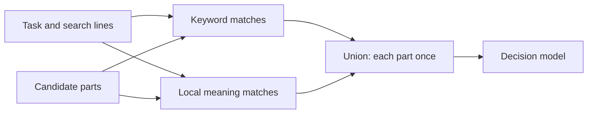

# @curatejs/core

Curate selects the memory an agent needs for a task from typed sources. Its RDC process ranks candidates, asks your decision function how strongly each item bears on the task, and asks your writer to turn the evidence into the dated log the task needs. Selection and curation each return a record.

## RDC process

- **Rank:** Order memory candidates by their signals.
- **Decide:** Keep every scored reference by default; use decision probability to order and weight it. Check rules against their separate applicability bar.
- **Curate:** Call `curate(task, picked, { write })` to write the dated log the working model reads.

## Install

```bash
pnpm add @curatejs/core
```

The host supplies its own sources, decision function, and writer. The default entry imports no model engine. The optional local embedding entry uses a separately installed runtime.

## Requirements

Node.js 22.20 or later.

## Source packages

Core supplies no reader. Install [chat](https://github.com/jonny981/curate/blob/main/packages/chat/README.md), [git](https://github.com/jonny981/curate/blob/main/packages/git/README.md)
or [markdown](https://github.com/jonny981/curate/blob/main/packages/markdown/README.md) for built-in readers. Each depends on core.
The `@curatejs/core/internal` entry contains shared file, git and keyword helpers
used by those packages; it supplies no source or ranking defaults.

## Sources

A source implements `CandidateSource`: it has an `id`, a declared `role`
(`reference`, `rule` or `mixed`), and a `read` that takes a
`CandidateReadRequest` and returns a `CandidateReadResult`.

`read` answers one of three outcomes:

- **`status: 'read'`**: candidates, plus `complete: false` whenever
  enumeration stopped early or skipped anything.
- **`status: 'absent'`**: the expected nothing: no directory, no store.
  Non-fatal, with its reason.
- **A thrown `SourceReadError`**: a real failure: an unreadable file, a
  corrupt store, or `code: 'cancelled'` when the read was aborted.

The request's `exclude` paths are refused before any content is opened,
so excluded text never reaches signals or a model. A `revision` pin is
resolved once and used for every operation that read performs; a source
that cannot honour a pin answers `absent` rather than guess. A
candidate's `text` is the retained snapshot of the exact text scored.

Request flags let a streaming reader do lane work inside the read.
`phraseLane: true` means `task` is an exact phrase to match, not keywords
to score, so the reader can keep matches without scoring the corpus; on
a kind lane `topic` then carries the task the lane serves, and the
reader ranks each match by it. `meaningLane` carries the embedding
function for a meaning read: the reader scores each part's similarity
inside the read and returns only the kept parts, so the corpus's text
is never held. `wholeLanes` arrives already resolved: `false` tells the
reader to narrow its own lane at the score curve and emit only the
kept candidates; `limit` on a kind or meaning read caps that kept set
after the curve, not the scoring before it. A read that narrowed
itself reports `laneCutApplied: true` and sets `matched` to the lane's
count before the curve, so the pick never cuts it twice. A reader
that returns everything leaves both unset and the pick cuts as before,
so a non-streaming source needs no change.

`context.files` shares file text between lanes and overlapping sources
in one pick. Readers fill it through a byte cap (64 MB): inside the cap
a file is read once; past it each pass re-reads, so a large corpus is
never held whole.

## Search options

`pickFromSources` accepts host-written `searchLines` in its read request.
Each source searches the task and every distinct, nonblank line. A line
can be keywords or a short passage describing what the answer evidence
would say. Curate generates no lines. Keyword searches need no model.

```ts
const picked = await pickFromSources(
  sources,
  {
    task,
    searchLines: ['Backup copies are encrypted and tested by restoring them.'],
    searchPhrases: ['restored a', 'tested the backup'],
    stripSearchInstructions: true,
  },
  { task, decide, limits: { maxCandidates: 200 } },
);
```

- **Results:** The union keeps each `[sourceId, id]` once, with its best
  rank and the candidate data from that search. `searchRanks` records
  each zero-based rank within its source; `null` means absent from that
  search. The lowest rank becomes the record's `priority`.
- **Candidate budget:** `maxCandidates` applies to each search's
  interleaved feed. Their union can exceed that number, so extra searches
  add decisions without displacing original candidates. Batch and time
  limits still apply to the combined run.
- **Read budget:** `request.limit` applies to each keyword source read. Markdown
  and chat keep their best matches; git history enumerates the latest
  commits before ranking. A git read limit therefore excludes older
  commits from keyword searches. Phrase searches filter before this limit,
  as described below. Resolved revisions are reused across reads.
- **Single search:** Omit `searchLines` or pass `[]`. Duplicate lines
  and lines that repeat the original task add no read.

`searchPhrases` adds exact, contiguous word searches over candidate text and titles.
Case and punctuation are ignored; short words and word order remain.
For example, “got my” matches “I even got my vinyl signed”, while
“forgot my” and “got a copy of my” do not match. There is no stemming.
A phrase cannot span the title and text. Matches are ordered by occurrence
count, then item id.
The original task and keyword lines keep their ordinary search behavior.

Phrase matching runs before the per-read `limit` is applied. The pick
asks the source to enumerate without that limit and marks the read
`phraseLane`; a streaming reader then keeps only the matching parts,
while a reader that ignores the flag gets the same exact-match filter in
core after its read. Either way a phrase read can cost more local I/O
than a keyword read. Exclusions, revision pins and cancellation still
reach the reader.
A source that stops enumeration remains incomplete. A phrase with no
matches contributes no candidates. The per-search decision budget also
applies to each phrase; only matching candidates enter that feed.
Omit `searchPhrases` or pass `[]` to keep phrase searches off.
Curate generates no phrases and makes no model call.

Each source read is a set of lanes: one keyword lane for the task and
each distinct search line, one phrase lane per phrase, and any kind or
meaning lanes. A read result's `lanes` lists every lane with its search
text, its type (`search`, `phrase`, `kind` or `meaning`), the candidate
count the source returned for it before the lane's own filter, and the
count the lane kept. The
read's candidates are the union of what the lanes kept; the union has
no ceiling beyond what the lane curves cut. A host can read
`candidates.length` for the union size each task produced and report
its median, spread and largest across tasks; the per-lane `read` and
`kept` counts show which lanes made the large cases large.

Keyword lanes on reference sources cut themselves where each lane's own
score curve flattens. `cutLane` orders a lane's candidates by the sum
of their signals, and `cutScoreCurve` finds the bend: the point
furthest below the straight line between the lane's best and worst
positive scores. The curve measures the lane's own match score: a
candidate carries it in `laneScore` when its signals hold an ordering
or rank-merge score. Chat's signals hold a rank-merge score, so the
chat curve reads the pre-merge keyword score, never a rank position.
Candidates at or below the bend drop out. Equal scores fall together,
two or fewer positive scores always stay, and a lane with no bend
keeps every positive score. A search lane where nothing scored admits
nothing: it matched nothing. When a read keeps no candidates at all
it reports `noSearchMatch` on its read result, so the caller sees
the miss and can ask more broadly. The count comes from the scores,
so no lane has a fixed cut and the union has no ceiling. `searchPhrases` lanes are
never cut: an exact phrase is its own evidence. A kind lane is never
cut on how often its phrase occurs: the count says a match exists, not
that it is relevant, and a direction said once would lose to a phrase
everyone repeats. A streaming reader instead ranks each kind-lane
match by the task's own score and cuts that curve inside the read
when `wholeLanes` is off; a reader that cannot score the task returns
every match and the pick keeps them all. Meaning lanes get the same
curve cut on similarity scores, inside the read when the source
streams it. Pass `wholeLanes: true` in the read request to keep every
candidate each search returned.

`kindLanes` adds phrase lanes in the language of the kind of message a
task asks for. It maps each source kind (`chat`, `git-history`,
`markdown`) to a list of exact phrases, for example direction wording
such as "we need to" or "never" for chat and "decision:" for notes.
A source reads only its own kind's phrases. Each phrase is a lane of
its own: the source searches for it, then an exact-match filter keeps
the candidates whose title or text contains it. A phrase only
identifies the match; it does not measure relevance. The read request
sends the phrase as `task` and the task itself as `topic`, and a
streaming reader scores the matches against the topic and cuts that
score curve inside the read. A source that cannot score returns every
match rather than ranking by phrase frequency, so a direction stated
once survives a phrase used everywhere.

Each source package exports ready phrase sets, one list per kind of
message a task commonly asks for: `CHAT_KIND_PHRASES`,
`GIT_HISTORY_KIND_PHRASES` and `MARKDOWN_KIND_PHRASES`. Each maps
`directions`, `decisions` and `corrections` to phrases in its source's
register, for example "we decided" and "settled on" in chat against
"chose" and "instead of" in commits. Feed the matching list in for the
task, such as `kindLanes: { chat: CHAT_KIND_PHRASES.directions }`.

When the task asks what a named person said, `speakerOnly: true`
narrows chat kind lanes to that person's own messages: a candidate
with chat metadata matches only when its recorded role is `user`.
Candidates without chat metadata still match. Omit `kindLanes` to keep
kind lanes off; omit `speakerOnly` to keep every matching role.

For direct `pick` calls, hosts supplying `searchRanks` must include the
original search at index 0 and extra searches after it. Supply ranks for
every part of a searched source. Sources without those ranks retain
their ordinary signal order in each feed.

`stripSearchInstructions: true` removes explicit, standalone output
clauses such as “cite both” and “answer in one line” from search text.
The exported `stripSearchInstructions(task)` helper performs the same
operation. It preserves unfamiliar wording and retrieval needs such as
counting, dates, comparisons and identifying the newer fact. The full
task still goes to `decide`; pass that same task to `curate`.

### Optional local meaning search

`meaning: { embed }` adds local embedding searches for the task and its
distinct search lines. Each part receives a separate meaning rank for
each query. Keyword ranks and signals stay intact. The decision feed
unions the keyword and meaning matches, keeping each `[sourceId, id]`
once. Omit `meaning` to keep ordinary keyword search.



For the supplied local adapter, install its optional peer runtime:

```bash
pnpm add node-llama-cpp@3.18.1
```

```ts
import { pickFromSources } from '@curatejs/core';
import { createLocalEmbedder } from '@curatejs/core/local-embeddings';

// A local MiniLM GGUF model file; the adapter downloads nothing.
const local = await createLocalEmbedder({ modelPath });
try {
  const picked = await pickFromSources(
    sources,
    { task, searchLines, meaning: { embed: local.embed } },
    { task, decide },
  );
} finally {
  await local.dispose();
}
```

- **Model:** The adapter accepts sentence embedding models that take plain
  text. The tested model is [MiniLM-L6 Q4](https://huggingface.co/second-state/All-MiniLM-L6-v2-Embedding-GGUF),
  a 19,699,648-byte model with 384 vector dimensions. It uses the same
  Node runtime as QMD's larger EmbeddingGemma model. Models that require
  query or document prompts need a host-supplied embedding function.
- **Complete text:** Inputs longer than the model window are embedded in
  token windows. Their normalized vectors are averaged by token count.
  No input text is cut off to fit the model. A part whose body contains
  only whitespace or invisible formatting characters uses its title for
  embedding, including a commit with only a subject.
  Its original body and title remain in the returned evidence.
- **Storage:** Candidate vectors exist only while a batch is scored and
  are discarded afterward. Curate writes no database, vector index or
  candidate cache. The model file stays on disk.
- **Candidate reads:** A supplied keyword `request.limit` still controls
  keyword results. Each meaning query first asks the source to serve the
  lane itself (`meaningLane` on the read request): a streaming reader
  scores similarity inside the read, keeps what the curve keeps, and
  returns only those parts flagged `meaningLane`, so the corpus's text
  is never held. A source that does not honour the flag answers an
  ordinary keyword read, and the pick then makes one unrestricted
  fallback read and scores its whole pool itself. Exclusions and
  revision pins apply either way. Partial source reads remain recorded
  as partial.
- **Dials:** `meaning.nearest` is an optional positive integer per query
  and source. Each meaning query is cut where its similarity score
  curve flattens, the same cut keyword lanes get; pass `wholeLanes: true`
  on the read request (or `meaning.wholeLanes: true` for meaning only)
  to keep every rank. `nearest` bounds the ranks a query keeps either
  way. An optional `limits.maxCandidates` still applies to each
  interleaved query feed; their union can exceed it.
  The union preserves keyword eligibility; caller-supplied batch or time
  limits can still leave keyword candidates unasked because meaning
  ranks affect the combined decision order.
- **Failures:** Local model failures stop the search before decisions.
  Cancellation is checked between batches and model windows. There is
  no API fallback.

For hosts that already have candidates, `addMeaningRanks(candidates,
task, { embed, searchLines })` returns the same union rank data for
`pick`. An `EmbeddingFunction` returns one vector per complete input
text, in input order. The helper uses cosine similarity, which compares
vector direction rather than length, and breaks ties by candidate id.

### Defaults and evidence

The LongMemEval tuning check covers 249 questions and 445 labelled
answer-turn starts. It measures evidence reaching decisions, not final
answer accuracy. The union comparisons use a budget per search.

| Option | Default | Measured reason |
| --- | --- | --- |
| **Reference selection** | Keep every scored item; bar 0 | In the saved-decision sweep, 0.05/0.5 removed every fed fragment of 50 answer turns; 0.2/0.6 removed 70; a single 0.6 cut removed 183. Keeping everything added no selection losses. Seven of 445 labelled turns were absent from the feed. This measures retention before curation, not final answer accuracy. |
| **Extra search lines** | Run when supplied | Using the chat package, five subject lines plus five alternate-name lines at 100 parts reach 440/445 turns and add 207.3 decisions per question. At 200, five subject lines reach 442/445 and add 214.2. At 600, task-only search reaches all 445; extra lines add no labelled evidence. |
| **Phrase searches** | Off unless supplied | One event phrase recovers one extra labelled turn at 100 parts for 0.9 extra decisions per question on average. Keyword lines also recover that turn. On its sports-event order question, the phrase adds two parts, compared with 58 for one subject line. At 200 and 600 it adds no labelled turns. |
| **Local meaning search** | Off | In 249 tuning questions, 200 keyword parts plus 48 nearest task-meaning matches reaches all 445 labelled turn starts and all their surviving parts, adding 19.5 decisions per question. Keyword-only retrieval at 600 parts reaches the same evidence. The 48-part depth is measured for that tuning setup, not a cutoff for other histories. Final-answer accuracy is unmeasured. |
| **Instruction removal** | Off | It changed zero tuning questions and ranks. Benefit on tasks with output instructions is unmeasured. |
| **Rank protection** | Off | In a 60-question cached sample, recall in the first four items fell from 94.09% to 84.68%; in the first eight, from 100% to 99.71%. Full-feed packing is unmeasured. |
| **Best part first** | Off | One part per session reached 259/445 answer turns. Even an optimistic continuation at 0.4 reached only 423/445. This does not establish a safe way to skip parts. |

The line comparison generates five subject lines, five alternate-name
lines and five subject-free event phrases per tuning question with a
subscription model, then tests prefixes of one, three and five.
Keywords use the chat package's default ranking. Core unions the feeds
and applies the budget per search. These host settings retain every
labelled turn and every complete labelled turn found with all fifteen
lines, checked question by question:

| Parts per search | Subject lines | Alternate-name lines | Event phrases |
| --- | --- | --- | --- |
| 100 | 5 | 5 | 0 |
| 200 | 5 | 0 | 0 |
| 600 | 0 | 0 | 0 |

Hosts can keep event phrases for cheaper retrieval of specific events.
The sports-event order example uses “watched” to recover its third
labelled turn. A count/list-only route would omit that question.
The combined keyword settings also find that turn, so omitting phrases
from these combined defaults preserves its evidence.

The line gains use keyword and phrase search, not vector search. The rank sample uses saved “needed”
answers, rather than a complete decision feed. The document check uses
a 0.4 continuation gate. No continuation gate is used by the package.

## Picking

`pick(candidates, { task, decide })` ranks the candidates, asks `decide`
in bounded batches, and returns the selected candidates with a
`PickRecord`. `everyScored` is on by default, so every reference
with a valid decision probability is kept, including zero. The model
orders and weights these items rather than dropping them. References
with no valid decision answer remain unanswered; limits can leave items
unassessed. A `decide` call that throws fails the pick with a `PickError`,
unless the elapsed limit stopped the call or the caller's signal aborted
it. The error's `record` carries the pick's record, which names the
batch's candidate ids and the error's message in `decideError`. A failed
decision batch leaves its candidates unanswered even when an earlier
batch answered some of their questions; a failed tag batch leaves a
decided selection standing and records the error on the tag answers.
There is no retry and no fallback.

For a single cut, set your own bar:

```ts
const picked = await pick(candidates, {
  task, decide, everyScored: { bar: 0.05 },
});
```

Rules also keep every scored item by default. Set `thresholds.rule`
for an optional applicability cut. `applies: always` rules bypass that check.

`everyScored: { bySize }` replaces the flat bar with a
curve of `[decided count, bar]` points. Below the first point the first
bar applies; above the last the last bar applies; between two points
the bar moves linearly. The count is the number of references that
answered, so a small decided set can keep everything while a large one
cuts more of the weakest. The record keeps the sorted points and the
bar used as `thresholds.appliedReference`. Points must be unique
nonnegative safe integers with bars between 0 and 1. Their positions
are a measurement question: set them against the history the funnel
will read, and measure recall where each point lands before relying
on it.

`pickFromSources(sources, request, options)` reads the
sources first, then picks over the combined candidates; a rule source
that returned `complete: false` or was absent makes the record's
`rulesCoverage` `'incomplete'`, even when every supplied rule was
answered. `rulesEnumerationComplete: false` in the options is honoured
the same way.

Each candidate's `changedPaths` names the repository paths it changed;
`gitHistory` fills it from the commit's diff, never from paths the text
mentions. With an optional reference cut enabled, a reference answered
at or above `linkedPathBar` (0.4 by default) still passes when a selected
commit from the same `repository` names its `path` in
`changedPaths`. The record entry names the commit that carried it over
in `link`, and a linked candidate never carries another. The bar is a
chosen default, not a measured best; `PickThresholds.linkedPathBar`
overrides it.

`cascade` accepts a fitted question set: `bias` and `questions`, each
with `key`, `instructions`, `true`, `false`, and `weight`. Curate combines
the answers with those weights into the decision probability. Optional
`first`, `band: [low, high]`, and `firstOnly: { bias, weight }` ask one
question first and use its fitted probability outside the band; inside
the band, all questions contribute. The record keeps the configuration
and each question's answer. A missing returned answer contributes nothing
to the fitted sum; when every answer is missing, the item stays unanswered.
If a limit stops required questions before they are asked, the item stays
unassessed.

### Question sets by source

`cascadesByKind` accepts a question set for each source kind: `chat`,
`git-history`, and `markdown`. The built-in sources declare their `kind`.
Custom sources can declare it too. A supplied `cascade` remains the
fallback for a kind without a set and for a source without a kind.
Without either set, the ordinary reference question applies.
Rule candidates keep their separate applicability question.

```ts
import { pickFromSources } from '@curatejs/core';
import { chat, CHAT_CASCADE } from '@curatejs/chat';
import { gitHistory, GIT_HISTORY_CASCADE } from '@curatejs/git';
import { knowledgeBase, MARKDOWN_CASCADE } from '@curatejs/markdown';

const picked = await pickFromSources(
  [chat({ paths: ['transcripts'] }), gitHistory('.'), knowledgeBase('docs')],
  { task },
  {
    task, decide,
    cascadesByKind: {
      chat: CHAT_CASCADE,
      'git-history': GIT_HISTORY_CASCADE,
      markdown: MARKDOWN_CASCADE,
    },
  },
);
```

For direct `pick` calls, supply `sourceKinds: { conversations: 'chat' }`
to map each candidate's `sourceId` to its kind. `pickFromSources` fills
that map from the sources that returned those candidates; a declared
source kind takes precedence over the supplied map.
The record keeps the per-kind sets and source map. Each candidate
entry records `sourceKind` when its kind is known.

The chat package’s `CHAT_CASCADE` contains the fitted relevance, own-situation and needed
questions, with relevance asked first. `GIT_HISTORY_CASCADE` and
`MARKDOWN_CASCADE`, exported by git and markdown respectively, share four fitted questions: `current`, `needed`,
`when`, and `offtopic`. They ask about relevance, needed information,
timing, and a different subject. The negative `offtopic` weight lowers
the score when an item is about a different subject. These sets ask
neither `own` nor `preference` of commits or notes. Fitted scores order
evidence; they do not measure the chance of a correct final answer.

### Decision tags

`tags` asks extra yes/no questions of each reference that passes
relevance, after selection decides. A `PickTagSet` is a named set of
`PickCriterion` questions such as intent or importance. The answers
never change what is selected: they label the kept pieces so a later
step can read intent, importance and emphasis without asking the
decision model again. Rules are never tagged.

```ts
import { DECISION_TAGS } from '@curatejs/core';
import { GIT_HISTORY_TAGS } from '@curatejs/git';
import { MARKDOWN_TAGS } from '@curatejs/markdown';

const picked = await pickFromSources(sources, request, {
  task, decide,
  tags: DECISION_TAGS,
  tagsByKind: { 'git-history': GIT_HISTORY_TAGS, markdown: MARKDOWN_TAGS },
});
```

`DECISION_TAGS` carries the shared sets: intent (instruction, decision,
correction, idea, question, fact, chat), importance (passing, relevant,
important, critical), emphasis (neutral, emphatic, approving) and a
yes/no "corrects something earlier" set. `GIT_HISTORY_TAGS` adds fix,
feature and revert for commits; `MARKDOWN_TAGS` adds decision record,
rule and how-to for notes. `tagsByKind` adds sets for references of one
source kind, using the same `sourceKinds` map as `cascadesByKind`.
Tag set keys must be unique across `tags` and `tagsByKind` for one
candidate.

Every answer is recorded on the reference's record entry under `tags`,
with its status kept as returned (`answered`, `missing`, `refused` or
`error`). Tag questions run under the same stopping dials as relevance;
a question a stop left unasked records `unassessed` with the stop
reason, and the sets stay on the reference so a host can see which tags
are partial. A set's `value` is the first of its questions, in list
order, answered at 0.5 or more; earlier keys win, and the value stays
unset when none reach 0.5. A single-question set values to `yes` at
probability 0.5 or more, otherwise `no`. A set whose answers all
failed records its answers and no value. The record keeps the supplied sets. Omit both options to keep
the decision pass to relevance questions only.

By default, all scored reference items are kept and ordered by decision
probability, strongest first, with ranked order breaking ties. There is no fixed character cap.
`keepTop: N` marks the first N ranked keyword hits. Those that pass
the threshold move to the front; rejected items stay rejected. N must be a
nonnegative safe integer. Fitted sets and top-hit promotion are opt-in.

### Optional rank protection

`rankProtection: true` orders selected references by
`w / rank + (1 - w) * probability`. Rank is one-based within the source;
with extra searches it is the best rank across them. The weight `w` is
0.75 at ranks 1–3, 0.60 at 4–10, and 0.40 below that. Rules stay first,
and `keepTop` retains its explicit promotion.

This affects order only. Optional reference cuts still apply; rules keep
their separate applicability bar. The record stores `orderScore`
separately; curator weights remain the original decision probabilities. Omit the option or pass
`false` to retain the default order and record format.

### Optional best part first

`bestPartFirst: true` first asks about the fed part with the most distinct
task words in each document. Words must have more than two characters;
ties use feed order. Chat parts group by provider and session, notes by
their file, and commits remain separate items. Source and revision are
part of every group identity. Hosts can supply `candidate.documentId`
for their own parts; candidates without document metadata stay separate.

Curate applies the representative's question set before asking about all
its other fed parts. A low score on the first part never skips the rest
of the document. Optional cuts apply to each part's own decision score.

Each fed reference records its `representative` item id. Batch, candidate,
time and cancellation limits remain in force. A stopped run reports the
stop reason for unasked parts. Rules are asked independently. Omit the
option or pass `false` to judge the whole feed as usual.

### Optional label gate

`labels: { directory, deciderId }` adds the parts the labels find to
the decide feed, off by default. Each reference part answers seven fixed
kind questions once: a personal fact, something owned or used, a
purchase or arrival, an event or plan, a preference, a habit, and a
decision or change. The answers do not depend on the task, so the pick
stores each part's set in `directory`, one JSON file per part written to
a temporary file and renamed into place. A later pick over the same
part text reuses the stored set and asks nothing. A changed part, a
different `deciderId`, or a different `questionVersion` stores under a
different key and is labelled again. A missing, corrupt or wrong-shaped
file is a miss, and a refused, missing or errored answer is never
stored.

The task answers the same seven questions, and its set is stored the
same way under the task's own key: a later pick over the same task text
reuses it too. A kind the task needs at 0.5 or more puts every part
labelled 0.5 or more on that kind in the label lane, ordered by that
probability. The decide step then sees the union of the keyword lanes
and the label lane, ordered by reciprocal-rank fusion of the two
orders. The 0.5 bar is one shared constant, `LABEL_LANE_BAR`, a dial
to fit rather than a measured best. Through `pickFromSources` the gate
labels the source's full uncut search pool, so a part the keyword lanes
dropped can still reach the decide step through the label lane; through
`pick` directly it labels every reference part supplied. Label batches
count against `maxBatches` and `maxElapsedMs`, so a stop while labelling
leaves the decide step unasked. The label lane is not capped by
`maxCandidates`: every part in it reaches the decide step unless
`everyRanked` caps the merged ranking.

The record's `labels` field keeps the question-set version, the
`deciderId`, how many items' labels the decide port was asked, how many
were reused from the store, the gate's size, and `failedWrites`, how
many label sets the store could not write. A failed write keeps the
answers for this pick, adds one `warning` to `labels`, and the next pick
asks for that set again. A reference part the keyword lanes never
held, left out on its stored or answered labels, records `unassessed`
with reason `'gate'`; a part a lane limit cut or a stop left unlabelled
keeps that reason instead. Omit the option and the pick is identical to
a pick without it.

`route: 'jev'` asks the task itself what kind of answer it needs, off
by default. The four route questions in `ROUTE_QUESTIONS` ask whether
the task needs a count or a complete list across sessions, a date, a
duration or an order, the user's stated tastes, or the latest value of
something. They go through the decide port once per pick: in the same
request as the task's kind labels when the label gate asks them, alone
otherwise, and always as one request whatever the request-size dials
allow. An answer at `LABEL_LANE_BAR` or more switches on the
curator options its route maps to: `taste` switches on
`preferenceAdvice` and `preferenceChange`, and `count`, `date` and
`latest` switch on `working`. `latest` routes to worked notes because
a worked note carries each fact's date, so the curator can order the
changes and pick the newest. The record's `route` field keeps the
answers and the options they switched on; `curate`'s own `route: 'jev'`
applies them. Omit the option and the pick is identical to a pick
without it.

### Optional decision cache

`cache: { store, deciderId }` stores each answered decision, off by
default. The `store` port is asynchronous `get(key)` and
`set(key, value)`; `decisionFileStore(directory)` is the supplied one,
one JSON file per answer under `directory`, each written to a
temporary file and renamed into place. `deciderId` is required: it
names the decider behind the stored answers, so two different
deciders never read each other's files.

Each answer's key is a SHA-256 over the task text, the question-set
version, the rendered question's wording, true and false criteria
and fitted name and tag set, the `deciderId`, the text cut applied,
and every field of the part the decider receives: its source id, id,
title, role, kind and date, and its text, a change past the cut
included. A changed task, version, deciderId, wording, part or cut
asks again; an unchanged part hits. The key names the part and its
exact question, not the batch around it, so an answer is reused
across batches: a later pick that adds or changes one part asks only
that part and reuses the rest. That rests on one assumption: a
part's answer barely depends on the parts batched beside it. Reuse
matters for resumed runs and repeated questions, where most parts
are unchanged. A missing, corrupt, wrong-shaped or unreadable entry
is a miss, and a refused, missing, errored or never-asked answer is
never stored, so a stored file always holds one complete answer. The
signal and elapsed dials guard the reads as they guard the batches:
a stop leaves every question not yet resolved unassessed. Thresholds and
link rules apply to cached answers as fresh ones, so a changed
threshold reselects from stored answers without asking.

A stored answer marks its record entry `reused`: on a selected or
rejected entry when every decision behind it came from the store,
on each per-question and tag answer, and never on an
`applies: 'always'` rule, which is never asked. The record's `cache`
field keeps the question-set version, the `deciderId`, how many
decision and tag questions the decide port was asked, how many
answers were reused, and `failedWrites`. Label questions go through
the same port but are not counted here: `labels.asked` counts each
asked item once, and an item asked sends one question per label
kind. A failed write keeps the answers for this pick, adds one
`warning` to `cache`, and the next pick asks for them again. Pass
`cache: false` to bypass a configured cache for one pick, for
example a held-out benchmark run: nothing is read or written and
every part is asked. Omit the option and the pick is identical to a
pick without it.

### Optional scaled top-k

`everyRanked: { c }` decides only the top `round(c × N^0.8)` reference parts
of the ranking the decide step reads; `everyRanked` is on by default
and `true` reads them all. N is the number
of reference parts the pick received: the history's size, not the
ranking's. Through `pickFromSources` the read carries the source's
full uncut pool, so lane cuts and read limits do not shrink it; a pool
member only counts toward N, and with the label gate off it reaches
the feed or the record only when the rare-word round pulls it in. The
ranking is the gate's fused order
when the gate fused its lane into the keyword order, the keyword
order otherwise. Rules pass through uncounted and are never cut. A
part below the keep count is never asked; it records `unassessed` with
reason `'pick'`. `c` must be a positive finite number, and an invalid
`c` throws a `TypeError` before any decide call. The record's `pick`
field keeps `n`, `c`, `kept` and which ranking was cut (`'fusion'` or
`'keyword'`).

Measured on the tuning half's saved rankings (249 questions, 445 answer
messages) with the label gate on and `wholeLanes` on, over every part of
each history from 127 to 8,475 parts:

| Keep rule | Answer messages kept, of 445 | Parts kept at 850 parts | Parts kept at 8,475 |
| --- | --- | ---: | ---: |
| `2.173 × N^0.8` | 444–445 (99.8–100%) | 479 | 3,017 |
| `0.68 × N^0.8` | 437–442 (98–99%) | 150 | 944 |
| `0.471 × N^0.8` | 432–440 (97–99%) | 104 | 654 |

The table replays those saved rankings: they break equal fusion scores
by item id, where the package's fused order breaks them by keyword
position. It checks the study's coverage, not identical coverage for
the package's own ranking.

It is a dial, never the default: the default keeps every part the
ranking holds because no fixed count is safe everywhere. The dial's
point is cost: the decide step's work grows sublinearly with the
history's size instead of with the whole ranking.

### Optional rare-word round

`rare`, alone or beside `everyRanked: { c }`, turns on a second, narrow
round after the selection pass, off by default. `rare: true` runs it
at its defaults; `{ share, bar }` tunes it. The parts that cleared
the selection bar are its seeds. A seed word is rare when its document
frequency over the history is at most `share × N`, where the history
is every reference part the pick received: the same N the top-k count
reads. `share` defaults to `5/850`, the count of 5 fitted on an
850-part LongMemEval history. On a history under 340 parts the default
share can pull nothing: a shared word appears in at least 2 parts, and
`5/850 × N` stays below 2. Every unselected part sharing a rare word
is pulled in, pool members included: one the first pass never asked
goes through the decide step, one already decided reuses its score,
and no part is asked twice. A pulled part joins the selection at or
above `bar`, a second and lower bar than the selection bar, defaulting
to `0.0146`; the seeds keep the pick's own bar. `share` must be a
positive finite number and `bar` between 0 and 1, both checked before
any decide call. The record's `pick.rare` keeps the share and bar
used, the rare words, the parts pulled in, and how many were asked
and added.

Measured on the tuning half's saved decisions (249 questions): holding
the selection bar at 0.05 loses 15 answer messages, and the round at
its defaults recovers 6 of them while adding 12.9 parts a question,
matching the fixed-count study's 6 of 15 at about 15.

### Markdown candidate kinds

The Markdown package's `markdown({ paths, kind })` source adds a candidate
`kind`: `knowledge`, `docs`, `rules`, or `instructions`. This is separate from
source kind `markdown`, which selects a fitted cascade through `cascadesByKind`.
Without a cascade, core asks the candidate-kind question. Host candidates with
role `rule` retain rule questions; instruction candidates use the instruction
question. Decision questions and records keep the candidate kind.

`ranking: { docs: { bm25: 2 } }` weights signals by Markdown kind before the
candidate feed is chosen when candidates have no search ranks. Search ranks
retain their lane order. Omitted signal weights are 1. Weights must be finite;
negative weights are allowed. The record includes `ranking` when supplied.
Selection retains the score-order and keep-all defaults.

Sources can declare `maxQuestionText` as their preferred reader part size.
Infinity requests whole items by default. Explicit pick and read text budgets
take precedence. The Markdown source uses this to keep whole text; existing
readers retain their part sizes. A shared `CandidateReadContext` passes file
bytes between overlapping reads within one `pickFromSources` call.

## Curating

`curate(task, picked, { write })` accepts the result of `pick` or
`pickFromSources`. It calls your `write(prompt, signal)` function to
write the log the task needs, with no fixed character cap.
`prompt.instructions` contains the v4 dated-log wording and three weight
tiers: 0.6 or more, 0.1 to below 0.6, and below 0.1. `prompt.body` contains the
task and selected reference items in their selected order. Each header
shows the item's short id (`E1`, `E2`, and so on in selected order),
the candidate's date value, its source kind when
the read recorded one, its decision weight without rounding, and any
recorded tags: `### E1 (2023-05-30, markdown, 0.87, intent: correction): title`.
A missing date stays missing.
The instructions ask the writer to keep every observation from items at
0.6 or more, include useful facts from items at 0.1 to below 0.6, and use
items below 0.1 only when they clearly state a needed fact. The prompt
asks for less space for low scores; they remain available as evidence.
The writer cites the short ids; the format check knows only them, and
the returned log and `record.items` carry the full item ids again.
When ids clash across sources, `record.items` keeps each id as a
`[sourceId, id]` JSON string so callers can tell them apart.

```ts
import { curate, pick, type CurateWrite, type MemoryCandidate, type PickDecide } from '@curatejs/core';

// The host supplies both functions, using its chosen model route.
async function recall(task: string, candidates: MemoryCandidate[], decide: PickDecide, write: CurateWrite) {
  const picked = await pick(candidates, { task, decide });
  const curated = await curate(task, picked, { write });
  return { log: curated.log, pickRecord: picked.record, curateRecord: curated.record };
}
```

The returned `log` is the text for the working model to read. Its lines
have this form:

```text
[2023-05-13] Visited York (said 2023-05-20; trips.md#2)
```

The event date and the date it was said are separate. The prompt asks
the writer to keep exact names and amounts, merge repeated events with
both ids, and mark later observations that replace earlier ones.
Selected rules stay in `picked.selected` for the host to pass as exact
instructions; the curator reads only reference items.

`taskDate: '2023-05-22'` adds ` (asked 2023-05-22)` to the task in
every writer call. The date label is kept exactly, including any time or weekday.

`working: true` adds worked notes below the log for counts, dates, order
and latest values. It is off by default. The working section's title
can be plain text or a Markdown heading.

`context: true` asks the writer to keep who, where and which item or event
on each observation. It asks for links from that observation's own session
and forbids invented links. It is off by default. The same guidance applies
when condensing; output checks validate dates and source ids, not whether
the writer preserved each factual link.

`routeByTask: true` chooses guidance from the task's words alone:

- **Counts and lists:** Enable worked notes and ask for each distinct instance across the supplied sessions.
- **Dates and order:** Enable worked notes for dates, gaps and order.
- **Advice:** Enable the advice preference lines.
- **Changed facts, named things and other tasks:** Keep the ordinary dated-log guidance.

The option is off by default. Explicit `working` and `preferenceAdvice`
values override the route's choices. `context` stays independently configurable.
`classifyTask(task)` exposes the same code-only classification. It can return
several kinds for one task. It uses common English phrases, capitals and
quoted names; it does not infer unstated changes or consult evidence.

`route: 'jev'` chooses guidance from the route answers the pick
recorded, off by default. A `taste` answer at the bar turns on both
preference lines; a `count`, `date` or `latest` answer turns on worked
notes, which carry each fact's date so the curator can order the
changes and pick the newest. It cannot combine with `routeByTask`, and
it needs `route` on
the pick's record, so it must run on a pick made with `route: 'jev'`.
Explicit `working`, `preferenceAdvice` and `preferenceChange` values
override the route's choices. The record includes `route` when it is
on.

`preferenceAdvice: true` asks for optional `Advice preferences:` lines
with the user's stated tastes, relevant experiences and constraints for
advice tasks. `preferenceChange: true` asks for optional
`Changed preference:` lines with stated changes of taste or exclusions.
Both are off by default. Each added line must have text and cite
the short `En` source ids in parentheses or square brackets, for
example:

```text
Advice preferences: Likes history and quiet walks (E1)
Changed preference: Wants quieter trips [E1]
```

The returned log restores the full item ids, as it does on
observation lines.

These lines also count toward `contextLimit`. The same preference
instructions apply when condensing. Dates and source ids on observation
lines keep their strict checks when preferences are enabled.

`record` holds `promptVersion: 'v4'`, `weights: 'tiers'`, `working`,
`preferenceAdvice`, `preferenceChange`, `items`, `logLength`, `condensed`,
and `overContextLimit`. It includes `taskDate` when supplied.
It includes `context` when supplied and `taskKinds` when routing is enabled.
A chained write adds `batchTokens` and `batches`.
Each item holds its full `id` (the prompt shows it as `E` plus the
item's 1-based position), the full `candidate`, and
the exact decision `weight`.

Set `contextLimit` to the positive integer number of characters the
caller's working model can accept:

```ts
const curated = await curate(task, picked, { write, contextLimit: 12000 });
```

If the first validated log exceeds that limit, Curate calls `write`
exactly once more with the task, the full log, and exact item weights.
The condense prompt asks the writer to merge or drop observations from
items below 0.1 first, then those from 0.1 to below 0.6. It asks for
observations from items weighted 0.6 or more to stay whole, and for
retained observations to keep their event dates, said dates, source
ids, and replacement dates. The result must pass the same format checks.
These checks do not prove that the writer followed the tier instructions.

`contextLimit` cannot combine with `batchTokens`; see below.
The record
includes `contextLimit` when supplied. `logLength` is the
first validated log's length after trimming. `condensed` says whether
the second call ran; `condensedLength` is present only when it ran.
`overContextLimit: true` says that the returned log still exceeds the
budget. Such a log is returned whole without another call or a length
error. Without `contextLimit`, Curate makes one call and returns the
validated log without condensing.

`working: true` asks the writer to add numbered instances inside the
task's period, computed time gaps or order, and latest values under
`Working (the curator's; check it against the log):`. It is off by
default. The reader should check these notes against the log.

A malformed observation throws a clear error. So does an empty log,
except from a later pass of a chained write, which may return nothing
(see below). Each observation must have
valid calendar dates in its event and `said` fields and the short ids of
items given to the writer. Merged sources can separate ids with commas,
semicolons, `and`, or `&`. If sources recorded the same fact on different
days, repeat the dated group: `(said 2023-05-20; E1; said 2023-05-21; E2)`.
Every source date and id is checked. Optional
suffixes are `(when not stated)`, `(replaces [YYYY-MM-DD])` and
`(replaces Ln)`; replacement dates must also be valid. In a chained
write each observation line also starts with a stable `Ln` id, and a
date marker is checked but never honoured there (see below). These
checks verify the format and source ids;
they do not prove the writer's
facts or date calculations. Worked notes count toward `contextLimit`.
There is no retry, truncation, or fallback to raw items. Missing selected
weights and a selection with no reference items fail before `write`.
Writer failures propagate to the caller. `signal` reaches the writer;
the host must make its model call honour cancellation.

### Token batches and chained writes

`batchTokens` writes the log in chained passes, strongest evidence
first. References go to the writer in decision-weight order (equal
weights put the newer date first), cut into consecutive batches that
each hold as many whole items as fit the budget. The size is an
estimate: characters divided by four. An item larger than `batchTokens`
sits alone in its own batch and is never cut. No item is split.

```ts
const curated = await curate(task, picked, { write, batchTokens: 2000 });
```

The strongest batch's references go to the writer alone first. Every
observation line then gets a stable id (`L1`, `L2`, ...) that stays
with it for the rest of the run. Each later batch gets the task, the
log so far with its line ids and its own evidence. The log is shown
for reference only: the pass is asked to return just the new
observation lines for facts the log does not already state, plus any
working section and preference lines in full, and not to repeat an
existing line. A later pass may return no lines at all when its batch
holds nothing new, so `write` must pass an empty reply through rather
than reject it.

Every line an earlier batch wrote stays in the log, id and wording
unchanged; a later pass only adds lines. Earlier lines keep their
order. Each new line goes in front of the first earlier line with a
later event date, so the log still reads oldest first; on the same
date the earlier line comes first. A reply line that carries an
earlier line's id is dropped as a repeat, and an earlier line left out
of the reply stays anyway. A line a later
pass adds may end with `(replaces L7: the subject it corrects)` to
tell the reader it is newer; the marked line stays in the log either
way. The writer is asked to mark only a newer correction or decision
about the same subject that is at least as important, and to write no
mark when it is unclear. A `(replaces [YYYY-MM-DD])` marker is never
honoured in a chained write: the first pass is asked for none, and in
any pass a date marker, or a mark naming an id the log does not hold,
is stripped from the line it sits on.

`record.batchTokens` keeps the supplied budget and `record.batches`
lists each pass in run order with its item count, the lines it added
with their new ids, and the replacement marks it wrote: each mark's
new line id and the earlier id it names. Omit `batchTokens` to write
the log in one call; a single call writes no line ids. A chained write
cannot combine with `contextLimit`: a condensing pass cannot preserve
a chained log's line ids, so passing both throws a `TypeError` before
the writer runs. `batchTokens` must be a positive integer. Nothing is
cut or dropped; batching only splits the evidence across more calls.

## Levers and modes

Every cost/performance lever follows one rule: turning it on reads more
evidence or adds more guidance, at the risk of more cost; turning it
off saves cost and can lose quality. Each lever lives in one of three
places: the read request `pickFromSources` takes, the options `pick`
takes, or the options `curate` takes. The pick's record keeps every
lever's resolved state under `levers`, and `levers.preset` names the
mode the states match: `performance`, `economy` or `custom`. Its
`route` records the questions asked. The curate record carries the
same lever set for the whole mode. Its `route` holds both states,
`{ asked, applied }`, and its `preset` names the mode they make, so a
pick that asked and a curator that never applied reads `custom`, not
`performance`. `meaning.wholeLanes` resolves the meaning lanes on their
own, so when it disagrees with the read request's `wholeLanes` the
record holds `levers.wholeLanes: { keyword, meaning }` and the preset
is `custom`.

| Lever | What "on" does | Cost when on | Measured impact | Where measured |
| --- | --- | --- | --- | --- |
| Read `wholeLanes` | Keeps every candidate each keyword and meaning lane returned. Off, each lane cuts where its own score curve flattens (chat: the pre-merge keyword score; `searchPhrases` lanes are never cut, and kind lanes are never cut on phrase counts). | The decide feed grows by the parts the curves would have cut; kept counts vary with each lane's scores, and deciding is the expensive stage. | The cut the off state applies missed 6 of 445 answer messages on the tuning half: three shared no words with the question, three ranked below the cut. Its score and cost impact, and the loss under the label gate, are not yet measured. | Saved tuning-half lanes, 249 questions. |
| Pick `everyRanked` | Every ranked reference part reaches the decide step. Off as `{ c }`, only the top `round(c × N^0.8)` reach it, where N is the number of reference parts the pick received; rules pass through uncut and dropped parts record `unassessed` with reason `'pick'`. | The decide step reads every ranked part, the whole ranking: all 850 of 850 parts at one measured size and all 8,475 of 8,475 at the largest. The off dial at c = 0.68 read 150 of the 850 and 944 of the 8,475. | On the keyword-and-label ranking the off dial at c = 0.68 kept 437–442 of 445 answer messages (98–99%) at every size from 127 to 8,475 parts (on keeps the whole ranking) and scored 229 of 249 at $0.18 a question; the on state's score and cost under the label gate are not yet measured. | Saved tuning-half rankings replayed, label gate on and `wholeLanes` on; the tuning dials in the root README. |
| Pick `everyScored` | Every part with a valid decision probability stays selected, including zero. Off as `{ bar }` cuts below the bar; `{ bySize }` cuts below a bar that rises with the decided count. | The curator receives every scored part: about 850 parts at $0.51 a question in the LongMemEval run, against about 70 parts at $0.13 at the 0.0146 bar. | On scored 225 of the 249 tuning questions at $0.51 a question; off at the 0.0146 bar scored the same 225 at $0.13 (223 on the all-500 replay) and 458 of 500 against 460, at a quarter of the cost. A saved 0.6 bar removed every fed fragment of 183 labelled answer turns; a 0.05 bar lost 8 of 438 answer messages. 0.0146 is the highest cut that lost no answer message on the tuning questions. | Saved-decision sweep and the LongMemEval runs in the root README. |
| Pick `labels` | Labels each reference part and the task with seven kind questions, stores each part's set under `directory`, and adds a label lane fused into the ranking so parts the keyword lanes dropped can reach decide. Needs a caller-supplied store and `deciderId`. | Seven questions per part plus one set for the task, once per part text and `deciderId`; later picks reuse the store. | Keyword alone reached 439 of the tuning half's 445 answer messages; with each part labelled, all 445 were reached at 38% of each history. Its score and cost impact is not yet measured. | Saved label run on the tuning half, in the root README. |
| Pick `route`, `curate` `route` | `route: 'jev'` on the pick asks the task the four route questions once. `route: 'jev'` on `curate` applies the recorded answers to the curator's guidance: worked notes, the preference lines. | Four questions asked of the task once a pick, sharing the task's label request when that runs and asked in one separate request otherwise; the curator adds the lines the answers chose. | Not yet measured. | Not yet measured. |
| Pick `rare` | After the selection pass, pulls in every unselected part sharing a rare word with a selected part, pool members included; parts at or above `rare.bar` (default `0.0146`) join the selection. A word is rare at a document frequency of at most `rare.share × N` (default `5/850`). | The parts it pulls are asked or their scores reused: 12.9 parts a question at the defaults on the tuning half. On a history under 340 parts the default share can pull nothing. | Holding the selection bar at 0.05 lost 15 answer messages and the round recovered 6 of them. Its score impact is not yet measured. | Saved tuning-half decisions, 249 questions. |

The decision cache and the short `En` item ids are not levers: they
lose no quality, so they stay available whenever the caller asks for
them. The cache is on whenever the caller passes one.

### Two modes

`performance` and `economy` are exported plain objects, each a
`{ read, pick, curate }` fragment to spread into the matching call:

```ts
import { curate, economy, pickFromSources } from '@curatejs/core';

const picked = await pickFromSources(sources,
  { task, ...economy.read },
  { task, decide, ...economy.pick });
const curated = await curate(task, picked, { write, ...economy.curate });
```

| Lever | `performance` (the default) | `economy` |
| --- | --- | --- |
| `wholeLanes` | off: lanes are cut | off: lanes are cut |
| `everyRanked` | on: every ranked part is read | on: every ranked part is read |
| `everyScored` | on: every scored part is kept | off at `bar` 0.0146 |
| `labels` | off | off |
| `route` | off | off |
| `rare` | off | off |

With no preset the package runs exactly `performance`. `economy`
reproduces the economic setting the LongMemEval runs used: the only
lever it flips is `everyScored`, off at the 0.0146 bar, the highest
cut that lost no answer message on the tuning questions. `labels`
stays out of both presets because it needs a caller-supplied store
and `deciderId`; add it to either one:

```ts
const labelledEconomy = {
  ...economy,
  pick: { ...economy.pick, labels: { directory: 'labels', deciderId: 'my-decider' } },
};
```

A caller can also build its own mode for a scenario. A very long
history with a tight budget, for example, keeps the economy bar and
adds the measured keep count and the rare-word round:

```ts
const tightBudget = {
  read: { ...economy.read },
  pick: { ...economy.pick, everyRanked: { c: 0.68 }, rare: true },
  curate: { ...economy.curate },
};
```

`record.levers.preset` reads `custom` for any mix that matches neither
preset.

## Optional evidence limits

The defaults decide every candidate the lane union kept and show its
full text. Reader parts are 700 characters by default; every part is
preserved. `DEFAULT_MAX_QUESTION_TEXT` names that reader size, not a
decision cut. A source can return more candidates than the union
keeps, since reference-source keyword and meaning lanes cut at their
own score curves before any decision. Pass `wholeLanes: true` to decide
every returned candidate.

| Dial | Default | Cost and loss |
| --- | --- | --- |
| **`maxPerBatch`** | 150 questions | Changes request size only; all batches run. |
| **`maxBatchChars`** | Off | Sizes each request: a batch holds as many whole items as fit within N characters, counting the task's text, each item's id, title, date and text once per item in the batch, and each question's wording and true and false criteria per question. An item larger than the bound goes alone; nothing is dropped or cut. With `maxPerBatch` set too, a batch closes at whichever bound it reaches first. |
| **`maxCandidates`** | Off | Stops at N candidates per search lane. A saved tuning comparison at 100 parts lost 43 of 445 labelled answer-turn starts; 600 retained all 445 in that comparison. This does not prove a safe cut for other data. |
| **`maxBatches`** | Off | Stops after N requests; every unasked candidate is recorded. With 151 one-question candidates and one 150-question batch, one candidate remains unassessed. Cascades can use multiple requests per candidate. |
| **`maxElapsedMs`** | Off | Stops questions when the elapsed time is reached. Loss depends on response time; stopped and failed questions remain in the record. |
| **`maxQuestionText`** | Off | Cuts each decision item to N Unicode characters and records `truncated`. For a 1,000-character item at 700, 300 characters are hidden. Readers can split instead; direct `pick` callers must choose their own cut. |
| **Source read `limit`** | Off | Chat and Markdown keep ranked candidates; git keeps newest commits before ranking. Readers report partial coverage. A limit of 1 on 2 candidates drops 1. |
| **`thresholds.rule`** | 0 | A user applicability cut omits rules below its probability. Quality loss on labelled rule tasks is unmeasured; the default adds no cut loss. |
| **`contextLimit`** | Off | Requests a second writer call to condense the complete log. Format checks do not prove fact retention. No quality loss curve has been established; leave off for full retention. Cannot combine with a chained write. |
| **`batchTokens`** | Off | Splits a chained write into passes of about N estimated tokens of evidence each, strongest first. Changes only how many calls the writer makes; no evidence is dropped. Cannot combine with `contextLimit`. |

Unlimited inputs can require more decision requests and model context.
Reader failures, cancellation, missing answers and model failures still
need host handling; removing a numerical cut does not prove full recall.
