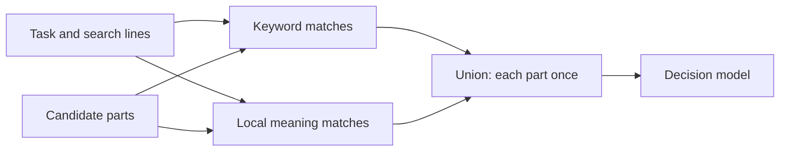

# @curatejs/core

Curate selects the memory an agent needs for a task from typed sources. Its RDC process ranks candidates, asks your decision function how strongly each item bears on the task, and asks your writer to turn the evidence into the dated log the task needs. Selection and curation each return a record.

## RDC process

- **Rank:** Order memory candidates by their signals.
- **Decide:** Keep every scored reference by default; use decision probability to order and weight it. Check rules against their separate applicability bar.
- **Curate:** Call `curate(task, picked, { write })` to write the dated log the working model reads.

## Install

```bash
pnpm add @curatejs/core
```

The host supplies its own sources, decision function, and writer. The default entry imports no model engine. The optional local embedding entry uses a separately installed runtime.

## Requirements

Node.js 22.12 or later.

## Source packages

Core supplies no reader. Install [chat](../chat/README.md), [git](../git/README.md)
or [markdown](../markdown/README.md) for built-in readers. Each depends on core.
The `@curatejs/core/internal` entry contains shared file, git and keyword helpers
used by those packages; it supplies no source or ranking defaults.

## Sources

A source implements `CandidateSource`: it has an `id`, a declared `role`
(`reference`, `rule` or `mixed`), and a `read` that takes a
`CandidateReadRequest` and returns a `CandidateReadResult`.

`read` answers one of three outcomes:

- **`status: 'read'`**: candidates, plus `complete: false` whenever
  enumeration stopped early or skipped anything.
- **`status: 'absent'`**: the expected nothing: no directory, no store.
  Non-fatal, with its reason.
- **A thrown `SourceReadError`**: a real failure: an unreadable file, a
  corrupt store, or `code: 'cancelled'` when the read was aborted.

The request's `exclude` paths are refused before any content is opened,
so excluded text never reaches signals or a model. A `revision` pin is
resolved once and used for every operation that read performs; a source
that cannot honour a pin answers `absent` rather than guess. A
candidate's `text` is the retained snapshot of the exact text scored.

## Search options

`pickFromSources` accepts host-written `searchLines` in its read request.
Each source searches the task and every distinct, nonblank line. A line
can be keywords or a short passage describing what the answer evidence
would say. Curate generates no lines. Keyword searches need no model.

```ts
const picked = await pickFromSources(
  sources,
  {
    task,
    searchLines: ['Backup copies are encrypted and tested by restoring them.'],
    searchPhrases: ['restored a', 'tested the backup'],
    stripSearchInstructions: true,
  },
  { task, decide, limits: { maxCandidates: 200 } },
);
```

- **Results:** The union keeps each `[sourceId, id]` once, with its best
  rank and the candidate data from that search. `searchRanks` records
  each zero-based rank within its source; `null` means absent from that
  search. The lowest rank becomes the record's `priority`.
- **Candidate budget:** `maxCandidates` applies to each search's
  interleaved feed. Their union can exceed that number, so extra searches
  add decisions without displacing original candidates. Batch and time
  limits still apply to the combined run.
- **Read budget:** `request.limit` applies to each keyword source read. Markdown
  and chat keep their best matches; git history enumerates the latest
  commits before ranking. A git read limit therefore excludes older
  commits from keyword searches. Phrase searches filter before this limit,
  as described below. Resolved revisions are reused across reads.
- **Single search:** Omit `searchLines` or pass `[]`. Duplicate lines
  and lines that repeat the original task add no read.

`searchPhrases` adds exact, contiguous word searches over candidate text and titles.
Case and punctuation are ignored; short words and word order remain.
For example, “got my” matches “I even got my vinyl signed”, while
“forgot my” and “got a copy of my” do not match. There is no stemming.
A phrase cannot span the title and text. Matches are ordered by occurrence
count, then item id.
The original task and keyword lines keep their ordinary search behavior.

Phrase matching runs in core after the source reads its candidates,
before the per-read `limit` is applied. It asks the source to enumerate
without that limit, so a phrase read can cost more local I/O than a keyword
read. Exclusions, revision pins and cancellation still reach the reader.
A source that stops enumeration remains incomplete. A phrase with no
matches contributes no candidates. The per-search decision budget also
applies to each phrase; only matching candidates enter that feed.
Omit `searchPhrases` or pass `[]` to keep phrase searches off.
Curate generates no phrases and makes no model call.

For direct `pick` calls, hosts supplying `searchRanks` must include the
original search at index 0 and extra searches after it. Supply ranks for
every part of a searched source. Sources without those ranks retain
their ordinary signal order in each feed.

`stripSearchInstructions: true` removes explicit, standalone output
clauses such as “cite both” and “answer in one line” from search text.
The exported `stripSearchInstructions(task)` helper performs the same
operation. It preserves unfamiliar wording and retrieval needs such as
counting, dates, comparisons and identifying the newer fact. The full
task still goes to `decide`; pass that same task to `curate`.

### Optional local meaning search

`meaning: { embed }` adds local embedding searches for the task and its
distinct search lines. Each part receives a separate meaning rank for
each query. Keyword ranks and signals stay intact. The decision feed
unions the keyword and meaning matches, keeping each `[sourceId, id]`
once. Omit `meaning` to keep ordinary keyword search.



For the supplied local adapter, install its optional peer runtime:

```bash
pnpm add node-llama-cpp@3.18.1
```

```ts
import { pickFromSources } from '@curatejs/core';
import { createLocalEmbedder } from '@curatejs/core/local-embeddings';

// A local MiniLM GGUF model file; the adapter downloads nothing.
const local = await createLocalEmbedder({ modelPath });
try {
  const picked = await pickFromSources(
    sources,
    { task, searchLines, meaning: { embed: local.embed } },
    { task, decide },
  );
} finally {
  await local.dispose();
}
```

- **Model:** The adapter accepts sentence embedding models that take plain
  text. The tested model is [MiniLM-L6 Q4](https://huggingface.co/second-state/All-MiniLM-L6-v2-Embedding-GGUF),
  a 19,699,648-byte model with 384 vector dimensions. It uses the same
  Node runtime as QMD's larger EmbeddingGemma model. Models that require
  query or document prompts need a host-supplied embedding function.
- **Complete text:** Inputs longer than the model window are embedded in
  token windows. Their normalized vectors are averaged by token count.
  No input text is cut off to fit the model. A part whose body contains
  only whitespace or invisible formatting characters uses its title for
  embedding, including a commit with only a subject.
  Its original body and title remain in the returned evidence.
- **Storage:** Candidate vectors exist only while a batch is scored and
  are discarded afterward. Curate writes no database, vector index or
  candidate cache. The model file stays on disk.
- **Candidate reads:** A supplied keyword `request.limit` still controls
  keyword results. Meaning search makes an additional unrestricted read
  so it can find other parts. Exclusions and revision pins apply to that
  read too. Partial source reads remain recorded as partial.
- **Dials:** `meaning.nearest` is an optional positive integer per query
  and source. Omit it to retain every meaning rank. An optional
  `limits.maxCandidates` still applies to each interleaved query feed;
  their union can exceed it. No meaning cutoff is supplied by default.
  The union preserves keyword eligibility; caller-supplied batch or time
  limits can still leave keyword candidates unasked because meaning
  ranks affect the combined decision order.
- **Failures:** Local model failures stop the search before decisions.
  Cancellation is checked between batches and model windows. There is
  no API fallback.

For hosts that already have candidates, `addMeaningRanks(candidates,
task, { embed, searchLines })` returns the same union rank data for
`pick`. An `EmbeddingFunction` returns one vector per complete input
text, in input order. The helper uses cosine similarity, which compares
vector direction rather than length, and breaks ties by candidate id.

### Defaults and evidence

The LongMemEval tuning check covers 249 questions and 445 labelled
answer-turn starts. It measures evidence reaching decisions, not final
answer accuracy. The union comparisons use a budget per search.

| Option | Default | Measured reason |
| --- | --- | --- |
| **Reference selection** | Keep every scored item; bar 0 | In the saved-decision sweep, 0.05/0.5 removed every fed fragment of 50 answer turns; 0.2/0.6 removed 70; a single 0.6 cut removed 183. Keeping everything added no selection losses. Seven of 445 labelled turns were absent from the feed. This measures retention before curation, not final answer accuracy. |
| **Extra search lines** | Run when supplied | Using the chat package, five subject lines plus five alternate-name lines at 100 parts reach 440/445 turns and add 207.3 decisions per question. At 200, five subject lines reach 442/445 and add 214.2. At 600, task-only search reaches all 445; extra lines add no labelled evidence. |
| **Phrase searches** | Off unless supplied | One event phrase recovers one extra labelled turn at 100 parts for 0.9 extra decisions per question on average. Keyword lines also recover that turn. On its sports-event order question, the phrase adds two parts, compared with 58 for one subject line. At 200 and 600 it adds no labelled turns. |
| **Local meaning search** | Off | In 249 tuning questions, 200 keyword parts plus 48 nearest task-meaning matches reaches all 445 labelled turn starts and all their surviving parts, adding 19.5 decisions per question. Keyword-only retrieval at 600 parts reaches the same evidence. The 48-part depth is measured for that tuning setup, not a cutoff for other histories. Final-answer accuracy is unmeasured. |
| **Instruction removal** | Off | It changed zero tuning questions and ranks. Benefit on tasks with output instructions is unmeasured. |
| **Rank protection** | Off | In a 60-question cached sample, recall in the first four items fell from 94.09% to 84.68%; in the first eight, from 100% to 99.71%. Full-feed packing is unmeasured. |
| **Best part first** | Off | One part per session reached 259/445 answer turns. Even an optimistic continuation at 0.4 reached only 423/445. This does not establish a safe way to skip parts. |

The line comparison generates five subject lines, five alternate-name
lines and five subject-free event phrases per tuning question with a
subscription model, then tests prefixes of one, three and five.
Keywords use the chat package's default ranking. Core unions the feeds
and applies the budget per search. These host settings retain every
labelled turn and every complete labelled turn found with all fifteen
lines, checked question by question:

| Parts per search | Subject lines | Alternate-name lines | Event phrases |
| --- | --- | --- | --- |
| 100 | 5 | 5 | 0 |
| 200 | 5 | 0 | 0 |
| 600 | 0 | 0 | 0 |

Hosts can keep event phrases for cheaper retrieval of specific events.
The sports-event order example uses “watched” to recover its third
labelled turn. A count/list-only route would omit that question.
The combined keyword settings also find that turn, so omitting phrases
from these combined defaults preserves its evidence.

The line gains use keyword and phrase search, not vector search. The rank sample uses saved “needed”
answers, rather than a complete decision feed. The document check uses
a 0.4 continuation gate. No continuation gate is used by the package.

## Picking

`pick(candidates, { task, decide })` ranks the candidates, asks `decide`
in bounded batches, and returns the selected candidates with a
`PickRecord`. The reference threshold defaults to zero, so every reference
with a valid decision probability is kept, including zero. The model
orders and weights these items rather than dropping them. References
with no valid decision answer remain unanswered; limits can leave items
unassessed.

For a single cut, set your own bar:

```ts
const picked = await pick(candidates, {
  task, decide, thresholds: { reference: 0.05 },
});
```

Rules also keep every scored item by default. Set `thresholds.rule`
for an optional applicability cut. `applies: always` rules bypass that check.

`pickFromSources(sources, request, options)` reads the
sources first, then picks over the combined candidates; a rule source
that returned `complete: false` or was absent makes the record's
`rulesCoverage` `'incomplete'`, even when every supplied rule was
answered. `rulesEnumerationComplete: false` in the options is honoured
the same way.

Each candidate's `changedPaths` names the repository paths it changed;
`gitHistory` fills it from the commit's diff, never from paths the text
mentions. With an optional reference cut enabled, a reference answered
at or above `linkedPathBar` (0.4 by default) still passes when a selected
commit from the same `repository` names its `path` in
`changedPaths`. The record entry names the commit that carried it over
in `link`, and a linked candidate never carries another. The bar is a
chosen default, not a measured best; `PickThresholds.linkedPathBar`
overrides it.

`cascade` accepts a fitted question set: `bias` and `questions`, each
with `key`, `instructions`, `true`, `false`, and `weight`. Curate combines
the answers with those weights into the decision probability. Optional
`first`, `band: [low, high]`, and `firstOnly: { bias, weight }` ask one
question first and use its fitted probability outside the band; inside
the band, all questions contribute. The record keeps the configuration
and each question's answer. A missing returned answer contributes nothing
to the fitted sum; when every answer is missing, the item stays unanswered.
If a limit stops required questions before they are asked, the item stays
unassessed.

### Question sets by source

`cascadesByKind` accepts a question set for each source kind: `chat`,
`git-history`, and `markdown`. The built-in sources declare their `kind`.
Custom sources can declare it too. A supplied `cascade` remains the
fallback for a kind without a set and for a source without a kind.
Without either set, the ordinary reference question applies.
Rule candidates keep their separate applicability question.

```ts
import { pickFromSources } from '@curatejs/core';
import { chat, CHAT_CASCADE } from '@curatejs/chat';
import { gitHistory, GIT_HISTORY_CASCADE } from '@curatejs/git';
import { knowledgeBase, MARKDOWN_CASCADE } from '@curatejs/markdown';

const picked = await pickFromSources(
  [chat({ paths: ['transcripts'] }), gitHistory('.'), knowledgeBase('docs')],
  { task },
  {
    task, decide,
    cascadesByKind: {
      chat: CHAT_CASCADE,
      'git-history': GIT_HISTORY_CASCADE,
      markdown: MARKDOWN_CASCADE,
    },
  },
);
```

For direct `pick` calls, supply `sourceKinds: { conversations: 'chat' }`
to map each candidate's `sourceId` to its kind. `pickFromSources` fills
that map from the sources that returned those candidates; a declared
source kind takes precedence over the supplied map.
The record keeps the per-kind sets, source map and each candidate's kind.
The single `cascade` path keeps its record format when per-kind sets
are omitted.

The chat package’s `CHAT_CASCADE` contains the fitted relevance, own-situation and needed
questions, with relevance asked first. `GIT_HISTORY_CASCADE` and
`MARKDOWN_CASCADE`, exported by git and markdown respectively, share four fitted questions: `current`, `needed`,
`when`, and `offtopic`. They ask about relevance, needed information,
timing, and a different subject. The negative `offtopic` weight lowers
the score when an item is about a different subject. These sets ask
neither `own` nor `preference` of commits or notes. Fitted scores order
evidence; they do not measure the chance of a correct final answer.

By default, all scored reference items are kept and ordered by decision
probability, strongest first, with ranked order breaking ties. There is no fixed character cap.
`keepTop: N` marks the first N ranked keyword hits. Those that pass
the threshold move to the front; rejected items stay rejected. N must be a
nonnegative safe integer. Fitted sets and top-hit promotion are opt-in.

### Optional rank protection

`rankProtection: true` orders selected references by
`w / rank + (1 - w) * probability`. Rank is one-based within the source;
with extra searches it is the best rank across them. The weight `w` is
0.75 at ranks 1–3, 0.60 at 4–10, and 0.40 below that. Rules stay first,
and `keepTop` retains its explicit promotion.

This affects order only. Optional reference cuts still apply; rules keep
their separate applicability bar. The record stores `orderScore`
separately; curator weights remain the original decision probabilities. Omit the option or pass
`false` to retain the default order and record format.

### Optional best part first

`bestPartFirst: true` first asks about the fed part with the most distinct
task words in each document. Words must have more than two characters;
ties use feed order. Chat parts group by provider and session, notes by
their file, and commits remain separate items. Source and revision are
part of every group identity. Hosts can supply `candidate.documentId`
for their own parts; candidates without document metadata stay separate.

Curate applies the representative's question set before asking about all
its other fed parts. A low score on the first part never skips the rest
of the document. Optional cuts apply to each part's own decision score.

Each fed reference records its `representative` item id. Batch, candidate,
time and cancellation limits remain in force. A stopped run reports the
stop reason for unasked parts. Rules are asked independently. Omit the
option or pass `false` to judge the whole feed as usual.

### Markdown candidate kinds

The Markdown package's `markdown({ paths, kind })` source adds a candidate
`kind`: `knowledge`, `docs`, `rules`, or `instructions`. This is separate from
source kind `markdown`, which selects a fitted cascade through `cascadesByKind`.
Without a cascade, core asks the candidate-kind question. Host candidates with
role `rule` retain rule questions; instruction candidates use the instruction
question. Decision questions and records keep the candidate kind.

`ranking: { docs: { bm25: 2 } }` weights signals by Markdown kind before the
candidate feed is chosen when candidates have no search ranks. Search ranks
retain their lane order. Omitted signal weights are 1. Weights must be finite;
negative weights are allowed. The record includes `ranking` when supplied.
Selection retains the score-order and keep-all defaults.

Sources can declare `maxQuestionText` as their preferred reader part size.
Infinity requests whole items by default. Explicit pick and read text budgets
take precedence. The Markdown source uses this to keep whole text; existing
readers retain their part sizes. A shared `CandidateReadContext` passes file
bytes between overlapping reads within one `pickFromSources` call.

## Curating

`curate(task, picked, { write })` accepts the result of `pick` or
`pickFromSources`. It calls your `write(prompt, signal)` function to
write the log the task needs, with no fixed character cap.
`prompt.instructions` contains the v4 dated-log wording and three weight
bands: 0.6 or more, 0.1 to below 0.6, and below 0.1. `prompt.body` contains the
task and selected reference items in their selected order. Each header
keeps the full item id, the candidate's date value, and its decision
weight without rounding. A missing date stays missing.
The instructions ask the writer to keep every observation from items at
0.6 or more, include useful facts from items at 0.1 to below 0.6, and use
items below 0.1 only when they clearly state a needed fact. The prompt
asks for less space for low scores; they remain available as evidence.
When ids clash across sources, their headers use `[sourceId, id]` as a
JSON string so the writer can tell them apart.

```ts
import { curate, pick, type CurateWrite, type MemoryCandidate, type PickDecide } from '@curatejs/core';

// The host supplies both functions, using its chosen model route.
async function recall(task: string, candidates: MemoryCandidate[], decide: PickDecide, write: CurateWrite) {
  const picked = await pick(candidates, { task, decide });
  const curated = await curate(task, picked, { write });
  return { log: curated.log, pickRecord: picked.record, curateRecord: curated.record };
}
```

The returned `log` is the text for the working model to read. Its lines
have this form:

```text
[2023-05-13] Visited York (said 2023-05-20; trips.md#2)
```

The event date and the date it was said are separate. The prompt asks
the writer to keep exact names and amounts, merge repeated events with
both full ids, and mark later observations that replace earlier ones.
Selected rules stay in `picked.selected` for the host to pass as exact
instructions; the curator reads only reference items.

`taskDate: '2023-05-22'` adds ` (asked 2023-05-22)` to the task in
every writer call. The date label is kept exactly, including any time or weekday.

`working: true` adds worked notes below the log for counts, dates, order
and latest values. It is off by default. The working section's title
can be plain text or a Markdown heading.

`context: true` asks the writer to keep who, where and which item or event
on each observation. It asks for links from that observation's own session
and forbids invented links. It is off by default. The same guidance applies
when condensing; output checks validate dates and source ids, not whether
the writer preserved each factual link.

`routeByTask: true` chooses guidance from the task's words alone:

- **Counts and lists:** Enable worked notes and ask for each distinct instance across the supplied sessions.
- **Dates and order:** Enable worked notes for dates, gaps and order.
- **Advice:** Enable the advice preference lines.
- **Changed facts, named things and other tasks:** Keep the ordinary dated-log guidance.

The option is off by default. Explicit `working` and `preferenceAdvice`
values override the route's choices. `context` stays independently configurable.
`classifyTask(task)` exposes the same code-only classification. It can return
several kinds for one task. It uses common English phrases, capitals and
quoted names; it does not infer unstated changes or consult evidence.

`preferenceAdvice: true` asks for optional `Advice preferences:` lines
with the user's stated tastes, relevant experiences and constraints for
advice tasks. `preferenceChange: true` asks for optional
`Changed preference:` lines with stated changes of taste or exclusions.
Both are off by default. Each added line must have text and cite
full source item ids in parentheses or square brackets, for example:

```text
Advice preferences: Likes history and quiet walks (trips.md#2)
Changed preference: Wants quieter trips [trips.md#2]
```

These lines also count toward `contextLimit`. The same preference
instructions apply when condensing. Dates and source ids on observation
lines keep their strict checks when preferences are enabled.

`record` holds `promptVersion: 'v4'`, `weights: 'tiers'`, `working`,
`preferenceAdvice`, `preferenceChange`, `items`, `logLength`, `condensed`,
and `overContextLimit`. It includes `taskDate` when supplied.
It includes `context` when supplied and `taskKinds` when routing is enabled.
Each item includes its prompt `id`, the full `candidate`, and
the exact decision `weight`.

Set `contextLimit` to the positive integer number of characters the
caller's working model can accept:

```ts
const curated = await curate(task, picked, { write, contextLimit: 12000 });
```

If the first validated log exceeds that limit, Curate calls `write`
exactly once more with the task, the full log, and exact item weights.
The condense prompt asks the writer to merge or drop observations from
items below 0.1 first, then those from 0.1 to below 0.6. It asks for
observations from items weighted 0.6 or more to stay whole, and for
retained observations to keep their event dates, said dates, full source
ids, and replacement dates. The result must pass the same format checks.
These checks do not prove that the writer followed the tier instructions.

The record includes `contextLimit` when supplied. `logLength` is the
first validated log's length after trimming. `condensed` says whether
the second call ran; `condensedLength` is present only when it ran.
`overContextLimit: true` says that the returned log still exceeds the
budget. Such a log is returned whole without another call or a length
error. Without `contextLimit`, Curate makes one call and returns the
validated log without condensing.

`working: true` asks the writer to add numbered instances inside the
task's period, computed time gaps or order, and latest values under
`Working (the curator's; check it against the log):`. It is off by
default. The reader should check these notes against the log.

An empty log or a malformed observation throws a clear error.
Each observation must have
valid calendar dates in its event and `said` fields and full ids of items
given to the writer. Merged sources can separate ids with commas,
semicolons, `and`, or `&`. If sources recorded the same fact on different
days, repeat the dated group: `(said 2023-05-20; notes#1; said 2023-05-21; notes#2)`.
Every source date and id is checked. Optional
suffixes are `(when not stated)` and `(replaces [YYYY-MM-DD])`; replacement
dates must also be valid. These checks verify the format and source ids;
they do not prove the writer's
facts or date calculations. Worked notes count toward `contextLimit`.
There is no retry, truncation, or fallback to raw items. Missing selected
weights and a selection with no reference items fail before `write`.
Writer failures propagate to the caller. `signal` reaches the writer;
the host must make its model call honour cancellation.

## Optional evidence limits

The defaults judge every supplied candidate and show its full text.
Reader parts are 700 characters by default; every part is preserved.
`DEFAULT_MAX_QUESTION_TEXT` names that reader size, not a decision cut.

| Dial | Default | Cost and loss |
| --- | --- | --- |
| **`maxPerBatch`** | 150 questions | Changes request size only; all batches run. |
| **`maxCandidates`** | Off | Stops at N candidates per search lane. A saved tuning comparison at 100 parts lost 43 of 445 labelled answer-turn starts; 600 retained all 445 in that comparison. This does not prove a safe cut for other data. |
| **`maxBatches`** | Off | Stops after N requests; every unasked candidate is recorded. With 151 one-question candidates and one 150-question batch, one candidate remains unassessed. Cascades can use multiple requests per candidate. |
| **`maxElapsedMs`** | Off | Stops questions when the elapsed time is reached. Loss depends on response time; stopped and failed questions remain in the record. |
| **`maxQuestionText`** | Off | Cuts each decision item to N Unicode characters and records `truncated`. For a 1,000-character item at 700, 300 characters are hidden. Readers can split instead; direct `pick` callers must choose their own cut. |
| **Source read `limit`** | Off | Chat and Markdown keep ranked candidates; git keeps newest commits before ranking. Readers report partial coverage. A limit of 1 on 2 candidates drops 1. |
| **`thresholds.reference`** | 0 | A saved 0.6 cut removed every fed fragment of 183 labelled answer turns. A user cut reduces curation input; the default adds no cut loss. |
| **`thresholds.rule`** | 0 | A user applicability cut omits rules below its probability. Quality loss on labelled rule tasks is unmeasured; the default adds no cut loss. |
| **`contextLimit`** | Off | Requests a second writer call to condense the complete log. Format checks do not prove fact retention. No quality loss curve has been established; leave off for full retention. |

Unlimited inputs can require more decision requests and model context.
Reader failures, cancellation, missing answers and model failures still
need host handling; removing a numerical cut does not prove full recall.
