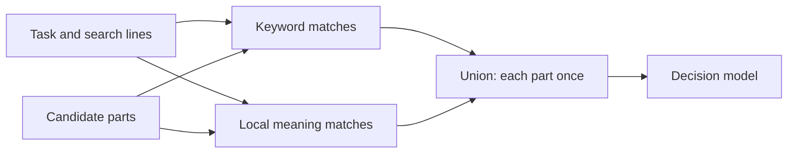

# @curatejs/core

Curate selects the memory an agent needs for a task from typed sources. Its RDC process ranks candidates, asks your decision function how strongly each item bears on the task, and asks your writer to turn the evidence into the dated log the task needs. Selection and curation each return a record.

## RDC process

- **Rank:** Order memory candidates by their signals.
- **Decide:** Judge ranked evidence with narrow questions. Keep references scored 0.0146 or more, ordered and weighted by decision probability. Check rules against their separate applicability bar.
- **Curate:** Call `curate(task, picked, { write })` to write the dated log the working model reads.

## Install

```bash
pnpm add @curatejs/core
```

The host supplies its own sources, decision function, and writer. The default entry imports no model engine. The optional local embedding entry uses a separately installed runtime.

## Requirements

Node.js 22.20 or later.

## Recall context

`memory()` reads sources, selects evidence and writes a dated, cited log in one call.
Supply the readers and your two model functions:

```ts
import { memory } from '@curatejs/core';

const mem = memory({ sources, decide, write });
const { log, rules, picked, result } = await mem.recall('What billing constraint must this change preserve?');
```

- **Log:** `log` is the writer's text after format checks and any recovery. `result` is the full `CurateResult`, including its record.
- **Rules:** `rules` joins selected rules with blank lines and preserves each rule's text. Rules do not go to the writer.
- **Selection:** `picked` is the full `PickSourcesResult`, including source reads and decision records.
- **Questions:** Each source carries its decision question set as `questions`, set through `historySource()`, and each built-in reader carries its fitted set. `memory()`, `pickFromSources()` and the `/curate` skill all ask each source its own set. A source without one asks core's ordinary question. A direct `pick()` takes the sets by source id as `questionsBySource`.
- **Incomplete collection:** Absent or incomplete reads, unanswered candidates and interrupted decisions throw before the writer runs. Parts intentionally excluded by the label questions are allowed. The error's `cause` holds `picked` for inspection. Source read errors propagate. A limit that leaves candidates unassessed also throws; use `pickFromSources()` directly if you need to accept a partial selection.
- **Cancellation:** `mem.recall(task, { signal })` passes the signal to the readers and both model functions.

Each source carries its own settings: whether the rare-word round runs on it, which label kinds its parts are asked, and the decision-score bars its parts are cut at.
Git and Markdown run the rare-word round and chat leaves it off; chat asks the seven label kinds and git and Markdown ask none; every reader keeps references scored 0.0146 or more.
Out of the box the call decides every ranked part, with routing off.
Explicit `read`, `pick` and `curate` options apply to the whole call:

```ts
const mem = memory({
  sources: [historySource({ reader: chat(), ...chatSettings }), git('.')],
  decide,
  write,
  read: { wholeLanes: true },
  pick: { everyScored: { bar: 0.05 } },
  curate: { context: true },
});
```

See [levers and source settings](#levers-and-source-settings) for each source's settings and how to change them.

`pickFromSources()` and `curate()` remain separate public calls for hosts that manage each step themselves.
`pickFromSources()` asks each source its own question set, as `memory()` does.
See the [runnable example](https://github.com/jonny981/curate#use-it) for installation and source setup.

## Model helpers

The optional `@curatejs/core/models` entry supplies four factories using Node's built-in `fetch`:

```ts
import { jev, chatWriter } from '@curatejs/core/models';

const decide = jev({ apiKey: process.env.TYPESAFE_API_KEY });
const write = chatWriter({ apiKey: process.env.CHAT_API_KEY, model: 'gpt-5-mini' });
```

- **Jev:** `jev({ apiKey?, model?, url? })` returns a `PickDecide` function for TypeSafe's System One endpoint, with `deciderId: typesafe:${model}:items-once`. The model defaults to `'jev-latest'`. Missing or invalid probabilities become missing answers.
- **Jev at another address:** set `url` for any server that speaks Jev's format, such as a Clef server. The key is then optional, and no `authorization` header is sent without one. The `deciderId` is `jev:${host}${path}:${model}:items-once`, read from `url`.
- **What a Jev request holds:** the request's state is the batch's task, then each item once, numbered, with its id, date, title and text. Each question's instructions are its wording, then the number of its item, so an item asked seven questions is sent once. `jevRequest(batch, model?)`, exported from `@curatejs/core`, builds that body.
- **Jev request size:** Jev documents its limits in tokens: 32,000 for the state plus the longest question, and 64,000 for the whole request. At an estimate of three characters a token, `jev()` splits a batch into several requests so that in each one the state plus its longest question's instructions and criteria is at most 96,000 characters, and the whole request body at most 192,000. An item's questions always go in its item's request, and an item larger than those bounds goes alone. The answers come back as one map for the batch, and a failed request fails the batch.
- **Labels and decisions stored by an older `jev()`:** they are keyed by its earlier ID, `typesafe:${model}`, so `jev()` asks for them once more. A pick that sets `labels.deciderId`, or a decision cache with its own `deciderId`, keeps its stored entries.
- **OpenAI Decisions:** `openAIDecisions({ apiKey, model? })` returns a `PickDecide` function for the [Decisions API](https://developers.openai.com/api/docs/guides/decisions), with `deciderId: openai:${model}`. The model defaults to `'gpt-6-luna'`. Predicate answers become probabilities; refusals become `{ status: 'refused' }`. Missing or invalid probabilities become missing answers.
- **Local decisions:** `localDecisions({ url, model, apiKey? })` returns a `PickDecide` function for an OpenAI-compatible chat completions address, with `deciderId: local:${host}${path}:${model}`. It sends one request a question, one after another. Each request holds the task, the question with its true and false criteria, and the item's id, date, title and text, and asks for one token with `temperature: 0`, `logprobs: true` and `top_logprobs: 20`. The answer is the probability of the "yes" tokens over the "yes" and "no" tokens among the first token's top log-probabilities, with case and leading whitespace ignored. When neither is there, the answer is missing. No `authorization` header is sent without a key.
- **Chat writer:** `chatWriter({ apiKey?, model, url? })` returns a `CurateWrite` function. The URL defaults to OpenAI's Chat Completions endpoint. Set `url` for another provider using that format; the key is then optional, and no `authorization` header is sent without one. Empty text passes through for later batches that add no observations; Curate checks the log itself.
- **Separate IDs per server:** the IDs built from `url` leave out its scheme and query. Set `labels.deciderId` yourself for two servers that differ only there. A decision cache keeps its own `deciderId`, so give it a different one for each server.
- **Errors:** `jev()` and `chatWriter()` reject a missing API key at their default addresses, and `openAIDecisions()` always does. A `localDecisions()` reply with no log-probabilities throws `The model server at <url> returned no log-probabilities; localDecisions needs a server that does.` HTTP failures and missing writer text throw. Cancellation reaches `fetch`.

> [!NOTE]
> At their default addresses, `jev()`, `openAIDecisions()` and `chatWriter()` make paid model calls. A local model server needs no hosted service. You can also supply plain `decide` and `write` functions using any model route.

## Source packages

Core supplies no reader. Install [chat](https://github.com/jonny981/curate/blob/main/packages/chat/README.md), [git](https://github.com/jonny981/curate/blob/main/packages/git/README.md)
or [markdown](https://github.com/jonny981/curate/blob/main/packages/markdown/README.md) for built-in readers. Each depends on core.
The `@curatejs/core/internal` entry contains shared file, git and keyword helpers
used by those packages; it supplies no source or ranking defaults.

## Sources

A source implements `CandidateSource`: it has an `id`, a declared `role`
(`reference`, `rule` or `mixed`), and a `read` that takes a
`CandidateReadRequest` and returns a `CandidateReadResult`.

`read` answers one of three outcomes:

- **`status: 'read'`**: candidates, plus `complete: false` whenever
  enumeration stopped early or skipped anything.
- **`status: 'absent'`**: the expected nothing: no directory, no store.
  Non-fatal, with its reason.
- **A thrown `SourceReadError`**: a real failure: an unreadable file, a
  corrupt store, or `code: 'cancelled'` when the read was aborted.

The request's `exclude` paths are refused before any content is opened,
so excluded text never reaches signals or a model. A `revision` pin is
resolved once and used for every operation that read performs; a source
that cannot honour a pin answers `absent` rather than guess. A
candidate's `text` is the retained snapshot of the exact text scored.

Request flags let a streaming reader do lane work inside the read.
`phraseLane: true` means `task` is an exact phrase to match, not keywords
to score, so the reader can keep matches without scoring the corpus; on
a kind lane `topic` then carries the task the lane serves, and the
reader ranks each match by it. `meaningLane` carries the embedding
function for a meaning read: the reader scores each part's similarity
inside the read and returns only the kept parts, so the corpus's text
is never held. `wholeLanes` arrives already resolved: `false` tells the
reader to narrow its own lane at the score curve and emit only the
kept candidates; `limit` on a kind or meaning read caps that kept set
after the curve, not the scoring before it. A read that narrowed
itself reports `laneCutApplied: true` and sets `matched` to the lane's
count before the curve, so the pick never cuts it twice. A reader
that returns everything leaves both unset and the pick cuts as before,
so a non-streaming source needs no change.

`context.files` shares file text between lanes and overlapping sources
in one pick. Readers fill it through a byte cap (64 MB): inside the cap
a file is read once; past it each pass re-reads, so a large corpus is
never held whole.

## Search options

`pickFromSources` accepts host-written `searchLines` in its read request.
Each source searches the task and every distinct, nonblank line. A line
can be keywords or a short passage describing what the answer evidence
would say. Curate generates no lines. Keyword searches need no model.

```ts
const picked = await pickFromSources(
  sources,
  {
    task,
    searchLines: ['Backup copies are encrypted and tested by restoring them.'],
    searchPhrases: ['restored a', 'tested the backup'],
    stripSearchInstructions: true,
  },
  { task, decide, limits: { maxCandidates: 200 } },
);
```

- **Results:** The union keeps each `[sourceId, id]` once, with its best
  rank and the candidate data from that search. `searchRanks` records
  each zero-based rank within its source; `null` means absent from that
  search. The lowest rank becomes the record's `priority`.
- **Candidate budget:** `maxCandidates` applies to each search's
  interleaved feed. Their union can exceed that number, so extra searches
  add decisions without displacing original candidates. Batch and time
  limits still apply to the combined run.
- **Read budget:** `request.limit` applies to each keyword source read. Markdown
  and chat keep their best matches; git history enumerates the latest
  commits before ranking. A git read limit therefore excludes older
  commits from keyword searches. Phrase searches filter before this limit,
  as described below. Resolved revisions are reused across reads.
- **Single search:** Omit `searchLines` or pass `[]`. Duplicate lines
  and lines that repeat the original task add no read.

`searchPhrases` adds exact, contiguous word searches over candidate text and titles.
Case and punctuation are ignored; short words and word order remain.
For example, “got my” matches “I even got my vinyl signed”, while
“forgot my” and “got a copy of my” do not match. There is no stemming.
A phrase cannot span the title and text. Matches are ordered by occurrence
count, then item id.
The original task and keyword lines keep their ordinary search behavior.

Phrase matching runs before the per-read `limit` is applied. The pick
asks the source to enumerate without that limit and marks the read
`phraseLane`; a streaming reader then keeps only the matching parts,
while a reader that ignores the flag gets the same exact-match filter in
core after its read. Either way a phrase read can cost more local I/O
than a keyword read. Exclusions, revision pins and cancellation still
reach the reader.
A source that stops enumeration remains incomplete. A phrase with no
matches contributes no candidates. The per-search decision budget also
applies to each phrase; only matching candidates enter that feed.
Omit `searchPhrases` or pass `[]` to keep phrase searches off.
Curate generates no phrases and makes no model call.

Each source read is a set of lanes: one keyword lane for the task and
each distinct search line, one phrase lane per phrase, and any kind or
meaning lanes. A read result's `lanes` lists every lane with its search
text, its type (`search`, `phrase`, `kind`, `meaning` or `name`), the candidate
count the source returned for it before the lane's own filter, and the
count the lane kept. The
read's candidates are the union of what the lanes kept; the union has
no ceiling beyond what the lane curves cut. A host can read
`candidates.length` for the union size each task produced and report
its median, spread and largest across tasks; the per-lane `read` and
`kept` counts show which lanes made the large cases large.

Keyword lanes on reference sources cut themselves where each lane's own
score curve flattens. `cutLane` orders a lane's candidates by the sum
of their signals, and `cutScoreCurve` finds the bend: the point
furthest below the straight line between the lane's best and worst
positive scores. The curve measures the lane's own match score: a
candidate carries it in `laneScore` when its signals hold an ordering
or rank-merge score. Chat's signals hold a rank-merge score, so the
chat curve reads the pre-merge keyword score, never a rank position.
Candidates at or below the bend drop out. Equal scores fall together,
two or fewer positive scores always stay, and a lane with no bend
keeps every positive score. A search lane where nothing scored admits
nothing: it matched nothing. When a read keeps no candidates at all
it reports `noSearchMatch` on its read result, so the caller sees
the miss and can ask more broadly. The count comes from the scores,
so no lane has a fixed cut and the union has no ceiling. `searchPhrases` lanes are
never cut: an exact phrase is its own evidence. A kind lane is never
cut on how often its phrase occurs: the count says a match exists, not
that it is relevant, and a direction said once would lose to a phrase
everyone repeats. A streaming reader instead ranks each kind-lane
match by the task's own score and cuts that curve inside the read
when `wholeLanes` is off; a reader that cannot score the task returns
every match and the pick keeps them all. Meaning lanes get the same
curve cut on similarity scores, inside the read when the source
streams it. Pass `wholeLanes: true` in the read request to keep every
candidate each search returned.

`kindLanes` adds phrase lanes in the language of the kind of message a
task asks for. It maps each source kind (`chat`, `git-history`,
`markdown`) to a list of exact phrases, for example direction wording
such as "we need to" or "never" for chat and "decision:" for notes.
A source reads only its own kind's phrases. Each phrase is a lane of
its own: the source searches for it, then an exact-match filter keeps
the candidates whose title or text contains it. A phrase only
identifies the match; it does not measure relevance. The read request
sends the phrase as `task` and the task itself as `topic`, and a
streaming reader scores the matches against the topic and cuts that
score curve inside the read. A source that cannot score returns every
match rather than ranking by phrase frequency, so a direction stated
once survives a phrase used everywhere.

Each source package exports ready phrase sets, one list per kind of
message a task commonly asks for: `CHAT_KIND_PHRASES`,
`GIT_HISTORY_KIND_PHRASES` and `MARKDOWN_KIND_PHRASES`. Each maps
`directions`, `decisions` and `corrections` to phrases in its source's
register, for example "we decided" and "settled on" in chat against
"chose" and "instead of" in commits. Feed the matching list in for the
task, such as `kindLanes: { chat: CHAT_KIND_PHRASES.directions }`.

When the task asks what a named person said, `speakerOnly: true`
narrows chat kind lanes to that person's own messages: a candidate
with chat metadata matches only when its recorded role is `user`.
Candidates without chat metadata still match. Omit `kindLanes` to keep
kind lanes off; omit `speakerOnly` to keep every matching role.

For direct `pick` calls, hosts supplying `searchRanks` must include the
original search at index 0 and extra searches after it. Supply ranks for
every part of a searched source. Sources without those ranks retain
their ordinary signal order in each feed.

`stripSearchInstructions: true` removes explicit, standalone output
clauses such as “cite both” and “answer in one line” from search text.
The exported `stripSearchInstructions(task)` helper performs the same
operation. It preserves unfamiliar wording and retrieval needs such as
counting, dates, comparisons and identifying the newer fact. The full
task still goes to `decide`; pass that same task to `curate`.

### Names in the task

`taskNames(task)` lists the people and things a task names, found with
code and no model. It finds quoted titles, hashtags, and runs of
capitalised words that do not start a sentence. A run of two or more
capitalised words counts even at the start of a sentence. Month and day
names, "I" and question words are never names. "Dr." and "St." stay
inside a name, and a trailing "'s" is dropped. So
`taskNames('Who graduated first among Emma, Rachel and Alex?')` returns
`['Emma', 'Rachel', 'Alex']`. It also lists capitalised words that name
nothing specific, such as "Korean". `classifyTask` tags a task `named`
exactly when `taskNames` finds a name.

A source with its `names` setting on searches once more for each name,
as an exact phrase that ignores case, like a `searchPhrases` entry. The
reason is recall: a part the search loses never reaches the decision
step, and a name is the most exact search a task offers. A name lane is
never cut on its score curve. Like every lane, it holds at most the
read's `limit` matches, `maxCandidates` caps it on its own, and an
`everyRanked: { c }` cut can leave one of its matches undecided. Its
entry in the read's `lanes` has the type `name` and the name as its
search text. A task with no names opens no name lane, and neither does
a name another phrase lane already searches. A name gets no meaning
lane.

`findNames` on `pick` or `pickFromSources` replaces `taskNames` for one
call, for example with a small model. It takes the task and returns the
names. It is called once per pick, and only when a source has `names`
on or a source's question set has `named`. A function that throws, or
returns anything but an array of strings, stops the pick. Curate ships
no model for it. `record.names` holds `found`, the names, and `by`,
`'code'` or `'caller'`. It is present when the pick looked for names.

### Optional local meaning search

`meaning: { embed }` adds local embedding searches for the task and its
distinct search lines. Each part receives a separate meaning rank for
each query. Keyword ranks and signals stay intact. The decision feed
unions the keyword and meaning matches, keeping each `[sourceId, id]`
once. Omit `meaning` to keep ordinary keyword search.



For the supplied local adapter, install its optional peer runtime:

```bash
pnpm add node-llama-cpp@3.18.1
```

```ts
import { pickFromSources } from '@curatejs/core';
import { createLocalEmbedder } from '@curatejs/core/local-embeddings';

// A local MiniLM GGUF model file; the adapter downloads nothing.
const local = await createLocalEmbedder({ modelPath });
try {
  const picked = await pickFromSources(
    sources,
    { task, searchLines, meaning: { embed: local.embed } },
    { task, decide },
  );
} finally {
  await local.dispose();
}
```

- **Model:** The adapter accepts sentence embedding models that take plain
  text. The tested model is [MiniLM-L6 Q4](https://huggingface.co/second-state/All-MiniLM-L6-v2-Embedding-GGUF),
  a 19,699,648-byte model with 384 vector dimensions. It uses the same
  Node runtime as QMD's larger EmbeddingGemma model. Models that require
  query or document prompts need a host-supplied embedding function.
- **Complete text:** Inputs longer than the model window are embedded in
  token windows. Their normalized vectors are averaged by token count.
  No input text is cut off to fit the model. A part whose body contains
  only whitespace or invisible formatting characters uses its title for
  embedding, including a commit with only a subject.
  Its original body and title remain in the returned evidence.
- **Storage:** Candidate vectors exist only while a batch is scored and
  are discarded afterward. Curate writes no database, vector index or
  candidate cache. The model file stays on disk.
- **Candidate reads:** A supplied keyword `request.limit` still controls
  keyword results. Each meaning query first asks the source to serve the
  lane itself (`meaningLane` on the read request): a streaming reader
  scores similarity inside the read, keeps what the curve keeps, and
  returns only those parts flagged `meaningLane`, so the corpus's text
  is never held. A source that does not honour the flag answers an
  ordinary keyword read, and the pick then makes one unrestricted
  fallback read and scores its whole pool itself. Exclusions and
  revision pins apply either way. Partial source reads remain recorded
  as partial.
- **Dials:** `meaning.nearest` is an optional positive integer per query
  and source. Each meaning query is cut where its similarity score
  curve flattens, the same cut keyword lanes get; pass `wholeLanes: true`
  on the read request (or `meaning.wholeLanes: true` for meaning only)
  to keep every rank. `nearest` bounds the ranks a query keeps either
  way. An optional `limits.maxCandidates` still applies to each
  interleaved query feed; their union can exceed it.
  The union preserves keyword eligibility; caller-supplied batch or time
  limits can still leave keyword candidates unasked because meaning
  ranks affect the combined decision order.
- **Failures:** Local model failures stop the search before decisions.
  Cancellation is checked between batches and model windows. There is
  no API fallback.

For hosts that already have candidates, `addMeaningRanks(candidates,
task, { embed, searchLines })` returns the same union rank data for
`pick`. An `EmbeddingFunction` returns one vector per complete input
text, in input order. The helper uses cosine similarity, which compares
vector direction rather than length, and breaks ties by candidate id.

### Defaults and evidence

The LongMemEval tuning check covers 249 questions and 445 labelled
answer-turn starts. It measures evidence reaching decisions, not final
answer accuracy. The union comparisons use a budget per search.

| Option | Default | Measured reason |
| --- | --- | --- |
| **Reference selection** | Keep references scored 0.0146 or more | In the saved-decision sweep, 0.05/0.5 removed every fed fragment of 50 answer turns; 0.2/0.6 removed 70; a single 0.6 cut removed 183. Keeping everything added no selection losses. Seven of 445 labelled turns were absent from the feed. This measures retention before curation, not final answer accuracy. |
| **Extra search lines** | Run when supplied | Using the chat package, five subject lines plus five alternate-name lines at 100 parts reach 440/445 turns and add 207.3 decisions per question. At 200, five subject lines reach 442/445 and add 214.2. At 600, task-only search reaches all 445; extra lines add no labelled evidence. |
| **Phrase searches** | Off unless supplied | One event phrase recovers one extra labelled turn at 100 parts for 0.9 extra decisions per question on average. Keyword lines also recover that turn. On its sports-event order question, the phrase adds two parts, compared with 58 for one subject line. At 200 and 600 it adds no labelled turns. |
| **Local meaning search** | Off | In 249 tuning questions, 200 keyword parts plus 48 nearest task-meaning matches reaches all 445 labelled turn starts and all their surviving parts, adding 19.5 decisions per question. Keyword-only retrieval at 600 parts reaches the same evidence. The 48-part depth is measured for that tuning setup, not a cutoff for other histories. Final-answer accuracy is unmeasured. |
| **Instruction removal** | Off | It changed zero tuning questions and ranks. Benefit on tasks with output instructions is unmeasured. |
| **Rank protection** | Off | In a 60-question cached sample, recall in the first four items fell from 94.09% to 84.68%; in the first eight, from 100% to 99.71%. Full-feed packing is unmeasured. |
| **Best part first** | Off | One part per session reached 259/445 answer turns. Even an optimistic continuation at 0.4 reached only 423/445. This does not establish a safe way to skip parts. |

The line comparison generates five subject lines, five alternate-name
lines and five subject-free event phrases per tuning question with a
subscription model, then tests prefixes of one, three and five.
Keywords use the chat package's default ranking. Core unions the feeds
and applies the budget per search. These host settings retain every
labelled turn and every complete labelled turn found with all fifteen
lines, checked question by question:

| Parts per search | Subject lines | Alternate-name lines | Event phrases |
| --- | --- | --- | --- |
| 100 | 5 | 5 | 0 |
| 200 | 5 | 0 | 0 |
| 600 | 0 | 0 | 0 |

Hosts can keep event phrases for cheaper retrieval of specific events.
The sports-event order example uses “watched” to recover its third
labelled turn. A count/list-only route would omit that question.
The combined keyword settings also find that turn, so omitting phrases
from these combined defaults preserves its evidence.

The line gains use keyword and phrase search, not vector search. The rank sample uses saved “needed”
answers, rather than a complete decision feed. The document check uses
a 0.4 continuation gate. No continuation gate is used by the package.

## Time

Every read measures from one moment, the task's date.
Two fields set it, on the read request and in `pick`'s options:

- **`taskDate`:** an ISO 8601 date or date-time, such as `2025-06-02` or `2025-06-02T09:15:00+01:00`. A date without a time means the end of that day in `timeZone`. A time without an offset is a time in `timeZone`. Anything else throws a `TypeError` before any read. Absent means now.
- **`timeZone`:** the IANA time zone of the person asking, such as `Europe/London`. Absent means the system's own zone. A name the runtime does not know throws a `TypeError`.

`pickFromSources` takes both from the read request, or from `pick`'s options when the request has none, and passes them to every read and to `pick`.
Without `taskDate`, it reads now once and passes that moment to every read as the request's `asOf`, the moment the record's `asOf` names.
A reader measures from `taskDate`, else `asOf`, else now. It leaves out records dated after the moment only when `taskDate` is given.
`memory().recall(task, { taskDate, timeZone })` passes them the same way.
It also gives `taskDate` to `curate` as the task's date label, unless `curate.taskDate` is set.

The readers use them:

- **Git:** the `recency` signal is measured from the task date.
- **Chat:** a `since` duration counts back from the task date, and each date carries the zone's offset, such as `2025-06-02T00:30:00.000+01:00`.
- **After the task date:** with `taskDate` given, a chat message or a git commit dated after it is not read. Without it nothing is left out for its date. Markdown keeps notes dated after it, since a note can declare an `effective` date ahead. A `revision` pin reads a knowledge base as it stood.

### The task's period

`taskPeriod(task, { asOf, timeZone })` returns the period a task names as `{ from, to }`, or `undefined`.
`from` is the start of the first day and `to` the end of the last, each an ISO date-time with the zone's offset.
`asOf` takes the forms `taskDate` takes and defaults to now.
It reads only these English forms:

- **A month:** after "in", "during" or "of", or with a year or a day: "in March", "March 2024", "3 March", "March 3".
- **A year:** after "in" or "during": "in 2024".
- **A named day, week, month or year:** "today", "yesterday", "this week", "last week", "this month", "last month", "this year", "last year".
- **A count back:** "N days ago", "N weeks ago", "N months ago".
- **An ISO date:** "on 2025-03-04".

A month or a day with no year is its latest occurrence on or before `asOf`.
Weeks start on Monday.
Several periods in one task give one span, from the earliest start to the latest end.
A month name counts only in the forms above, so "May I ask what we chose?" names no period.

`pick`'s `taskPeriod` option is on by default and acts only when the task names a period.
`pickFromSources` then reads each source once more with the read request's `taskPeriod` set to that period.
It adds the parts dated inside it that no lane kept, marked `dateWindow: 'task-period'` and `poolOnly`.
`pick` admits a part with a `dateWindow` to the decide step as it admits a lane member.
A rule source is not read again: its parts are never cut.
`taskPeriod: false` turns it off.

Nothing is removed for its date.
A part is dated when it was written, not when the thing it describes happened.
A message in April that recalls March is dated April, so a filter on March would drop the very answer.

Each reader serves the period read in its own way.
Chat keeps the parts dated inside the period as they stream past.
Git reads the period with `git log --since --until`.
Markdown keeps the parts of notes dated inside it.
A reader that ignores the request's `taskPeriod` answers a whole-lane read, and `pickFromSources` keeps the parts it returned that are dated inside the period.

The pick record names what was used:

- **`asOf`:** the moment used, as an ISO date-time in `timeZone`. Pass it back as `taskDate` with the same `timeZone` to replay the pick.
- **`timeZone`:** the zone dates were read in.
- **`taskPeriod`:** `{ from, to }`, present when the option was on and the task named a period.
- **`dateWindow`:** on a part and its `PickRecordEntry`, `'task-period'` when the period, not a lane, brought it in.

## Picking

`pick(candidates, { task, decide })` ranks the candidates, asks `decide`
in bounded batches, and returns the selected candidates with a
`PickRecord`. By default, labels run only for a source that carries
label kinds: `chat()` carries the seven kinds, and `git()` and the
Markdown readers carry none. Each reference is kept
when its score reaches its source's bar: `barBySource`, keyed by source
id, or 0.0146 for a source it does not name. `pickFromSources` fills
`barBySource` from each source's `bar`. `everyScored` sets one bar for
every source in their place; `everyScored: true` keeps every valid
score, including zero.
The model orders and weights selected references. References
with no valid decision answer remain unanswered; limits can leave items
unassessed. A `decide` call that throws fails the pick with a `PickError`,
unless the elapsed limit stopped the call or the caller's signal aborted
it. The error's `record` carries the pick's record, which names the
batch's candidate ids and the error's message in `decideError`. A failed
decision batch leaves its candidates unanswered even when an earlier
batch answered some of their questions; a failed tag batch leaves a
decided selection standing and records the error on the tag answers.
There is no retry and no fallback.

To change the score cut for every source, set your own bar:

```ts
const picked = await pick(candidates, {
  task, decide, everyScored: { bar: 0.05 },
});
```

Rules also keep every scored item by default. A rules source's
`ruleBar`, or `ruleBarBySource` on a direct `pick()`, sets an optional
applicability cut; `rules()` from `@curatejs/markdown` sets 0.5. A candidate
a host builds with `applies: 'always'` bypasses that check.

`everyScored: { bySize }` replaces the flat bar with a
curve of `[decided count, bar]` points. Below the first point the first
bar applies; above the last the last bar applies; between two points
the bar moves linearly. The count is the number of references that
answered, so a small decided set can keep everything while a large one
cuts more of the weakest. The record keeps the sorted points and the
bar used as `thresholds.appliedReference`. Points must be unique
nonnegative safe integers with bars between 0 and 1. Their positions
are a measurement question: set them against the history the funnel
will read, and measure recall where each point lands before relying
on it.

`pickFromSources(sources, request, options)` reads the
sources first, then picks over the combined candidates; a rule source
that returned `complete: false` or was absent makes the record's
`rulesCoverage` `'incomplete'`, even when every supplied rule was
answered. `rulesEnumerationComplete: false` in the options is honoured
the same way.

Each candidate's `changedPaths` names the repository paths it changed;
`git()` fills it from the commit's diff, never from paths the text
mentions. When a reference score cut applies, a reference answered
at or above `linkedPathBar` (0.4 by default) still passes when a selected
commit from the same `repository` names its `path` in
`changedPaths`. The record entry names the commit that carried it over
in `link`, and a linked candidate never carries another. The bar is a
chosen default, not a measured best; `PickThresholds.linkedPathBar`
overrides it.

A source's `questions` setting takes a fitted question set, a
`PickCascade`: `bias` and `questions`, each with `key`, `instructions`,
`true`, `false`, and `weight`. Curate combines the answers with those
weights into the decision probability. Optional `first`,
`band: [low, high]`, and `firstOnly: { bias, weight }` ask one question
first and use its fitted probability outside the band; inside the band,
all questions contribute. `historySource()` checks the set when it builds
the source. The record keeps the set under
`levers.sources[sourceId].questions` and each question's answer on the
part's entry. A missing returned answer contributes nothing
to the fitted sum; when every answer is missing, the item stays unanswered.
If a limit stops required questions before they are asked, the item stays
unassessed.

### Question sets by source

Each source asks its reference parts the set in its own `questions`
setting. The presets carry their reader's fitted set through their
settings objects, and two sources of the same kind can ask different
sets. A source without a set asks the ordinary reference question.
Rule candidates keep their separate applicability question.
`memory()`, `pickFromSources()` and the `/curate` skill ask each
source's set the same way.

```ts
import { historySource, pickFromSources } from '@curatejs/core';
import { chat } from '@curatejs/chat';
import { git, gitSettings } from '@curatejs/git';
import { knowledgeBase } from '@curatejs/markdown';

const picked = await pickFromSources(
  [chat({ paths: ['transcripts'] }), historySource({ reader: git('.'), ...gitSettings, questions: mySet }), knowledgeBase('docs')],
  { task },
  { task, decide },
);
```

A direct `pick` call has parts, not sources, so it takes the sets by
source id: `questionsBySource: { conversations: CHAT_CASCADE }`.
`pickFromSources` fills that map from the sources that returned those
candidates.

The chat package’s `CHAT_CASCADE` contains the fitted relevance, own-situation and needed
questions, with relevance asked first. `GIT_HISTORY_CASCADE` and
`MARKDOWN_CASCADE`, exported by git and markdown respectively, share four fitted questions: `current`, `needed`,
`when`, and `offtopic`. They ask about relevance, needed information,
timing, and a different subject. The negative `offtopic` weight lowers
the score when an item is about a different subject. These sets ask
neither `own` nor `preference` of commits or notes. Fitted scores order
evidence; they do not measure the chance of a correct final answer.

### Answer types

`answerTypes: true` on `pick` or `pickFromSources` asks the task what
kind of answer it needs. Your `decide` function gets the ten yes/no
questions in `ANSWER_TYPES` in one request per pick. They ride in the
request that asks the task its label kinds or route questions when
either runs, and go alone otherwise. A type answered at 0.5 or more is
needed; `answerTypes: { bar }` sets another bar. It is off by default,
and `memory()` passes it through `pick` like any pick option.

| Key | Phrase in the hint | Question | True when | False when |
| --- | --- | --- | --- | --- |
| `date` | a date | Is the answer a point in time? | The answer names when something happened or will happen: a calendar date, a day of the week, a month, a year or a time of day. | The answer is not a point in time. |
| `duration` | a length of time | Is the answer a length of time? | The answer is how long something lasted or took, or how much time passed between two events or since an event (days, weeks, months, years). | The answer is not a length of time. |
| `order` | the order of events | Does the answer depend on the order of two or more events? | The question asks which happened first, last, before or after, or asks for events in sequence. | The question does not ask about the order of events. |
| `number` | a number | Is the answer a number? | The answer is a number: a quantity, a count, an amount of money, a measurement, an age, a score or a percentage. | The answer is not a number. |
| `entity` | a specific name | Is the answer a specific named thing? | The answer is a particular person, place, product, brand, organisation, pet, or title of a book, film, show or song. | The answer is not a particular named person, place, product or title. |
| `yesno` | a yes or no | Can the question be answered with yes or no? | The question asks whether something is true, happened or holds, so a yes or a no answers it. | A yes or a no does not answer the question. |
| `list` | a full count or list | Does the answer need every instance of something gathered? | The answer is a count of items or events, or a complete list of them, so every instance must be found. | The answer does not need instances counted or listed. |
| `advice` | a recommendation | Does the question ask for a recommendation, a suggestion or an opinion? | The user asks what they should do, choose, try or think, rather than asking for a fact from their past. | The user asks for a fact, not for a recommendation or an opinion. |
| `preference` | the user's own tastes | Does the answer depend on the user's own preferences? | The user's stated likes, dislikes, tastes, wants or limits shape what a good answer is. | The user's preferences do not shape the answer. |
| `latest` | the latest value | Does the question ask for the current or most recent value of something that can change? | The answer is the most recent value or state of something that may have changed over time; an earlier value would be out of date. | The question does not ask for a current or latest value. |

The true and false columns are each entry's `trueCriterion` and
`falseCriterion`. `AnswerType` is the type of the keys.

`record.answerTypes` holds the `bar`, one entry in `answers` per type
with its answer, and `needed`, the types answered at or above the bar
in `ANSWER_TYPES` order. An answer a stop left unasked records
`unassessed` with the stop's reason.

A source's question set can carry `typed` questions beside its
`questions`. Each has an `answerType` and a fitted `weight`. It is
asked of the source's reference parts only when `needed` holds its
type, in the same request as the set's other questions. In a set with
`first` and `band`, it is asked only when the other questions are,
that is when the first answer is inside the band. Its answer adds
`weight × logit(p)` to the part's score like the others, and a typed
question that is not asked adds nothing. A part's record entry lists
the typed questions it was asked beside the others. Keys must be
unique across `questions` and `typed`.

```ts
import { historySource, memory } from '@curatejs/core';
import { git, gitSettings, GIT_HISTORY_CASCADE } from '@curatejs/git';

const DATED = {
  ...GIT_HISTORY_CASCADE,
  typed: [{
    answerType: 'date',
    key: 'when-decided',
    instructions: 'Does this commit say when this was decided?',
    true: 'It gives the date or time of the decision',
    false: 'It gives no date for the decision',
    weight: 1,
  }],
};
const mem = memory({
  sources: [historySource({ reader: git('.'), ...gitSettings, questions: DATED })],
  decide,
  write,
  pick: { answerTypes: true },
  curate: { answerHint: true },
});
```

No preset carries a typed question. A pick whose sources carry typed
questions while `answerTypes` is off throws a `TypeError` that names
the source, before any read.

`answerHint: true` on `curate` adds one line under the task line of the
curator's `TASK:` block. It names the needed types by their phrases, in
`ANSWER_TYPES` order: "The answer likely needs: a date, a number." When
no type cleared the bar it adds no line. `CurateRecord.answerHint`
holds the line. It reads `record.answerTypes` on the pick's record, and
throws a `TypeError` when the pick did not record one. It is off by
default.

### Keeping a part on one typed answer

A typed question can carry `keepAt`, a number from 0 to 1. When the
question is asked and its answer is at or above `keepAt`, the part is
kept even when its score is below the source's bar. Its record entry
then has `keptBy`, the key of the typed question that kept it.

`COUNT_MARKER` is a typed question for tasks that count or list. It
asks whether the part reports at least one actual instance of the thing
the task counts. A total, a question, a suggestion, a hypothetical, or
the assistant repeating something does not count. Its answer type is
`list`, its weight is 0 and its `keepAt` is 0.5. With weight 0 it never
moves a score: it only keeps a part that answers 0.5 or more. No preset
carries it. Add it to a set with `answerTypes` on:

```ts
import { COUNT_MARKER, historySource, memory } from '@curatejs/core';
import { chatWriter, jev } from '@curatejs/core/models';
import { chat, chatSettings, CHAT_CASCADE } from '@curatejs/chat';

const decide = jev({ apiKey: process.env.TYPESAFE_API_KEY });
const write = chatWriter({ apiKey: process.env.CHAT_API_KEY, model: 'gpt-5-mini' });

const mem = memory({
  sources: [historySource({ reader: chat(), ...chatSettings, questions: { ...CHAT_CASCADE, typed: [COUNT_MARKER] } })],
  decide,
  write,
  pick: { answerTypes: true },
});
```

### Questions written for each task

`writeQuestions` on `pick` or `pickFromSources` writes two to four
yes/no questions about the task, once per pick, before any decide
request. `memory()` passes it through `pick`. It takes the task and the
pick's signal and returns `PickCriterion` questions. Curate keys them
`task1` to `task4` and asks them of the reference parts of every source
whose question set has `written` weights. It is off by default.

`taskQuestionWriter(write)` builds the option from the same `write`
function the curator uses. It sends `TASK_QUESTION_PROMPT` as the
instructions, with the task in the body, and reads the JSON array in
the reply.

A set's `written: { highest, second }` adds
`highest × logit(best written answer) + second × logit(second-best
written answer)` to a part's score. Each answer is clamped to 0.0001
to 0.9999 before the logit. A written answer that comes back missing
adds nothing. In a set with `first` and `band`, written questions are
asked only when the other questions are, and a part outside the band
keeps the `firstOnly` score.

```ts
import { historySource, memory, taskQuestionWriter } from '@curatejs/core';
import { chatWriter, jev } from '@curatejs/core/models';
import { chat, chatSettings, PERSONAL_CHAT_WRITTEN_CASCADE } from '@curatejs/chat';

const decide = jev({ apiKey: process.env.TYPESAFE_API_KEY });
const write = chatWriter({ apiKey: process.env.CHAT_API_KEY, model: 'gpt-5-mini' });

const mem = memory({
  sources: [historySource({ reader: chat(), ...chatSettings, questions: PERSONAL_CHAT_WRITTEN_CASCADE })],
  decide,
  write,
  pick: { writeQuestions: taskQuestionWriter(write) },
});
```

Each mistake throws before any decide request:

- **A writer no set reads:** `writeQuestions` while no source's set has
  `written` throws a `TypeError`.
- **Weights with no writer:** a set with `written` while
  `writeQuestions` is unset throws a `TypeError` that names the source.
  Its weights were fitted with the written terms, so the score without
  them would be wrong.
- **A failed writer:** a writer that throws, or returns anything but 2
  to 4 questions each with nonempty `instructions`, `true` and `false`,
  stops the pick with the reason.

`record.writtenQuestions` holds the `questions` the writer wrote, with
their keys. A part's record entry lists the written questions it was
asked beside the others. A set with `written` cannot use the keys
`task1` to `task4` for its own questions.

### A question about each name

A question set's `named` field asks its `question` once per name the
task names, with `{name}` replaced by the name. It is asked of each
reference part in the same request as the set's other questions. In a
set with `first` and `band`, it is asked only of parts whose first
answer is inside the band. Each answer is keyed by the question's key
followed by the name's place in the list from 1, such as `name1`. A
task with no names asks it of no part and adds neither term. The names
come from `taskNames`, or from `findNames` when the call gives it.

`named: { question, highest, hasNames }` adds `highest × logit(highest
answer across the task's names) + hasNames` to a part's score. The
answer is clamped to 0.0001 to 0.9999 before the logit. With every name
answer missing, only `hasNames` is added. A name answer is a weighted
term, never a rule: other parts of the same history mention the same
name and get answers just as high, so a rule that raised a part to its
name answer ranked the answer parts worse in tuning.

`PERSONAL_CHAT_WRITTEN_CASCADE` carries `named`, asking "Does this part
mention {name}?", with `highest` 0.1655479793453193 and `hasNames`
-0.1646894012324575. Those weights were fitted together with the rest
of that set. No other shipped set carries `named`, because no weight
was fitted for one. A set's own question keys cannot be the name
question's key followed by a number.

### Decision tags

`tags` asks extra yes/no questions of each reference that passes
relevance, after selection decides. A `PickTagSet` is a named set of
`PickCriterion` questions such as intent or importance. The answers
never change what is selected: they label the kept pieces so a later
step can read intent, importance and emphasis without asking the
decision model again. Rules are never tagged.

```ts
import { DECISION_TAGS } from '@curatejs/core';
import { GIT_HISTORY_TAGS } from '@curatejs/git';
import { MARKDOWN_TAGS } from '@curatejs/markdown';

const picked = await pickFromSources(sources, request, {
  task, decide,
  tags: DECISION_TAGS,
  tagsByKind: { 'git-history': GIT_HISTORY_TAGS, markdown: MARKDOWN_TAGS },
});
```

`DECISION_TAGS` carries the shared sets: intent (instruction, decision,
correction, idea, question, fact, chat), importance (passing, relevant,
important, critical), emphasis (neutral, emphatic, approving) and a
yes/no "corrects something earlier" set. `GIT_HISTORY_TAGS` adds fix,
feature and revert for commits; `MARKDOWN_TAGS` adds decision record,
rule and how-to for notes. `tagsByKind` adds sets for references of one
source kind. For direct `pick` calls, supply `sourceKinds: { conversations: 'chat' }`
to map each candidate's `sourceId` to its kind. `pickFromSources` fills
that map from the sources that returned those candidates; a declared
source kind takes precedence over the supplied map. The record keeps the
map when `tagsByKind` is given, and each candidate entry records
`sourceKind` when its kind is known.
Tag set keys must be unique across `tags` and `tagsByKind` for one
candidate.

Every answer is recorded on the reference's record entry under `tags`,
with its status kept as returned (`answered`, `missing`, `refused` or
`error`). Tag questions run under the same stopping dials as relevance;
a question a stop left unasked records `unassessed` with the stop
reason, and the sets stay on the reference so a host can see which tags
are partial. A set's `value` is the first of its questions, in list
order, answered at 0.5 or more; earlier keys win, and the value stays
unset when none reach 0.5. A single-question set values to `yes` at
probability 0.5 or more, otherwise `no`. A set whose answers all
failed records its answers and no value. The record keeps the supplied sets.
Omit both options to skip decision tags.

Selected references are ordered by decision probability, strongest first,
with ranked order breaking ties. The default score cut is 0.0146.
There is no fixed character cap.
`keepTop: N` marks the first N ranked keyword hits. Those that pass
the threshold move to the front; rejected items stay rejected. N must be a
nonnegative safe integer. Fitted sets and top-hit promotion are opt-in.

### Optional rank protection

`rankProtection: true` orders selected references by
`w / rank + (1 - w) * probability`. Rank is one-based within the source;
with extra searches it is the best rank across them. The weight `w` is
0.75 at ranks 1–3, 0.60 at 4–10, and 0.40 below that. Rules stay first,
and `keepTop` retains its explicit promotion.

This affects order only. Reference score cuts still apply; rules keep
their separate applicability bar. The record stores `orderScore`
separately; curator weights remain the original decision probabilities. Omit the option or pass
`false` to retain the default order and record format.

### Optional best part first

`bestPartFirst: true` first asks about the fed part with the most distinct
task words in each document. Words must have more than two characters;
ties use feed order. Chat parts group by provider and session, notes by
their file, and commits remain separate items. Source and revision are
part of every group identity. Hosts can supply `candidate.documentId`
for their own parts; candidates without document metadata stay separate.

Curate applies the representative's question set before asking about all
its other fed parts. A low score on the first part never skips the rest
of the document. Score cuts apply to each part's own decision score.

Each fed reference records its `representative` item id. Batch, candidate,
time and cancellation limits remain in force. A stopped run reports the
stop reason for unasked parts. Rules are asked independently. Omit the
option or pass `false` to judge the whole feed as usual.

### Label gate

The gate runs for each source that carries label kinds, and for no other.
A source supplies its label questions through `labelKinds`, which
`historySource()` sets from its `labels` setting: `true` for `LABEL_KINDS`
(personal facts, things owned or used, purchases or arrivals, events or
plans, preferences, habits, and decisions), a list for those kinds, or
`false` for none. Chat's settings ask the seven kinds; git's and Markdown's ask none.
A source with no kinds receives no label questions; its other search lanes still apply.
`pick.labels: { directory, deciderId }` sets where labels are stored and the decider identity they are keyed by; both are optional.
The default directory is `$XDG_CACHE_HOME/curate/labels`, or `~/.cache/curate/labels` when `XDG_CACHE_HOME` is unset.

Give a source your own kinds through `labels`:

```ts
import { historySource, type LabelKind } from '@curatejs/core';
import { markdown, markdownSettings } from '@curatejs/markdown';

const labelKinds: readonly LabelKind[] = [{
  key: 'constraint',
  name: 'a constraint',
  part: {
    true: 'The excerpt states a constraint.',
    false: 'The excerpt states no constraint.',
  },
}];
const source = historySource({ reader: markdown({ paths: ['docs'], kind: 'docs' }), ...markdownSettings, labels: labelKinds });
```

`memory()` and `pickFromSources()` use each source's kinds automatically.
For a direct `pick()`, pass `labelKindsBySource`, keyed by each candidate's
`sourceId`; an absent or empty set means no label work:

```ts
const picked = await pick(candidates, {
  task,
  decide,
  labelKindsBySource: { [source.id]: labelKinds },
});
```

`PickDecide` accepts an optional `deciderId` property.
The built-in helpers use `typesafe:${model}:items-once` and `openai:${model}`.
An explicit `labels.deciderId` overrides the function's ID.
A handwritten function without an ID uses `'custom'`.
Different handwritten decision functions must supply different IDs to keep their saved labels apart.

Labels add the parts they find to the decide feed.
Each reference part answers its source's kind questions once.
The answers do not depend on the task, so the pick
stores each part's set in `directory`, one JSON file per part written to
a temporary file and renamed into place. A later pick over the same
part text reuses the stored set and asks nothing. A changed part,
`deciderId`, kind set or `questionVersion` uses a different key and is
labelled again. A missing, corrupt or wrong-shaped
file is a miss, and a refused, missing or errored answer is never
stored.

Picks running at the same time in one Node process share label work.
When a pick needs a part's labels that another pick is already asking for,
from the same label directory, kind set, `questionVersion` and `deciderId`,
it waits for that answer instead of asking again. When that answer fails,
a stop leaves the part unasked, or the asking pick's `signal` aborts
while its decide call is still running, one waiting pick asks for the
part itself and any other waiting pick waits for it. A wait ends at the waiting pick's own `signal` and `maxElapsedMs`.
Picks in separate processes do not share: each asks for the labels it
has not found in the store.

The task answers each distinct kind set once, and its sets are stored the
same way under the task's own keys: a later pick over the same task text
reuses it too. Each source has its own label bar, its `labelBar`
setting, 0.5 (`LABEL_LANE_BAR`) when absent. A kind the task needs at a
source's bar or more puts every part of that source labelled at that
bar or more on the kind in the label lane, ordered by that
probability. Two sources that share a kind set share the task's
labels, but each reads them at its own bar. The decide step then sees
the union of the keyword lanes and the label lane, ordered by
reciprocal-rank fusion of the two orders. Through `pickFromSources` the gate
labels the source's full uncut search pool, so a part the keyword lanes
dropped can still reach the decide step through the label lane; through
`pick` directly it labels reference parts with kinds in `labelKindsBySource`.
Label batches
count against `maxBatches` and `maxElapsedMs`, so a stop while labelling
leaves the decide step unasked. The label lane is not capped by
`maxCandidates`: every part in it reaches the decide step unless
`everyRanked` caps the merged ranking.

The record's `labelKindsBySource` lists the full kind definitions applied
to each source, or `[]` when it carries none.
The record's `labels` field keeps the question-set version, the
`deciderId`, how many items' labels the decide port was asked, how many
were reused from the store, `waited`, how many parts' labels came from
another pick's request in flight (left out when 0), the gate's size, and `failedWrites`, how
many label sets the store could not write. A failed write keeps the
answers for this pick, adds one `warning` to `labels`, and the next pick
asks for that set again. A reference part the keyword lanes never
held, left out on its stored or answered labels, records `unassessed`
with reason `'gate'`; a part a lane limit cut or a stop left unlabelled
keeps that reason instead. `memory()` accepts the intentional `'gate'`
exclusions, but rejects interrupted or unanswered work.

`route: 'jev'` asks the task itself what kind of answer it needs, off
by default. The four route questions in `ROUTE_QUESTIONS` ask whether
the task needs a count or a complete list across sessions, a date, a
duration or an order, the user's stated tastes, or the latest value of
something. They go through the decide port once per pick: in the same
request as the task's kind labels when the label gate asks them, alone
otherwise, and always as one request whatever the request-size dials
allow. An answer at `LABEL_LANE_BAR` or more switches on the
curator options its route maps to: `taste` switches on
`preferenceAdvice` and `preferenceChange`, and `count`, `date` and
`latest` switch on `working`. `latest` routes to worked notes because
a worked note carries each fact's date, so the curator can order the
changes and pick the newest. The record's `route` field keeps the
answers and the options they switched on; `curate`'s own `route: 'jev'`
applies them. Omit the option and the pick is identical to a pick
without it.

### Optional decision cache

`cache: { store, deciderId }` stores each answered decision, off by
default. The `store` port is asynchronous `get(key)` and
`set(key, value)`; `decisionFileStore(directory)` is the supplied one,
one JSON file per answer under `directory`, each written to a
temporary file and renamed into place. `deciderId` is required: it
names the decider behind the stored answers, so two different
deciders never read each other's files.

Each answer's key is a SHA-256 over the task text, the question-set
version, the rendered question's wording, true and false criteria
and fitted name and tag set, the `deciderId`, the text cut applied,
and every field of the part the decider receives: its source id, id,
title, role, kind and date, and its text, a change past the cut
included. A changed task, version, deciderId, wording, part or cut
asks again; an unchanged part hits. The key names the part and its
exact question, not the batch around it, so an answer is reused
across batches: a later pick that adds or changes one part asks only
that part and reuses the rest. That rests on one assumption: a
part's answer barely depends on the parts batched beside it. Reuse
matters for resumed runs and repeated questions, where most parts
are unchanged. A missing, corrupt, wrong-shaped or unreadable entry
is a miss, and a refused, missing, errored or never-asked answer is
never stored, so a stored file always holds one complete answer. The
signal and elapsed dials guard the reads as they guard the batches:
a stop leaves every question not yet resolved unassessed. Thresholds and
link rules apply to cached answers as fresh ones, so a changed
threshold reselects from stored answers without asking.

A stored answer marks its record entry `reused`: on a selected or
rejected entry when every decision behind it came from the store,
on each per-question and tag answer, and never on an
`applies: 'always'` rule, which is never asked. The record's `cache`
field keeps the question-set version, the `deciderId`, how many
decision and tag questions the decide port was asked, how many
answers were reused, and `failedWrites`. Label questions go through
the same port but are not counted here: `labels.asked` counts each
asked item once, and an item asked sends one question per label
kind. A failed write keeps the answers for this pick, adds one
`warning` to `cache`, and the next pick asks for them again. Pass
`cache: false` to bypass a configured cache for one pick, for
example a held-out benchmark run: nothing is read or written and
every part is asked. Omit the option and the pick is identical to a
pick without it.

### Optional scaled top-k

`everyRanked: { c }` decides only the top `round(c × N^0.8)` reference parts
of the ranking the decide step reads; `everyRanked` is on by default
and `true` reads them all. N is the number
of reference parts the pick received: the history's size, not the
ranking's. Through `pickFromSources` the read carries the source's
full uncut pool, so lane cuts and read limits do not shrink it; a pool
member only counts toward N, and with the label gate off it reaches
the feed or the record only when the rare-word round pulls it in. The
ranking is the gate's fused order
when the gate fused its lane into the keyword order, the keyword
order otherwise. Rules pass through uncounted and are never cut. A
part below the keep count is never asked; it records `unassessed` with
reason `'pick'`. `c` must be a positive finite number, and an invalid
`c` throws a `TypeError` before any decide call. The record's `pick`
field keeps `n`, `c`, `kept` and which ranking was cut (`'fusion'` or
`'keyword'`).

Measured on the tuning half's saved rankings (249 questions, 445 answer
messages) with the label gate on and `wholeLanes` on, over every part of
each history from 127 to 8,475 parts:

| Keep rule | Answer messages kept, of 445 | Parts kept at 850 parts | Parts kept at 8,475 |
| --- | --- | ---: | ---: |
| `2.173 × N^0.8` | 444–445 (99.8–100%) | 479 | 3,017 |
| `0.68 × N^0.8` | 437–442 (98–99%) | 150 | 944 |
| `0.471 × N^0.8` | 432–440 (97–99%) | 104 | 654 |

The table replays those saved rankings: they break equal fusion scores
by item id, where the package's fused order breaks them by keyword
position. It checks the study's coverage, not identical coverage for
the package's own ranking.

It is a dial, never the default: the default keeps every part the
ranking holds because no fixed count is safe everywhere. The dial's
point is cost: the decide step's work grows sublinearly with the
history's size instead of with the whole ranking.

### Optional rare-word round

A second, narrow round after selection, run within each source on its own.
Git and Markdown turn it on through their `rare` setting; chat leaves it off.
To turn it off for one source, build that source with `rare: false`:

```ts
const source = historySource({ reader: git('.'), ...gitSettings, rare: false });
```

`memory()` and `pickFromSources()` use each source's setting.
For direct `pick()` calls, pass `rareBySource`, keyed by each candidate's `sourceId`.
An omitted or false entry leaves that source's round off.
Explicit `rare: true`, `rare: false` or `rare: { share, bar }` overrides every source's setting for the whole pick.
The round only adds reference evidence. Rules keep their exact text and separate applicability check.
`rare: true` uses the round's default settings; `{ share, bar }` tunes them.
Each source's round reads only that source: its reference parts supply the seed words, count toward word frequency, and are the only parts it pulls in.
So one source's setting never changes another source's pick.
The parts that cleared their source's bar supply the seed words.
A seed word is rare when it appears in at most `share × N` of its source's reference parts, where N is that source's reference count.
N includes the source's pool members that the search lanes left out.
It can differ from `pick.n`, which counts references across every source for the top-k limit.
`share` defaults to `5/850`, the count of 5 fitted on an 850-part LongMemEval history.
On a source with fewer than 340 reference parts, the default share can pull nothing:
a shared word appears in at least 2 parts, and `5/850 × N` stays below 2.
Every unselected reference of the source that shares one of its rare words is pulled in, pool members included.
One the first pass never asked goes through the decide step; one already decided reuses its score.
No part is asked twice. A pulled part joins the selection at or
above `bar`, a separate bar defaulting to `0.0146`; the seeds keep
their source's own bar. `share` must be a positive finite number and `bar` between 0 and 1, both checked before
any decide call. The record's `pick.rare` keeps the share and bar
used, each source's N and rare words under `sources`, the parts pulled
in, and how many were asked and added.
The outer `pick.n` still counts references across every source.

Measured on the tuning half's saved decisions (249 questions): holding
the selection bar at 0.05 loses 15 answer messages, and the round at
its defaults recovers 6 of them while adding 12.9 parts a question,
matching the fixed-count study's 6 of 15 at about 15.

### Markdown candidate kinds

The Markdown package's `markdown({ paths, kind })` source adds a candidate
`kind`: `knowledge`, `docs`, `rules`, or `instructions`. This is separate from
the source's `questions` setting. A source without a question set asks the
candidate-kind question. Host candidates with
role `rule` retain rule questions; instruction candidates use the instruction
question. Decision questions and records keep the candidate kind.

`ranking: { docs: { bm25: 2 } }` weights signals by Markdown kind before the
candidate feed is chosen when candidates have no search ranks. Search ranks
retain their lane order. Omitted signal weights are 1. Weights must be finite;
negative weights are allowed. The record includes `ranking` when supplied.
Selection retains the default score order and 0.0146 score cut.

Sources can declare `maxQuestionText` as their preferred reader part size.
Infinity requests whole items by default. Explicit pick and read text budgets
take precedence. The Markdown source uses this to keep whole text; existing
readers retain their part sizes. A shared `CandidateReadContext` passes file
bytes between overlapping reads within one `pickFromSources` call.

## Curating

`curate(task, picked, { write })` accepts the result of `pick` or
`pickFromSources`. It calls your `write(prompt, signal)` function to
write the log the task needs, with no fixed character cap.
`prompt.instructions` contains the v4 dated-log wording and three weight
tiers: 0.6 or more, 0.1 to below 0.6, and below 0.1. `weightBands: [low, high]`
sets the two numbers, with 0 < low < high < 1; absent means `[0.1, 0.6]`.
Each number is written into the instructions as JavaScript prints it, so
`0.1` stays `0.1`. `prompt.body` contains the
task and selected reference items in their selected order. Each header
shows the item's short id (`E1`, `E2`, and so on in selected order),
the candidate's date value, its source kind when
the read recorded one, its decision weight without rounding, and any
recorded tags: `### E1 (2023-05-30, markdown, 0.87, intent: correction): title`.
A missing date stays missing.
The instructions ask the writer to keep every observation from items at
0.6 or more, include useful facts from items at 0.1 to below 0.6, and use
items below 0.1 only when they clearly state a needed fact. The prompt
asks for less space for low scores; they remain available as evidence.
The writer cites the short ids; the format check knows only them, and
the returned log and `record.items` carry the full item ids again.
When ids clash across sources, `record.items` keeps each id as a
`[sourceId, id]` JSON string so callers can tell them apart.

```ts
import { curate, pick, type CurateWrite, type MemoryCandidate, type PickDecide } from '@curatejs/core';

// The host supplies both functions, using its chosen model route.
async function recall(task: string, candidates: MemoryCandidate[], decide: PickDecide, write: CurateWrite) {
  const picked = await pick(candidates, { task, decide });
  const curated = await curate(task, picked, { write });
  return { log: curated.log, pickRecord: picked.record, curateRecord: curated.record };
}
```

The returned `log` is the text for the working model to read. Its lines
have this form:

```text
[2023-05-13] Visited York (said 2023-05-20; trips.md#2)
```

The event date and the date it was said are separate. The prompt asks
the writer to keep exact names and amounts, merge repeated events with
both ids, and mark later observations that replace earlier ones.
Selected rules stay in `picked.selected` for the host to pass as exact
instructions; the curator reads only reference items.

`taskDate: '2023-05-22'` adds ` (asked 2023-05-22)` to the task in
every writer call. The date label is kept exactly, including any time or weekday.

`working: true` adds worked notes below the log for counts, dates, order
and latest values. It is off by default. The working section's title
can be plain text or a Markdown heading.

`context: true` asks the writer to keep who, where and which item or event
on each observation. It asks for links from that observation's own session
and forbids invented links. It is off by default. The same guidance applies
when condensing; output checks validate dates and source ids, not whether
the writer preserved each factual link.

`routeByTask: true` chooses guidance from the task's words alone:

- **Counts and lists:** Enable worked notes and ask for each distinct instance across the supplied sessions.
- **Dates and order:** Enable worked notes for dates, gaps and order.
- **Advice:** Enable the advice preference lines.
- **Named things and other tasks:** Keep the ordinary dated-log guidance.

The option is off by default. Explicit `working` and `preferenceAdvice`
values override the route's choices. `context` stays independently configurable.
`classifyTask(task)` exposes the same code-only classification. It returns
`count`, `date`, `advice`, `named` or `other`, and can return several kinds
for one task. It uses common English phrases and `taskNames`; it does not
consult evidence.

`route: 'jev'` chooses guidance from the route answers the pick
recorded, off by default. A `taste` answer at the bar turns on both
preference lines; a `count`, `date` or `latest` answer turns on worked
notes, which carry each fact's date so the curator can order the
changes and pick the newest. It cannot combine with `routeByTask`, and
it needs `route` on
the pick's record, so it must run on a pick made with `route: 'jev'`.
Explicit `working`, `preferenceAdvice` and `preferenceChange` values
override the route's choices. The record includes `route` when it is
on.

`preferenceAdvice: true` asks for optional `Advice preferences:` lines
with the user's stated tastes, relevant experiences and constraints for
advice tasks. `preferenceChange: true` asks for optional
`Changed preference:` lines with stated changes of taste or exclusions.
Both are off by default. Each added line must have text and cite
the short `En` source ids in parentheses or square brackets, for
example:

```text
Advice preferences: Likes history and quiet walks (E1)
Changed preference: Wants quieter trips [E1]
```

The returned log restores the full item ids, as it does on
observation lines.

These lines also count toward `contextLimit`. The same preference
instructions apply when condensing. Observation dates and source ids
are checked with preferences enabled too; failed repairs use the recovery
described below.

`record` holds `promptVersion: 'v4'`, `weights: 'tiers'`, `weightBands`, `working`,
`preferenceAdvice`, `preferenceChange`, `items`, `logLength`, `condensed`,
and `overContextLimit`. It includes `taskDate` when supplied.
It includes `empty: true` when the log is empty, `emptyRetries` when an
empty reply was asked once more, and `repairs` when a reply was sent back
for its format.
When format recovery runs, `formatRecovery.keptAsWritten` lists malformed
lines retained and `formatRecovery.dropped` lists discarded lines.
These arrays hold the writer's raw lines, with short `En` ids mapped by
their positions in `record.items`; the returned log restores full item ids.
It includes `context` when supplied and `taskKinds` when routing is enabled.
A chained write adds `batchTokens` and `batches`, and `batchDefault: true`
when the default batch size chose it.
Each item holds its full `id` (the prompt shows it as `E` plus the
item's 1-based position), the full `candidate`, and
the exact decision `weight`.

Set `contextLimit` to the positive integer number of characters the
caller's working model can accept:

```ts
const curated = await curate(task, picked, { write, contextLimit: 12000 });
```

If the first checked or recovered log exceeds that limit, Curate calls `write`
exactly once more with the task, the full log, and exact item weights.
The condense prompt asks the writer to merge or drop observations from
items below 0.1 first, then those from 0.1 to below 0.6. It asks for
observations from items weighted 0.6 or more to stay whole, and for
retained observations to keep their event dates, said dates, source
ids, and replacement dates. The result goes through the same format checks.
If it fails, Curate keeps its usable lines, or the original log when none
remain, without another writer call.
These checks do not prove that the writer followed the tier instructions.

The condense prompt's three steps use the same two numbers as
`weightBands`.

`contextLimit` cannot combine with `batchTokens`; see below. With
`contextLimit` and no `batchTokens`, the evidence is written in one call
however large, then condensed as above: the default batch size does not
apply.
The record
includes `contextLimit` when supplied. `logLength` is the
first checked or recovered log's length after trimming. `condensed` says whether
the second call ran; `condensedLength` is present only when it ran.
`overContextLimit: true` says that the returned log still exceeds the
budget. Such a log is returned whole without another call or a length
error. Without `contextLimit`, Curate returns the checked or recovered log
without condensing; only a format repair or an empty reply can add
another writer call.

`working: true` asks the writer to add numbered instances inside the
task's period, computed time gaps or order, and latest values under
`Working (the curator's; check it against the log):`. It is off by
default. The reader should check these notes against the log.

A malformed observation fails a format check that quotes the line.
An empty first reply is not an error: the prompt asks the writer for one when
no evidence bears on the task, so `write` must pass an empty reply
through rather than reject it. Curate asks once more, with one added line
that says the reply held no observation lines and asks the writer to check
the items again; `emptyRetries` in the record counts it. If the second reply
is empty too, or has no line naming a supplied item, Curate returns an empty
log and the record carries `empty: true`. A malformed second reply gets no
repair call; its usable lines are kept as described below. A sentence that says nothing was found
fails the check like any other line that is not an observation. Each observation must have
valid calendar dates in its event and `said` fields and the short ids of
items given to the writer. Merged sources can separate ids with commas,
semicolons, `and`, or `&`. If sources recorded the same fact on different
days, repeat the dated group: `(said 2023-05-20; E1; said 2023-05-21; E2)`,
or list the dates in one group: `(said 2023-05-20 and 2023-05-21; E1, E2)`.
Every source date and id is checked. Optional
suffixes are `(when not stated)`, `(replaces [YYYY-MM-DD])` and
`(replaces Ln)`; replacement dates must also be valid. A terminal period
is accepted after the citation or suffix. In a chained
write each observation line also starts with a stable `Ln` id, and a
date marker is checked but never honoured there (see below). These
checks verify the format and source ids;
they do not prove the writer's
facts or date calculations. Worked notes count toward `contextLimit`.
A reply that fails these checks goes back to the writer once, with the
reason, the failing line and the rejected text, and `repairs` in the
record counts it. If repair also fails, Curate recovers the original reply:
it keeps valid lines and malformed lines naming at least one supplied item
id, and drops malformed lines naming none. If the original has no usable
lines, Curate tries the repaired reply. An empty repair cannot erase a
cited original. Recovery restores full item ids without correcting dates
or other malformed text; inspect `record.formatRecovery` for those lines.
A format error throws only when no usable evidence remains. The condensing
call gets no repair; malformed condensed output uses the same line recovery,
and an empty or unusable result keeps the original log. There is no
truncation or fallback to raw items. Missing selected
weights and a selection with no reference items fail before `write`.
Writer failures propagate to the caller. `signal` reaches the writer;
the host must make its model call honour cancellation.

### Token batches and chained writes

`batchTokens` writes the log in chained passes, strongest evidence
first. References go to the writer in decision-weight order (equal
weights put the newer date first), cut into consecutive batches that
each hold as many whole items as fit the budget. The size is an
estimate: characters divided by four. An item larger than `batchTokens`
sits alone in its own batch and is never cut. No item is split.

```ts
const curated = await curate(task, picked, { write, batchTokens: 2000 });
```

The strongest batch's references go to the writer alone first. Every
observation line then gets a stable id (`L1`, `L2`, ...) that stays
with it for the rest of the run. Each later batch gets the task, the
log so far with its line ids and its own evidence. The log is shown
for reference only: the pass is asked to return just the new
observation lines for facts the log does not already state, plus any
working section and preference lines in full, and not to repeat an
existing line. A later pass may return no lines at all when its batch
holds nothing new, so `write` must pass an empty reply through rather
than reject it. Only an empty first pass is asked once more.

Every line an earlier batch wrote stays in the log, id and wording
unchanged; a later pass only adds lines. Earlier lines keep their
order. Each new line goes in front of the first earlier line with a
later event date, so the log still reads oldest first; on the same
date the earlier line comes first. A reply line that carries an
earlier line's id is dropped as a repeat, and an earlier line left out
of the reply stays anyway. A line a later
pass adds may end with `(replaces L7: the subject it corrects)` to
tell the reader it is newer; the marked line stays in the log either
way. The writer is asked to mark only a newer correction or decision
about the same subject that is at least as important, and to write no
mark when it is unclear. A `(replaces [YYYY-MM-DD])` marker is never
honoured in a chained write: the first pass is asked for none, and in
any pass a date marker, or a mark naming an id the log does not hold,
is stripped from the line it sits on.

`record.batchTokens` keeps the budget and `record.batches`
lists each pass in run order with its item count, the lines it added
with their new ids, and the replacement marks it wrote: each mark's
new line id and the earlier id it names. A given `batchTokens` always
writes a chained log, even when one batch holds every item.

With `batchTokens` omitted and no `contextLimit`, Curate adds up the
same per-item estimate. Evidence at `DEFAULT_BATCH_TOKENS` (150,000)
or less is written in one call, exactly as with no batch size; a single
call writes no line ids. Evidence over it is written as a chained log in
batches of 150,000, exactly as `batchTokens: 150000` would, and the
record adds `batchDefault: true`. A chained write
cannot combine with `contextLimit`: a condensing pass cannot preserve
a chained log's line ids, so passing both throws a `TypeError` before
the writer runs. `batchTokens` must be a positive integer. Nothing is
cut or dropped; batching only splits the evidence across more calls.

## Levers and source settings

Every cost and selection lever follows one rule: turning it on reads more
evidence or adds more guidance, at the risk of more cost; turning it
off saves cost and can lose quality. A lever lives in one of four
places: a source's own settings, the read request `pickFromSources`
takes, the options `pick` takes, or the options `curate` takes. The
pick's record keeps every lever's resolved state under `levers`, with
the settings each source ran with under `levers.sources`. Its `route`
records the questions asked. The curate record carries the same lever
set; its `route` holds both states, `{ asked, applied }`.
`meaning.wholeLanes` resolves the meaning lanes on their own, so when it disagrees with the read request's `wholeLanes` the
record holds `levers.wholeLanes: { keyword, meaning }`.

| Lever | What "on" does | Cost when on | Measured impact | Where measured |
| --- | --- | --- | --- | --- |
| Read `wholeLanes` | Keeps every candidate each keyword and meaning lane returned. Off, each lane cuts where its own score curve flattens (chat: the pre-merge keyword score; `searchPhrases` lanes are never cut, and kind lanes are never cut on phrase counts). | The decide feed grows by the parts the curves would have cut; kept counts vary with each lane's scores, and deciding is the expensive stage. | The cut the off state applies missed 6 of 445 answer messages on the tuning half: three shared no words with the question, three ranked below the cut. Its score and cost impact, and the loss under the label gate, are not yet measured. | Saved tuning-half lanes, 249 questions. |
| Pick `everyRanked` | Every ranked reference part reaches the decide step. Off as `{ c }`, only the top `round(c × N^0.8)` reach it, where N is the number of reference parts the pick received; rules pass through uncut and dropped parts record `unassessed` with reason `'pick'`. | The decide step reads every ranked part, the whole ranking: all 850 of 850 parts at one measured size and all 8,475 of 8,475 at the largest. The off dial at c = 0.68 read 150 of the 850 and 944 of the 8,475. | On the keyword-and-label ranking the off dial at c = 0.68 kept 437–442 of 445 answer messages (98–99%) at every size from 127 to 8,475 parts (on keeps the whole ranking) and scored 229 of 249 at $0.18 a question; the on state's score and cost under the label gate are not yet measured. | Saved tuning-half rankings replayed, label gate on and `wholeLanes` on; the tuning dials in the root README. |
| Source `bar`, pick `everyScored` | Off by default: each source cuts its references below its own `bar`, 0.0146 for every reader. `everyScored` sets one cut for every source in place of their bars: `true` keeps every part with a valid decision probability, including zero; `{ bar }` cuts below a flat bar; `{ bySize }` cuts below a bar that rises with the decided count. | The curator receives every scored part. At the 0.0146 bar it receives about 70 of a LongMemEval history's 850 parts. | At the 0.0146 bar: 225 of the 249 tuning questions at $0.13 a question (223 on the all-500 replay), and 458 of 500. A saved 0.6 bar removed every fed fragment of 183 labelled answer turns; a 0.05 bar lost 8 of 438 answer messages. 0.0146 is the highest cut that lost no answer message on the tuning questions. | Saved-decision sweep and the LongMemEval runs in the root README. |
| Source `labels` | Per source: a source that carries label kinds has its reference parts labelled with those kind questions, and the task is asked once per distinct kind set. Sources with no kinds receive no label questions. Stores each set under `directory` and adds a label lane so parts the keyword lanes dropped can reach decide. Uses a default cache directory and decision-function ID; `pick.labels` overrides both. | One question per kind for each part and task, once per text, kind set and `deciderId`; later picks reuse the store. | Keyword alone reached 439 of the tuning half's 445 answer messages; with each part labelled, all 445 were reached at 38% of each history. Its score and cost impact is not yet measured. | Saved label run on the tuning half, in the root README. |
| Pick `route`, `curate` `route` | `route: 'jev'` on the pick asks the task the four route questions once. `route: 'jev'` on `curate` applies the recorded answers to the curator's guidance: worked notes, the preference lines. | Four questions asked of the task once a pick, sharing the task's label request when that runs and asked in one separate request otherwise; the curator adds the lines the answers chose. | Not yet measured. | Not yet measured. |
| Source `rare`, pick `rare` | Per source: after the selection pass, pulls in the source's unselected references sharing a rare word with one of its selected references. Each source turns it on with its own `rare` setting; `pick.rare` sets it for every source. Each source's round counts word frequency over its own references only and pulls only its own parts, pool members included; parts at or above `rare.bar` (default `0.0146`) join the selection. A word is rare at a document frequency of at most `rare.share × N` (default `5/850`), where N is that source's reference count. | The parts it pulls are asked or their scores reused: 12.9 parts a question at the defaults on the tuning half. On a history under 340 parts the default share can pull nothing. | Holding the selection bar at 0.05 lost 15 answer messages and the round recovered 6 of them. Its score impact is not yet measured. | Saved tuning-half decisions, 249 questions. |

The decision cache and the short `En` item ids are not levers: they
lose no quality, so they stay available whenever the caller asks for
them. The cache is on whenever the caller passes one.

### Source settings

Each source carries seven settings, tuned for its kind of history:

- **`rare`:** run the rare-word round on this source's parts.
- **`labels`:** the label kinds asked of each part: `true` for `LABEL_KINDS`, a list for those kinds, `false` for none.
- **`labelBar`:** the label bar, from 0 to 1, for which kinds the task needs and which of this source's parts join the label lane; absent means 0.5.
- **`names`:** open one exact-phrase lane per name the task names ([names in the task](#names-in-the-task)). The reason is recall.
- **`bar`:** keep a reference part scored at or above this.
- **`ruleBar`:** keep a rule scored at or above this; absent means 0. Only sources whose parts are rules use it.
- **`questions`:** the decision questions asked of each reference part; absent means the built-in question for the part's kind.
- **`decay`:** rank older notes lower by their age at the task date, as `{ halfLife: '365 days' }`; absent or `false` is off, as in every preset. Markdown sources only; see the [Markdown reader](https://github.com/jonny981/curate/blob/main/packages/markdown/README.md#decay).

Each reader package exports its settings as one plain object, and its convenience functions carry it:

| Settings object | Value | Carried by |
| --- | --- | --- |
| `chatSettings` (`@curatejs/chat`) | `{ rare: false, labels: true, names: true, bar: 0.0146, questions: CHAT_CASCADE }` | `chat()` |
| `gitSettings` (`@curatejs/git`) | `{ rare: true, labels: false, names: true, bar: 0.0146, questions: GIT_HISTORY_CASCADE }` | `git()` |
| `markdownSettings` (`@curatejs/markdown`) | `{ rare: true, labels: false, names: true, bar: 0.0146, questions: MARKDOWN_CASCADE }` | `markdown()`, `knowledgeBase()` |
| `rulesSettings` (`@curatejs/markdown`) | `{ ...markdownSettings, names: false, ruleBar: 0.5 }`; 0.5 is a starting value, not yet tuned; it will be fitted on the 160-task rules test | `rules()` |

Rules have no name lanes because they are chosen by where they apply, not by search.

The 0.0146 bar is the highest cut that lost no answer message on the tuning questions.
The levers for the whole call start at: `wholeLanes` off, `everyRanked` on, and `route` off.
`everyScored` and `rare` are unset, so each source's own `bar` and `rare` apply.

A source's settings change only that source's pick, with one exception: a selected commit brings in a note it changed, through the changed-path link.
That holds while `everyRanked` stays on and no stopping limit is set.
`everyRanked: { c }` ranks every source's parts in one list before it cuts, and a stopping limit in `limits` is shared by every source, so with either one, one source's settings can change another's pick.

The record's `levers.sources` maps each source id to the settings it ran with, a `SourceSettings`:

- **`kind`:** the source's kind, when it declares one.
- **`labels`:** whether the label gate ran on its parts.
- **`labelBar`:** the label bar its needs and label lane used, present when the source carries label kinds.
- **`rare`:** whether the rare-word round was on for its parts.
- **`bar`:** the bar its references were cut at, 0 when every scored part was kept.
- **`ruleBar`:** the bar its rules were cut at, present when the source produced rules.
- **`questions`:** the question set its reference parts were asked, present when the source carries one; absent, they were asked the built-in question.
- **`decay`:** the half-life its parts ranked with, present when the source has `decay` on. Only a record `pickFromSources()` produced carries it.

So a run reads as, for example, `{ kind: 'chat', labels: true, labelBar: 0.5, rare: false, bar: 0.0146 }`: a chat source with labels on.
`levers.rare` is `false` or `{ share, bar }`, and `levers.everyScored` is present only when the call gave it.

Set your own with `historySource()`.
`reader` is any source, a reader's or your own, and `rare`, `labels`, `names` and `bar` are required, so spread a settings object to start from its values:

```ts
import { historySource, pickFromSources } from '@curatejs/core';
import { chat, chatSettings } from '@curatejs/chat';
import { markdown, markdownSettings } from '@curatejs/markdown';

const sources = [
  historySource({ reader: chat(), ...chatSettings, labels: false }),
  historySource({ reader: markdown({ paths: ['docs'], kind: 'docs' }), ...markdownSettings, rare: false, bar: 0.05 }),
];
const picked = await pickFromSources(sources, { task }, { task, decide });
```

A direct `pick()` takes the same settings by source id: `labelKindsBySource`, `labelBarBySource`, `rareBySource`, `barBySource`, `ruleBarBySource` and `questionsBySource`.

## What each setting did

`levers` says which settings were on. `effects` says what each one did.
Each pick record and each curate record carries an `effects` list.
A pick entry names one setting that was on and the source it acted on.
It counts the parts the setting looked at and the kept parts it brought in or kept out.
When the setting brought in nothing and kept out nothing, its sentence says why.
A setting that was off has no entry, and every count comes from the one pick that ran.

A part reaches the decide step by one or more ways in: the task's own keyword lane, an extra lane (a search line, a phrase, a name or a meaning query), the label lane, a whole-lane read past the lane cut, the task's period, the rare-word round, or the commit-to-note link.
A setting that opens a way in counts a kept part as `added` only when that was the part's only way in and neither the link nor the rare-word round kept it.
A part two ways brought in counts for neither.
A lane is a way in only for the parts inside its candidate limit (`maxCandidates`).
A search line that repeats the task opens no lane, and its entry says so.

| Setting | Entry when | `actedOn` | `added` | `dropped` |
| --- | --- | --- | --- | --- |
| `labels` | The source carries label kinds; the summary names the source's label bar | The source's parts labelled this pick, asked or reused from the store | Kept parts whose only way in was the label lane | 0. The gate never removes a part a lane holds. `null` when a feed cut or a stop ended the feed early |
| `rare` | The round ran on the source | Parts the round pulled in | Pulled parts that joined the selection | 0 |
| `searchLines`, `searchPhrases`, `meaning` | The read request gave that option | Parts those lanes held | Kept parts whose only way in was those lanes | 0, or `null` when a feed cut or a stop ended the feed early |
| `names` | The source's `names` setting is on | Parts the name lanes held | Kept parts whose only way in was a name lane | 0, or `null` when a feed cut or a stop ended the feed early |
| `wholeLanes` | `read.wholeLanes` is on | Parts read past the lane cut | Kept parts whose only way in was the whole-lane read | 0, or `null` when a feed cut or a stop ended the feed early |
| `taskPeriod` | `taskPeriod` is on, the default | Reference parts dated inside the period; 0 when the task names none | Kept parts whose only way in was the period | 0, or `null` when the task named a period and a feed cut or a stop ended the feed early. When it added none, the summary says the task names no period, that none of the parts only the period brought in were kept, that every part from the period was already in a search lane, or that each part from the period also had another way in |
| `linkedPathBar` | The pick holds a reference part with a `path` and a `repository` | Reference parts rejected below their bar but at or above the link bar, with a `path` and a `repository` | Parts kept through the link | 0 |
| `bar` | Always, for a source with reference parts | The source's scored reference parts | 0 | Scored parts below the bar that no later pass kept. The changed-path link, the rare-word round and a typed question's `keepAt` can still keep a part below the bar |
| `ruleBar` | The source has rule parts and a bar above 0; the summary says how many rules were asked, picked and dropped | The source's rules asked | 0 | Rules below the bar |
| `decay` | The source has `decay` on | The dated parts the source's read ranked | Parts the source's search lanes, taken together, kept only because decay ranked others lower | Parts every search lane of the source left out only because decay ranked them lower. Both are counted in the read, before the decide step, from one set of scores |
| `alwaysOnSkipped` | The source's read skipped files the agent's harness loads every session; the summary names each file and why | The files skipped | 0 | `null`. A skipped file is never split into parts |
| `everyScored` | The call gave the override | As `bar`; it replaces the source's `bar` entry | 0 | As `bar` |
| `everyRanked` | The call gave `{ c }` | Ranked parts | 0 | `null`. The summary says how many parts the cut left undecided |
| `typed` | The source's question set has typed questions | Parts asked at least one typed question | Kept parts whose score reaches the source's bar only with the typed terms, and parts a typed question's `keepAt` kept | Parts below the bar only because of the typed terms that no later pass kept |
| `written` | The source's question set has `written` weights | Parts asked at least one written question | Kept parts whose score reaches the source's bar only with the written terms, other than parts a typed question's `keepAt` keeps | Parts below the bar only because of the written terms that no later pass kept |
| `named` | The source's question set has `named` | Parts asked at least one name question | Kept parts whose score reaches the source's bar only with the name terms, other than parts a typed question's `keepAt` keeps | Parts below the bar only because of the name terms that no later pass kept |

Labels, extra lanes, `wholeLanes` and the task's period also change the order of the decide feed.
That order matters only when something ends the feed early: an `everyRanked: { c }` cut or a stopping limit.
Then one of these settings can swap one kept part for another even when every part had two ways in.
One pick cannot say which parts would have been decided without the setting, so `dropped` is `null` and the summary says the feed ended early.

To know which parts lie past the lane cut, a read with `wholeLanes` on still finds the cut.
It marks each part that every lane holding it holds past the cut with `pastLaneCut: true`.
The mark is on the part and on its pick entry, and the read returns the same parts as before.

### Reading a record

A direct `pick()` over every part of a 400-part chat history, with labels on, decides every part.
Labels had nothing to add:

```json
{
  "setting": "labels",
  "source": "chat",
  "actedOn": 400,
  "added": 0,
  "dropped": 0,
  "summary": "labels on chat: labelled 400 parts, but every part was already going to the decide step, so labels added none. It added no part."
}
```

The same history through `pickFromSources`, where the keyword lane holds 60 parts, gives the label lane parts to add:

```json
{
  "setting": "labels",
  "source": "chat",
  "actedOn": 400,
  "added": 56,
  "dropped": 0,
  "summary": "labels on chat: labelled 400 parts; 70 reached the decide step only through the label lane, and 56 of them were kept."
}
```

A benchmark or tuning run should check `effects` before it pays for answers.
A setting with `added` and `dropped` both 0, not `null`, brought in no part and kept out none.
It may still have changed the order of the kept parts, and the curator sees that order.
To prove that two arms gave the curator the same input, compare their kept parts in order, or their curator prompts.

### Curate's entries

A curate record's `effects` covers `curate`'s own options; the pick's entries stay in the pick record.

| Option | Entry when | `lines` |
| --- | --- | --- |
| `route` | `route: 'jev'` applied | Lines written by the options it switched on; the summary names them |
| `routeByTask` | It is on | As `route` |
| `working` | On, set directly or by a route | Lines in the worked-notes section |
| `preferenceAdvice`, `preferenceChange` | On | Preference lines in the log. Both options write them, so with both on each entry gives the total and says so |
| `contextLimit` | Set | `null`. The summary gives the log's length before and after, or says the log was within the limit |
| `context`, `taskDate` | On or set | `null`. They change what the curator is told, and one call cannot count which lines that changed |
| `answerHint` | On | `null`. The summary quotes the line it added to the curator's task, or says no answer type cleared the bar |
| `weightBands` | Set to bands other than `[0.1, 0.6]` | `null`. The summary names the two numbers, and one call cannot count which lines they changed |
| `batchTokens` | The default batch size applied: neither `batchTokens` nor `contextLimit` was given | `null`. The summary gives the evidence's estimated tokens and says the log was written in one call, or in how many layered batches |

```json
{
  "setting": "working",
  "lines": 3,
  "summary": "working: the curator wrote 3 lines of worked notes."
}
```

### Record fields

- **`PickRecord.effects`:** a `PickSettingEffect[]`, one entry per setting that was on, per source it applied to.
- **`PickSettingEffect`:** `setting`, the setting's name as a caller writes it; `source`, the source the counts are for; `actedOn`, the parts it looked at; `added`, the kept parts kept only because of it; `dropped`, the parts kept out only because of it, or `null` when one pick cannot tell; and `summary`, one plain sentence.
- **`CurateRecord.effects`:** a `CurateSettingEffect[]` for `curate`'s own options.
- **`CurateSettingEffect`:** `setting`; `lines`, the log lines the option wrote, or `null` when one curate call cannot tell; and `summary`.
- **`PickRecord.answerTypes`:** present when `answerTypes` was on: `bar`, `answers` with one answer per type, and `needed`, the types at or above the bar.
- **`PickRecord.writtenQuestions`:** present when `writeQuestions` ran: `questions`, the questions it wrote, keyed `task1` to `task4`.
- **`PickRecord.names`:** present when the pick looked for names: `found`, the names, and `by`, `'code'` when `taskNames` found them or `'caller'` when `findNames` did.
- **`keptBy`:** on a selected `PickRecordEntry`, the key of the typed question whose `keepAt` kept the part below its bar.
- **`CurateRecord.answerHint`:** the line `answerHint` added to the curator's task, absent when it added none.
- **`pastLaneCut`:** on a part and its `PickRecordEntry`, true when a read with `wholeLanes` on returned the part although the lane cut would have dropped it.
- **`PickRecord.asOf`, `PickRecord.timeZone`, `PickRecord.taskPeriod`:** the moment and zone the pick read dates in, and the period the task named ([Time](#time)).
- **`dateWindow`:** on a part and its `PickRecordEntry`, `'task-period'` when the task's period brought it in.

`pickFromSources` tells `pick` how each source was read through the `readsBySource` option: the option each `searchRanks` position came from, the extra-lane options the read request gave, and whether the read kept whole lanes.
A direct `pick` without it gets no extra-lane or `wholeLanes` entries.

## Optional evidence limits

The defaults decide every candidate admitted by keyword matches and show its full text.
Enabled labels can add more candidates. Reader parts are 700 characters by default;
every part is preserved. `DEFAULT_MAX_QUESTION_TEXT` names that reader size, not a
decision cut. A source can return more candidates than the union
keeps, since reference-source keyword and meaning lanes cut at their
own score curves before any decision. Labels can add parts those curves
left out. Pass `wholeLanes: true` to keep every returned candidate in its lane.

| Dial | Default | Cost and loss |
| --- | --- | --- |
| **`maxPerBatch`** | 150 questions | Changes request size only; all batches run. |
| **`maxBatchChars`** | Off | Sizes each request: a batch holds as many whole items as fit within N characters, counting the task's text, each item's id, title, date and text once per item in the batch, and each question's wording and true and false criteria per question. An item larger than the bound goes alone; nothing is dropped or cut. With `maxPerBatch` set too, a batch closes at whichever bound it reaches first. |
| **`maxCandidates`** | Off | Stops at N candidates per search lane. A saved tuning comparison at 100 parts lost 43 of 445 labelled answer-turn starts; 600 retained all 445 in that comparison. This does not prove a safe cut for other data. |
| **`maxBatches`** | Off | Stops after N requests; every unasked candidate is recorded. With 151 one-question candidates and one 150-question batch, one candidate remains unassessed. Cascades can use multiple requests per candidate. |
| **`maxElapsedMs`** | Off | Stops questions when the elapsed time is reached. Loss depends on response time; stopped and failed questions remain in the record. |
| **`maxQuestionText`** | Off | Cuts each decision item to N Unicode characters and records `truncated`. For a 1,000-character item at 700, 300 characters are hidden. Readers can split instead; direct `pick` callers must choose their own cut. |
| **Source read `limit`** | Off | Chat and Markdown keep ranked candidates; git keeps newest commits before ranking. Readers report partial coverage. A limit of 1 on 2 candidates drops 1. |
| **A source's `ruleBar`** | 0 | A user applicability cut omits that source's rules below its probability. Quality loss on labelled rule tasks is unmeasured; the default adds no cut loss. |
| **`contextLimit`** | Off | Requests a second writer call to condense the complete log. Format checks do not prove fact retention. No quality loss curve has been established; leave off for full retention. Cannot combine with a chained write. |
| **`batchTokens`** | 150,000 when the evidence is over it, else one call | Splits a chained write into passes of about N estimated tokens of evidence each, strongest first. Changes only how many calls the writer makes; no evidence is dropped. Cannot combine with `contextLimit`; with `contextLimit` and no `batchTokens`, the default does not apply. |

Unlimited inputs can require more decision requests and model context.
Reader failures, cancellation, missing answers and model failures still
need host handling; removing a numerical cut does not prove full recall.
